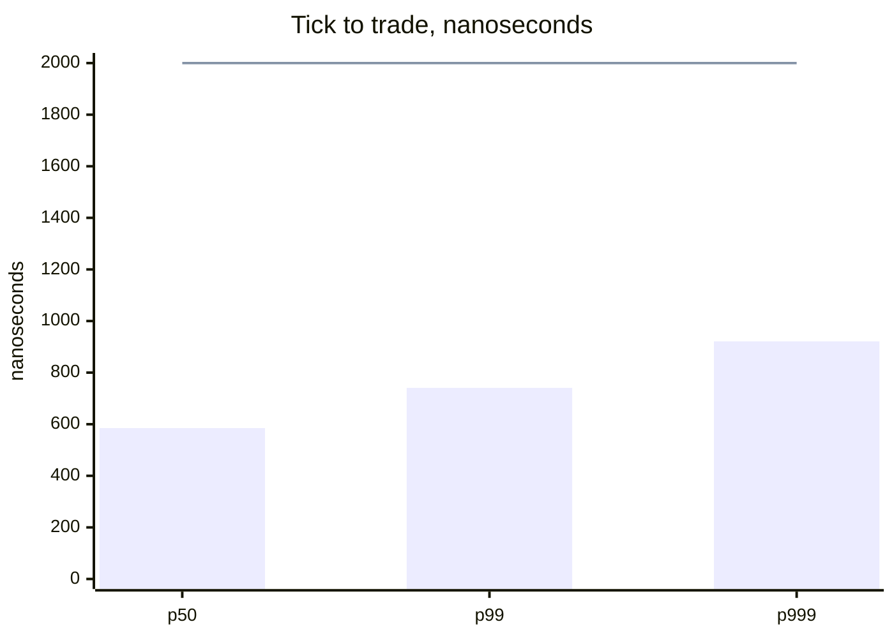

# pitlane

### SimNow closed-loop example

`examples/simnow/` is a self-contained mini-project. Its `ctp/` sources are a CTP gateway written on `MdEngine` and `TdClient`. It builds `pitlane_simnow` when `PITLANE_BUILD_CTP=ON` and a CTP `_se` API tree is available. The library itself does not link a broker API. Core demos live under `examples/demo/`. See `examples/simnow/README.md`.

```bash
cmake -S . -B build -DCMAKE_BUILD_TYPE=Release && cmake --build build -j --target pitlane_simnow
cd examples/simnow
cp -n conf/simnow_7x24.conf.example conf/simnow_7x24.conf   # set password
# after 16:00 (7×24 window):
../../build/pitlane_simnow conf/simnow_7x24.conf
```
The call guide is `doc/API.md`. The sidebar site is under `doc/site/en/`: open a local `doc/site/en/index.html`, the installed `share/doc/pitlane/site/en/`, or the repository GitHub Pages. Opening the HTML under `github.com/.../blob/...` shows source only. After a library change, update this guide and run `python3 doc/gen_site.py`.

Link with CMake:

```cmake
find_package(pitlane REQUIRED)
target_link_libraries(your_target PRIVATE pitlane::pitlane)
```

pitlane is a C++17 helper for trading processes that share a machine or a set of machines. It owns a fixed-size shared workspace for orders, positions, session calendars, and paper matching. Prices are integers; timestamps are microseconds. The library does not open sockets to an exchange or a broker API; its optional UDP link carries pitlane-to-pitlane messages only.

The name is the pit lane next to a track: traffic comes in, gets checked and queued, then goes back out to your counter or strategy.

## What it does

Market data, strategy, and order entry often live in different processes. They meet here through one memory-mapped desk: fixed-size messages on FanRings that fail closed when full (no grow, no silent overwrite of an unacked slot). Slots, ledgers, and working orders sit in compile-time arrays; cash and inventory update in place under a short gate.

Include `pitlane/pitlane.hpp` and link `libpitlane.a` (or `libpitlane.so`). Everything is in namespace `pitlane`. This is a same-machine and cross-host hub with its own types — not a drop-in replace for another live stack.

Release **2.23.0** (`pitlane::kVersion`). Shared-object soname stays `libpitlane.so.1`. Desk file layout is `kDeskVersion` 5. The symbol/quote yard (`Yard`, magic `PITYARD2`, `kYardVersion` 2) is a second map sized like the production pools.

2.23.0 adds an Aeron-style cross-host layer: a 32-byte frame codec (`net_pack` / `net_unpack`), a term log with pad frames and flow control (`TermLog`), a non-blocking IPv4 `UdpLink`, a leader/follower `ReplicaLog` with quorum commit, and a `RemoteHub` that bridges desk rings to remote intent/report traffic. It also adds the missing execution layers: `Oms`, `Ems`, `Sor`, `Pms`, and `Rms`; and a unified factor path, `FactorEngine` -> `FactorEval` -> `FactorPipeline`, that runs unchanged in research, backtest, paper, and live stages. The desk layout stays 5; the new transport has its own frame format.

Roles that other systems put on Mongo or RabbitMQ are covered **locally or across hosts**: `seed_facts` / `seed_hours` / `seed_holidays` for basic contract and calendar rows; `TopicBus` + `RouteBook` for same-machine topic routing and algo binding; `TermLog` + `UdpLink` + `ReplicaLog` for host-to-host frames and deterministic replication. Broker/CTP adapters stay outside the library. Startup may allocate or mmap; the helper hot path does not allocate or tear down resources.

Optional startup INI: `examples/demo/pitlane.conf`. `conf_load` overlays defaults; empty values keep them. `conf_normalize` clamps unsafe values (for example ring depths to a power of two ≤ the compile-time cap) and writes hint lines for you to print. Apply with `conf_map_opt` / `conf_arena_opt` / `desk_apply_conf` / `conf_venue_cfg` once at bring-up — the hot path never reopens the file.

Headers and sources sit one directory deeper, by area. `desk` holds the shared region and the records on it. `book` holds quotes, the trading day, and paper matching. `order` holds order life, checks, positions, and the OMS/EMS/SOR/PMS/RMS layer. `time` holds clocks and latency tapes. `study` holds features, markouts, factor evaluation, and the caller decision. `net` holds frames, term logs, UDP links, replication, and the remote hub. `util` holds numbers, text, frames, and fixed buffers. `host` holds process-side `sched_setaffinity`, scheduling policy, IRQ affinity, explicit huge-page pool control, `mlockall`, and NUMA membind. Sources for an area live under the same name in `src` when the area has compiled files. Tests for an area live under the same name in `tests`. The latency program is `tests/time/perf.cpp`. A direct include names the area, as in `pitlane/order/sheet.hpp`. `version.hpp` stays next to `pitlane.hpp`.

`PriceWindow` stores quantity on a fixed price step. The best price walks occupied bits and skips empty ticks. `publish_batch` writes several ring slots and advances the tail once. If one slot is still busy, the whole batch stays out. `SlotPool` keeps caller records in fixed slots and finds them by id. `margin_both` returns the larger of a money margin and a per-lot margin. `right_value` returns how far a call or a put is in the money. None of these calls sends an order.

`FillRing` keeps a local copy of the other side's index and reads the shared index only when that copy says the ring is full or empty. Each slot occupies its own cache line. `take_span` copies several published slots and stores the consumer index once. `ack_span` acks a run of ring positions and stops at the first one that reader cannot ack. `shown_before` sums the quantity strictly better than a price inside a `PriceWindow`. `ExtremeWindow` keeps the high and the low of the last few prices the caller pushed. `TimeLine` keeps ids at one price in arrival order. `cover_qty` sums the visible quantity that meets a limit, and stops at the quantity asked for. Buy and sell are separate loops. AVX2 compares four prices in one step; SSE4.2 compares two; a four-wide scalar peel finishes the rest. `touch_lines` prefetches and loads each cache line. `map_create` / `map_attach` prefer an explicit hugetlbfs file under `/dev/hugepages` (no THP / `MADV_HUGEPAGE`); they fall back to the caller path and set `fallback` when huge pages are unavailable. By default they also `mlock` the mapping and prefault every page; `numa_node >= 0` binds with `MPOL_BIND`. `ByteArena` defaults to the same hugepage / `mlock` / prefault path. Process-wide `mem_lock_all` remains a host helper after raising `RLIMIT_MEMLOCK`. `SpinLock` is a cache-line TTAS lock. `DagPlan` builds a grey/black topological order. Typed tickets block illegal fills at compile time. `OwnPair` keeps local two-sided tops; `SlotGate` forces a resync after a drop. `SendJoinRing` is a multi-producer fail-full send ring. `SigBook::find4` prefetches both buckets before matching. `SeqPublishRing` is a no-backpressure sequence ring that may overwrite unread slots; `FanRing` and `FillRing` still fail when full. Native builds cap auto-vector width at 256 bits (`-mno-avx512f`). `global_scale_set` stores a process-wide integer TSC cycle scale. `DecideScratch` only stores and compares scores the caller supplies. `FanRing::claim` fills a slot in place. `SeqField`, `LatestKeep`, `DualLane`, `PaceLatch`, study `OfiWin`/`SecMove`, mold presence bits, and `IntEma` cover the 2.8.0 set. `PrioSnap` / `PinBank` (multi-reader snapshots with per-slot refcounts), `PhaseGate` / `ActiveSum`, `IdClaim`, `infer_lots`, `FifoLot` / `AcbBook`, and `IntEmaDev` cover 2.9.0. `risk_merge` / `AcctRiskTab`, extended `gate_ask`, `BasketBook`, `TraderAcctTab` / `acct_idle`, board-lot and `MarginBook` helpers, `QueryFold` kind/page, `LaneBook`, `inflight_scan`, partial cancel under PullWait, `sign_begin` / `cash_enough`, `QuoteFold::apply_ordered`, and `MacAllow` / `RoleBits` extend that set for 2.10.0. `ObjectPool`, `StickyCounter`, `CoreBank`, and `WirePx` cover earlier helpers. `batch_size_for` picks an adaptive micro-batch size from backlog. `RankBits` / `QuadTab` hold dense id ranks and four-key cache-line static tables. `host/` provides affinity, realtime scheduling, IRQ affinity, `nr_hugepages` / `thp_disable`, `mlockall`, and NUMA `mbind`. `util/hint.hpp` and `util/simd.hpp` hold the branch tips, prefetch, packed clear, stream clear, and packed copy. None of these calls matches a trade.

## Shared region

A mapping file starts with the magic `PITLANE1`. The desk layout version is 5, stored as `kDeskVersion`. Layout 5 adds subscription, signal, market-order, and rebuild-quote rings. `desk_view` opens a file only when both the magic and this layout version match. A blank file is initialized once, and only when the call allows creation. An older file with a different version is not treated as the current layout.

One shared region holds eight rings.

| Contents | Capacity |
| --- | ---: |
| Orders | 1024 |
| Reports | 1024 |
| Quotes | 2048 |
| Algo orders | 256 |
| Control | 256 |
| Signals | 512 |
| Prints | 512 |
| Queries | 256 |

Cash and positions each have 256 rows.

Each ring has one writer. Each reader remembers the next position it will read. A publish can name the readers that must acknowledge the message. With no readers named, the first reader to acknowledge takes the message. Once readers are named, the slot can be reused only after all of them have acknowledged it. The session loop uses reader bit 7. A message meant for that loop must set this bit, or it must name no reader.

A control message of kind 1 stops the session loop. A timer with a repeat interval of 0 fires once.

Packets larger than these slots stay out of the shared region. The caller sends them on its own ring. A send that exceeds the given capacity fails.

## Orders, positions, and queries

An order id is a 64-bit integer. The fields are site, kind, the last digit of the trading day, a ten-second slot, and a serial number. They are stored as bit fields, not concatenated as decimal text. The caller defines the kind.

The instrument directory holds at most 256 names, numbered from 1. A name can point at related instruments, and it can record its underlying, its derivatives, and what it tracks. A night session may open later than it closes, which means the session crosses midnight.

Before an order is stored, offset and direction are normalized. Stocks, bonds, funds, STAR Market names, indexes, and repos are treated as opens. On SHFE and INE, a plain close becomes a close of yesterday. On the other futures exchanges, close-today and close-yesterday become a plain close. Buy, margin buy, buy-to-cover, and creation are long. Sell, short sell, sell-to-repay, and redemption are short. A limit order with a price of 0 is rejected.

One futures quantity can be split into several orders in three ways: close today, then close yesterday, then open the rest; close only; or close yesterday only. Any other way fails. Each slice stays within the maximum lot, and a slice smaller than the minimum lot is not sent.

Moving a position toward a target sends one order at a time. Where today and yesterday are stored apart, yesterday is closed first. Commodity futures also check that the open does not pass the open limit. Equity-index futures use the net position, and they close yesterday only. Yesterday here is the position minus the quantity already opened today.

Close-today, close-yesterday, and a plain close freeze different quantities. A stock sell reduces the quantity available to sell. A fill then writes today, yesterday, and the total back according to the offset and direction at the time of the order.

Before an order goes to the counter, the library can limit the quantity, the notional, and the number of orders still working. Working orders are checked against three limits: no acknowledgement for too long, a lifetime that has expired, and a cancel that has waited too long. An expired order leaves the working list.

Position and cash queries are queued per engine, for at most 32 engines and 64 accounts. Requests for the same account become one query. A new request fails when the queue is full. The caller decides when to ask for the next page.

## Market data and the trading day

A subscription receives every instrument unless it is changed to receive only instruments allowed in advance. A missing limit-up or limit-down price is filled from the fallback price supplied by the caller. A raw price is divided by the given denominator. A record marked `S` is a session switch and is dropped.

A market-data time is moved back onto the trading day it belongs to. From 08:00 through 18:00 it stays on the calendar day. After 18:00, Monday moves back 3 days and every other day moves back 1 day. In the early morning, Monday moves back 2 days and every other day moves back 1 day. Weekends and closed days are then skipped.

Paper orders and cancels can use a different delay in each part of the day. Before 09:30 the delay is 0. After that, the day is split at 10:00, 10:30, 11:00, 11:30, 13:30, 14:00, 14:30, and 15:00, which makes nine bands. From 15:00 onward the last band is used. A set of samples can be used instead, and the delay is interpolated. A negative order delay means the order did not reach the book.

## Paper matching

Paper matching handles 48 instruments at once, with at most 192 orders still working. A new order waits out its order delay, and only then does the book at that moment decide a fill, a rest, or an expiry. A cancel waits out its cancel delay in the same way.

A day order that reaches its own limit fills the whole remainder, which may be larger than the quantity shown at that price. An order that only wants to rest expires as soon as it would trade through the opposite price. An immediate order takes only the quantity then visible, and the rest expires. An all-or-nothing order expires entirely when the visible quantity does not cover it.

The fill price is the passive price. A price level is removed as soon as its quantity reaches 0. If the buy and the sell belong to the same account and would trade with each other, the order stops. A call auction picks the price that matches the most quantity. When two prices match the same quantity, the higher price can be chosen, or the price closer to a reference.

After an order rests, prints reduce the quantity ahead of it. A print whose aggressive side is the same as the resting order does not fill it. When the displayed quantity at a price changes later, prints already counted are not subtracted again.

## Helpers for market data, orders, and counters

These calls sit beside the shared desk. A market-data process, an order process, and a counter adapter can use them. The library still does not connect to an exchange.

A quote book takes a batch of level changes and keeps the previous book when any edit in the batch is invalid. Prints are stored on their own log, so a print does not change quote levels. A minute roll keeps high, low, and volume, and it ignores a clock that moves backward.

Price walks move an integer price across tick bands. Session calls say which span a minute belongs to, including a session that crosses midnight.

An order moves only through the transitions the life table allows. Margin and fees follow the product class. Slice, hedge, board-lot, and chase calls prepare the next child order. The caller still decides whether to send it.

A bind table maps a local id to a counter id and holds a fill that arrives before its status. A channel rule lists the price types and offsets that channel accepts. Reject codes for local checks and for the counter share one numbering.

List, flow, ratio, price-distance, and self-trade checks only report a reason. Framing writes the length after the body is known. A sequence watch reports a gap, and a short hold releases messages in id order. A span mark stores timestamps beside a message.

A second set of calls stays on data the caller already holds. A wire template overwrites a few offsets, and a block length lets an older reader skip bytes it does not know. A sojourn check drops a queued item only after it stays late for a whole window. Sparse price chunks and cancel handles are fixed tables. A command snapshot can be rewound only while its revision is still current. A parent schedule returns the next child quantity and due time. Fill alignment, a due-time queue, bars, and corporate-action factors all take the caller's numbers and return a result. None of them opens a session, reads a feed, or chooses whether an order is sent.

A third set stays on buffers and counters the caller already owns. A byte stream is cut into frames, and the checksum follows that counter. A sequence gate holds later numbers aside until a gap is filled in order. Token buckets and theoretical arrival times pace one key. Several checks can sign one order, and an opening quota returns quantity that was not used. Place and cancel acknowledgements age on separate clocks. The caller records latency samples, stores a half round-trip clock offset, and publishes a finished snapshot. A fixed bucket finds a key from a short signature, and a grace count says when every reader has moved on. None of these calls opens a socket or sends an order.

A sheet keeps one order's life, quantity, cause, and the stamps used for the acknowledgement and the completion. `gate_ask` walks the list, the channel rule, the price distance, the self-trade rows, and the flow window, and returns the first cause. The flow window changes only after the earlier checks pass. The pieces underneath remain available on their own.

`study_step` is the place a strategy is developed. It updates a quote book, fills the spread, mid, imbalance, and microprice, then calls a function the caller supplies. That function returns an order or declines. A returned order can be checked and staged on a sheet. The library does not choose the side or the price, and the call does not send. A relation table, a fixed factor board, a replay cursor, and a four-horizon markout sit beside that step for research. None of them reads a file.

A fourth set measures cycles and keeps fixed tables the caller drives on its own thread. `cycles_read` and `cycles_ordered` read the processor cycle counter. The caller writes a one-line microsecond slot and supplies the integer scale that turns cycles into nanoseconds. A magnitude histogram reports the median and the tail. A tick wheel, a staged ring, a sequence window, a reader window, an in-place fill ring, and per-core trace tapes are fixed tables. The library does not start a thread, does not open a socket, and does not send an order.

## Build and install

CMake 3.16 or newer is required, together with a C++17 compiler. From the repository root:

```bash
cmake -S pitlane -B pitlane/build
cmake --build pitlane/build
cd pitlane/build && ctest --output-on-failure
```

Run the tests from the build directory. To check for address errors and undefined behavior, build a second tree:

```bash
cmake -S pitlane -B pitlane/build-san -DPITLANE_SANITIZE=ON
cmake --build pitlane/build-san
cd pitlane/build-san && ctest --output-on-failure
```

`ctest` also runs `perf` and `perf_shared`. Each one drops a warmup, then records the minimum, the median, the 99th, and the 999th cycle count. A run passes when those ranks stay in order, a longer pause has a higher median, and that median stays under a wide ceiling. The same run checks the scale, lap, and histogram helpers, times one call inside the ring, the order gate, and the paper venue, and times the quote, book, strategy, and match stages of the paper center. `simnow_bench` repeats that measurement from `examples/simnow/` and does not link a broker library.

The same run measures tick to trade across three processes on one shared desk. The market-data process publishes a quote. The engine reads it, writes the bid and ask into a book, computes the spread, and asks the test strategy whether to buy. On a yes, the risk check and the order sheet run, and the order is published for the gateway. The gateway takes a cycle stamp as soon as that order is visible. The sample is the gap between the quote stamp and that gateway stamp. The report that carries the gateway stamp back is not part of the sample. Cycles are converted with a scale taken outside the measured section. In an ordinary optimized build, the median of repeated runs keeps the 99th and the 999th at or under 2 microseconds. A sample several times above the body of the distribution is counted separately, and only a small number of those samples is allowed. The sanitizer build checks the same path with a wide ceiling.

On an Intel Xeon E5-2667 v2 at 3.30 GHz, with the three processes pinned to cores 0, 2, and 4 of the same socket, one optimized run looked like this. Each batch keeps 2000 samples. The 99th and the 999th below are the path after the few samples that sat several times above the body were set aside. The raw 999th still shows those samples. The pass line uses the median of the five batches, and that median stays under 2 microseconds.

| Batch | p50 ns | p99 ns | p999 ns | raw p999 ns | Samples set aside |
| --- | ---: | ---: | ---: | ---: | ---: |
| 1 | 578 | 1168 | 1287 | 12514 | 6 |
| 2 | 589 | 814 | 936 | 12654 | 6 |
| 3 | 577 | 708 | 896 | 13341 | 7 |
| 4 | 591 | 677 | 865 | 13164 | 5 |
| 5 | 585 | 741 | 921 | 13285 | 5 |
| Median | 585 | 741 | 921 | 13164 |  |



The bars are the medians above. The line is the 2 microsecond limit.

The default build uses `-O3`, `-fno-exceptions`, and `-fno-rtti`. It also turns on `-march=native` and link-time optimization. Turn those off with `-DPITLANE_NATIVE=OFF` and `-DPITLANE_LTO=OFF` when the binary must run on another CPU, or when the toolchain has no IPO. Profile-guided builds use `-DPITLANE_PGO=GENERATE` then `-DPITLANE_PGO=USE` after a training run. Hot-path packed clears, copies, and price compares are written with SSE2/SSE4.2/AVX2 intrinsics in the headers, with scalar fallbacks; they do not wait for the compiler to auto-vectorize. AVX-512 stays out. Desk mappings and `ByteArena` default to explicit huge pages (hugetlbfs / `MAP_HUGETLB`) with no THP; they fall back to ordinary pages when none are reserved. `thp_disable`, `hugepage_count_ensure`, `mem_lock_all`, and NUMA membind complete the process setup. The sanitizer build keeps `-O1` and leaves LTO off. The ordinary warnings stay on and are treated as errors. Install into a chosen prefix:

```bash
cmake --install pitlane/build --prefix /opt/pitlane
```

One build produces the static library `libpitlane.a` and the shared library `libpitlane.so`. The code is built position-independent, so the static library can also be linked into another shared library. To build the static library only, configure with `-DPITLANE_BUILD_SHARED=OFF`.

Other programs include the same headers. Link the shared library with `-lpitlane`, and make sure `libpitlane.so` can be found in the install directory at run time. The install also places the headers under `include/pitlane`.

`examples/demo/` holds small programs that link the library and check their own result. `demo` writes one buy into a temporary mapping and fills it in the paper matcher. `desk` walks names, cash, a ring batch, and one session beat. `book` walks the quote, the price window, the calendar, and the limit book. `order` walks the gate, the sheet, and the lot split. `study` walks features and a caller-supplied decision. `time` walks the cycle scale, the clock page, and the fill ring. `lane` walks the counter check, a late fill, and the channel. `own` walks caller-owned ids, slices, and a venue fill. `pace` walks framing, a snapshot, and the fixed tables. After the build:

```bash
./pitlane/build/pitlane_demo
./pitlane/build/pitlane_desk
./pitlane/build/pitlane_book
./pitlane/build/pitlane_order
./pitlane/build/pitlane_ex_study
./pitlane/build/pitlane_time
./pitlane/build/pitlane_lane
./pitlane/build/pitlane_own
./pitlane/build/pitlane_pace
```

## Limits

Each ring may have only one writing process. Each reader keeps its own read position.

Do not initialize a mapping again after its magic has been written.

Instrument numbers used by paper matching must be less than 48. Signals allow 128 subscriptions and a queue of 256. A new signal is rejected once that queue is full.

## License

MIT. See `LICENSE` in the repository root.
