# pitlane

C++17 header-only trading kernel plus `pitlane-trading`, a CTP/paper console: market data and order books, continuous and call-auction matching, risk, clearing, backtesting, factor and pair-spread strategies, and a web ops UI. Deterministic hot paths.

### pitlane trading console

`pitlane-trading/` is a self-contained project and the only runnable program in the tree. Its `adapters/ctp/` sources form a CTP gateway on `MdEngine` and `TdClient`, and hold the CTP snapshot adapters; they build when `PITLANE_TRADING_CTP=ON` (the default) and a CTP `_se` API tree is present. Other venues go in a sibling `adapters/<name>/` directory with their own `config.hpp`, and are selected with `adapter = <name>` in the system conf; their private keys load from `conf/adapters/<name>.conf`, not from the core conf. The library itself never links a broker API and ships no broker adapter headers. See `pitlane-trading/README.md`.

```bash
cmake -S . -B build -DCMAKE_BUILD_TYPE=Release && cmake --build build -j --target pitlane_trading
cd pitlane-trading
cp -n conf/live.conf.example conf/live.conf
cp -n conf/adapters/ctp.conf.example conf/adapters/ctp.conf   # set password
# after 16:00 (7×24 window):
../build/pitlane_trading conf/live.conf
```

The project also configures on its own: it reuses a sibling pitlane tree, follows `-DPITLANE_SOURCE_DIR=<dir>`, or fetches the upstream repository.

```bash
cmake -S pitlane-trading -B build-trading && cmake --build build-trading -j
```

### Web console

One page covers the center: strategy instances and the pair-spread card, manual pair packages and credit terms, research grids, backtests with equity and drawdown curves, block-tape inspection, market charts by product class, funding-account aware tickets, pre-trade rules and alarms, operations, clearing, and accounts. The page itself is `client/index.html` at the repository root. The screenshots come from a paper run with four live instances, a finished research job and backtest, and a loaded block tape:

| Strategies | Research |
| --- | --- |
| 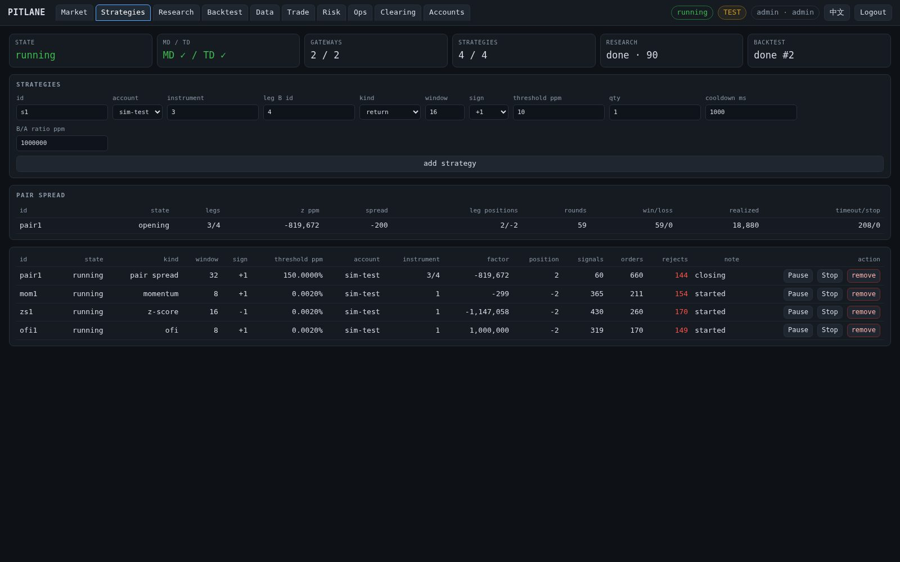 | 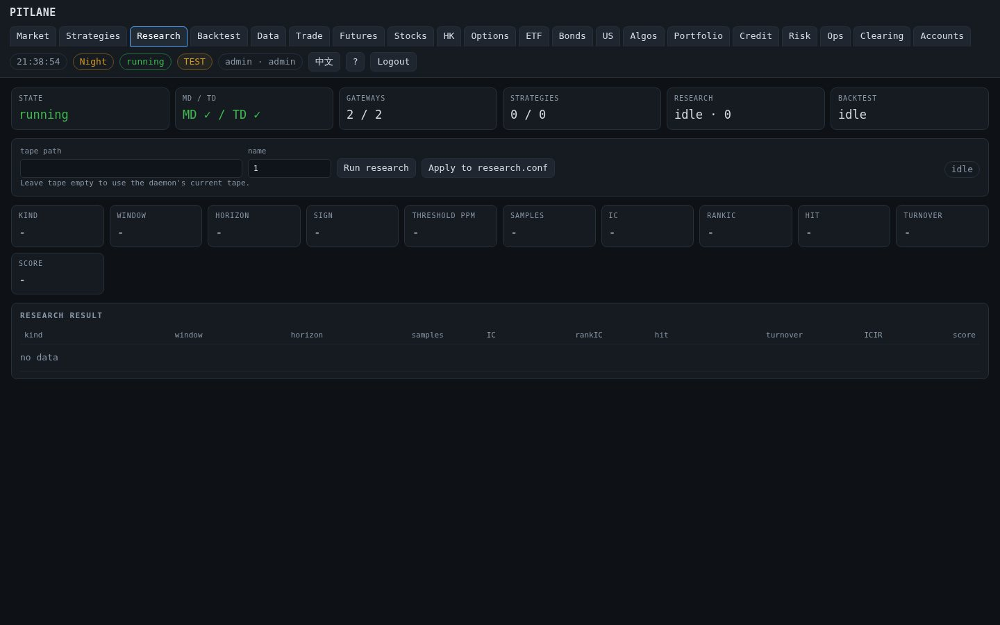 |
| 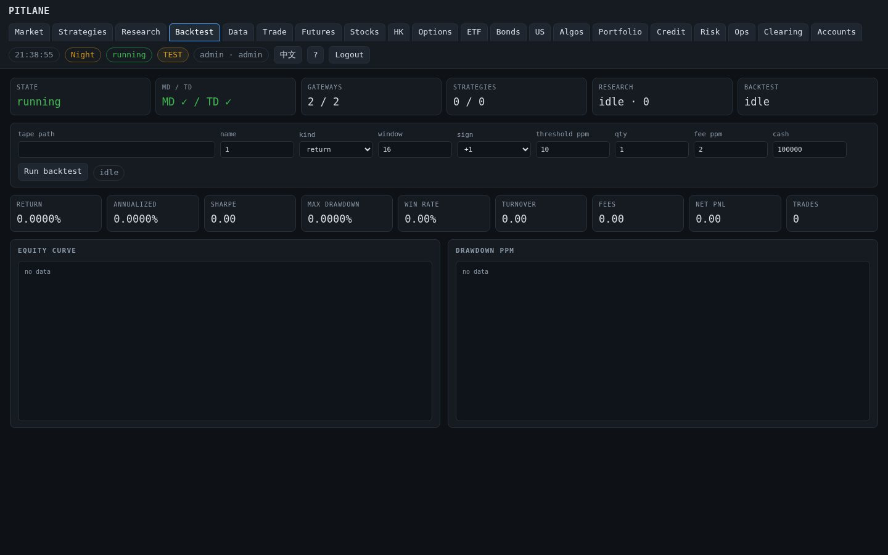 | 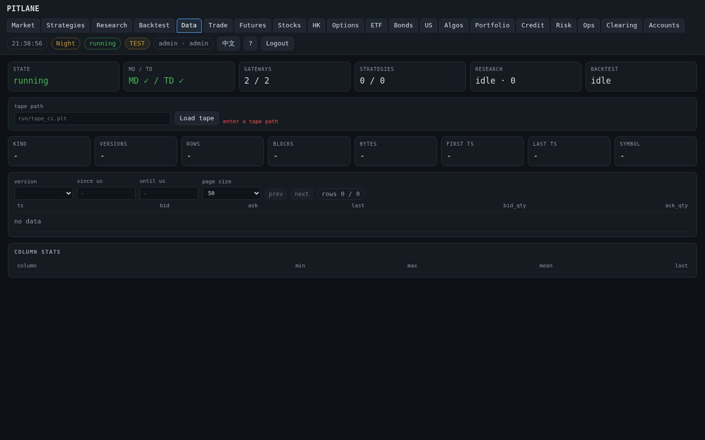 |
| 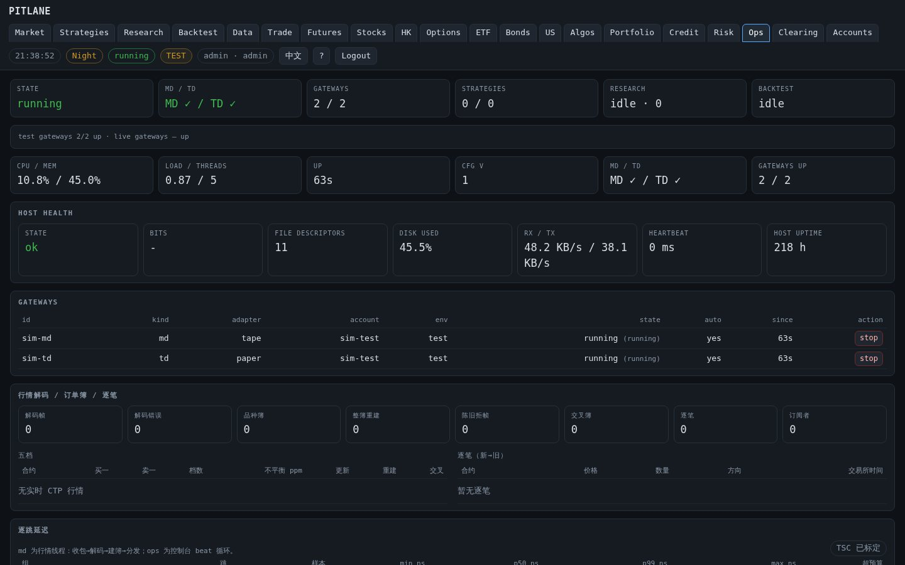 | 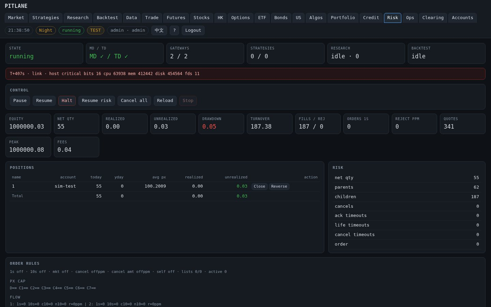 |
| 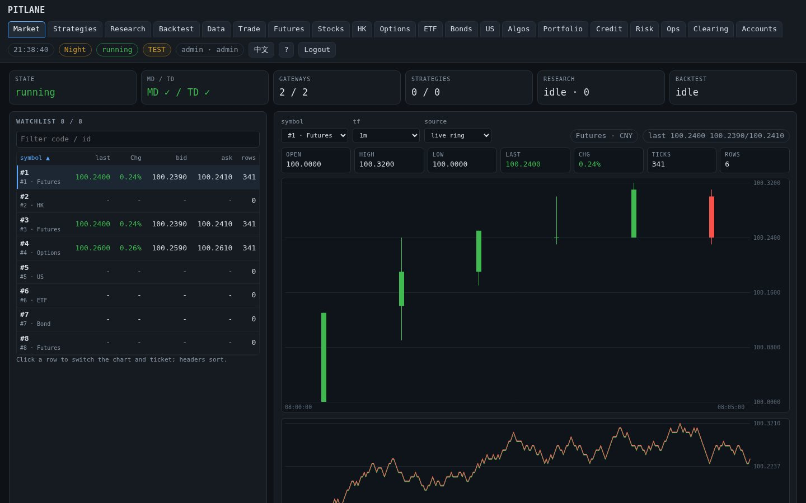 | 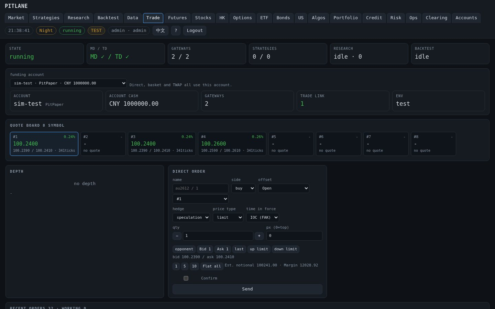 |
| 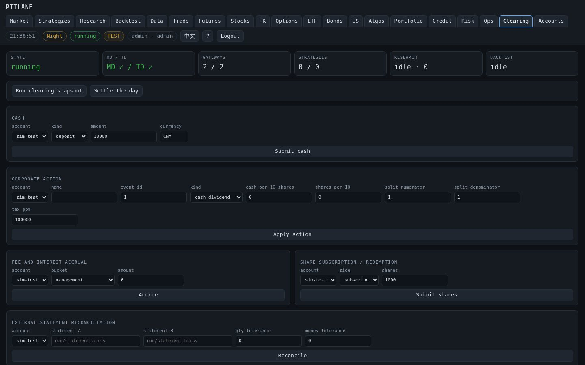 | 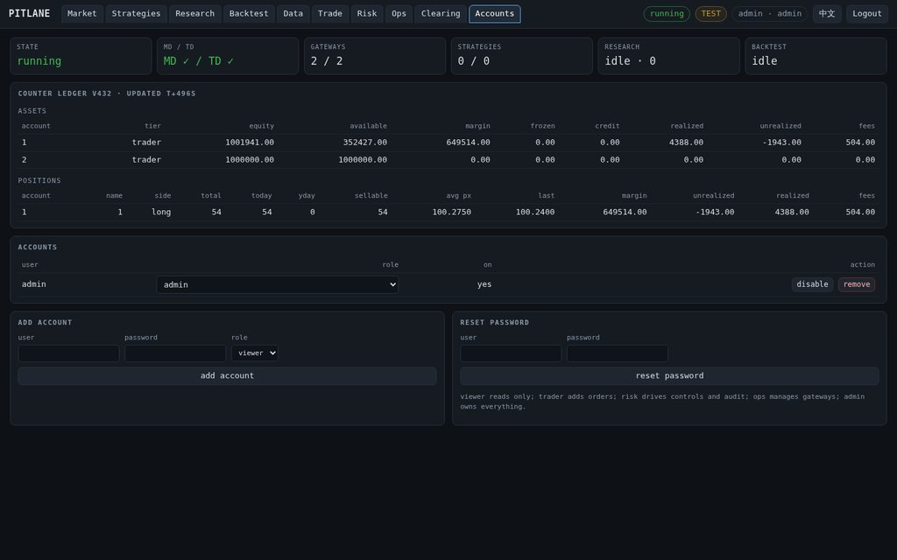 |

The call guide is `doc/API.md` and the request reference is `doc/web-api.md`. The sidebar site lives in `doc/site/en/`: open it locally, from the installed `share/doc/pitlane/site/en/`, or on GitHub Pages (opening the HTML under `github.com/.../blob/...` shows source only). After a library change, update the guides and run `python3 doc/gen_site.py`.

```cmake
find_package(pitlane REQUIRED)
target_link_libraries(your_target PRIVATE pitlane::pitlane)
```

pitlane is a C++17 helper for trading processes that share a machine or a set of machines. It owns a fixed-size shared workspace for orders, positions, session calendars, and paper matching. Prices are integers; timestamps are microseconds. It opens no exchange or broker sockets; the optional UDP link carries pitlane-to-pitlane messages only.

The name is the pit lane next to a track: traffic comes in, gets checked and queued, then goes out to your counter or strategy.

## Architecture

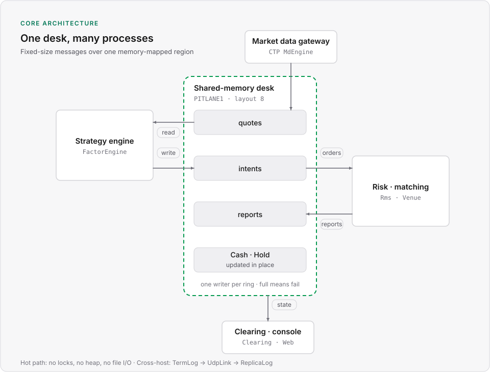

Market data, strategy, risk, and clearing usually run as separate processes. They share one `PITLANE1` mapping instead of calling each other: the market-data gateway publishes `quotes`, a strategy reads them and publishes `intents`, risk and the paper venue read `intents` and publish `reports`, and clearing reads `reports` plus the in-place `Cash`/`Hold` rows. Each ring has one writer and one cursor per reader; a full ring fails the write instead of growing or overwriting an unacked slot. The hot path takes no lock, allocates nothing, and performs no file I/O. The optional cross-host layer carries the same frames through `TermLog`, `UdpLink`, and `ReplicaLog`.

## What it does

Market data, strategy, and order entry usually live in different processes. They meet through one memory-mapped desk: fixed-size messages on FanRings that fail closed when full (no grow, no overwrite of an unacked slot). Slots, ledgers, and working orders sit in compile-time arrays; cash and inventory update in place under a short gate.

Include `pitlane/pitlane.hpp` and link `libpitlane.a` (or `libpitlane.so`); everything is in namespace `pitlane`. This is a same-machine and cross-host hub with its own fixed-layout types: processes integrate through the shared desk or the C ABI.

Release **1.0.0** (`pitlane::kVersion`), the first release considered production-ready. Soname is `libpitlane.so.1`, desk layout is `kDeskVersion` 8, and the symbol/quote yard (`Yard`, magic `PITYARD2`, `kYardVersion` 2) is 2.

1.0.0 ships the complete counter enum set: offsets use the seven CTP codes unchanged (including `ForceClose`, `ForceOff`, and `LocalForceClose`); `Intent::biz` carries the securities-credit axis (margin trading, repayments, collateral transfers, lock/unlock, split/merge orders), which the paper book records per business while CTP refuses anything that is not an ordinary trade; price types include opposite-best and own-best beside limit and market; the hedge flag includes covered writes and exercise is no longer hard-coded as speculation. It also includes five-level market orders, the option exercise lane, clearing merges, and the three timeout counters.

The pitlane console closes the loop from a tape to a running strategy. `study/factor_lab.hpp` sweeps a fixed kind × window × horizon grid and scores rows by IC, rank IC, hit rate, quintiles, turnover, and an eight-segment ICIR. `study/backtest.hpp` replays a tape through one integer-cost configuration and returns return, annualised return, Sharpe, drawdown, win rate, exposure, turnover, net PnL, and an equity/drawdown curve. `ops/strategy.hpp` keeps eight strategy slots with a state machine, a fixed command ring, and seqlock row snapshots. Research and backtests run on the console's job worker; strategies run on the trading thread over fixed `FactorEngine` rings, with no lock, heap allocation, or file I/O on the hot path.

`study/block_tape.hpp` records ticks in append-only 64 KiB blocks (eight int64 columns × 1024 rows), a 64-byte header, and 64-byte commit records that publish immutable versions. Readers can query an older version, project columns, skip blocks by time, and binary-search inside a block; `pread` means the file is never mapped, so a truncated tail cannot raise `SIGBUS`. `study/tape_source.hpp` feeds a version or its tail to existing research and backtest code. The optional C ABI (`include/pitlane/capi/pitlane_c.h`, `libpitlane_c.so`) exposes open/close, meta, rows, describe, write, one backtest, the version, a monotonic clock, and a strategy bridge: `pl_bridge` owns a wait-free event ring, a wait-free command ring, and a bounded log ring, carrying quotes, rebuilds, market orders and trades, order and algo responses, signals and signal batches, assets, positions, packages, timers, control, property, log, and parameter/date lifecycle events one way, inserts, cancels, pauses, subscriptions, asset and position queries, algo inserts and cancels, source queries, log state, and control replies the other, and strategy log lines back to the engine. A full ring drops and counts the record instead of blocking. `python/pitlane` wraps the tape calls with ctypes and exposes the bridge as `Bridge`, `Event`, `Cmd`, `Log`, `Context`, `Strategy`, `pump`, `run`, and `now_us`, with `info`, `warn`, `error`, and `debug` on a strategy writing one log line each; the engine never calls into Python. The console adds a Data tab over the same endpoints.

Same-machine and cross-host duties are covered directly: `seed_facts` / `seed_hours` / `seed_holidays` for contracts and calendars; `TopicBus` + `RouteBook` for same-machine topics and algo binding; `TermLog` + `UdpLink` + `ReplicaLog` for host-to-host frames and deterministic replication. Startup may allocate or mmap; the helper hot path does not.

Optional startup INI: keys are the member initializers on `PitConf` in `desk/config.hpp`; `pitlane-trading/conf/paper.conf` is a working config. `conf_load` overlays defaults (empty values keep them), `conf_normalize` clamps unsafe values and writes hint lines, and `conf_map_opt` / `conf_arena_opt` / `desk_apply_conf` / `conf_venue_cfg` apply it once at bring-up. The hot path never reopens the file.

Code is grouped by area: `desk` (shared region and records), `book` (quotes, trading day, paper matching), `order` (order life, checks, positions, OMS/EMS/SOR/PMS/RMS, execution pacing), `time` (clocks, latency tapes), `study` (features, markouts, factor evaluation), `net` (frames, term logs, UDP, replication), `util` (numbers, text, frames, buffers), `host` (affinity, scheduling, IRQ, huge pages, `mlockall`, NUMA). Sources sit under the same name in `src`, tests under `tests`; the latency program is `tests/time/perf.cpp`. A direct include names the area, as in `pitlane/order/sheet.hpp`.

The helper layer is deliberately broad: price windows and displayed-quantity sums, fill and fan rings, snapshot windows, spin locks, DAG ordering, typed tickets, sequence gates, token buckets, wire templates, sparse price chunks, command snapshots, parent schedules, bars, corporate-action factors, cycle readers, latency histograms, trace tapes, and the host tuning calls. Each is a fixed table or a pure function over caller data. None opens a session, reads a feed, sends an order, or matches a trade. See `doc/API.md` for the per-file table.

## Shared region

A mapping file starts with the magic `PITLANE1`; the layout version is 8 (`kDeskVersion`). Layout 8 added `Intent::biz` and `Intent::px_mode`; layout 7 added the `execs` exercise lane and 64-byte reports, and layout 6 added full ledger rows for cross-process queries, control replies, and counter order snapshots. Processes sharing a region must all restart together. `desk_view` opens a file only when magic and layout match, initializes a blank file once when creation is allowed, and never treats an older version as current.

| Contents | Capacity |
| --- | ---: |
| Orders (intents) | 32768 |
| Reports | 32768 |
| Quotes | 8192 |
| Algo orders | 32768 |
| Control | 16384 |
| Control replies | 4096 |
| Exercise notes | 1024 |
| Counter orders | 16384 |
| Pulses | 4096 |
| Prints | 4096 |
| Queries | 1024 |
| Ledger assets | 2048 |
| Ledger positions | 2048 |
| Package requests | 2048 |
| Package responses | 16384 |
| Logs | 2048 |
| Subscriptions | 2048 |
| Signals | 4096 |
| Market orders | 4096 |
| Rebuild quotes | 2048 |

Cash holds 512 rows and positions 4096. `conf_normalize` may shrink a ring at startup, never above its compile-time cap. Each ring has one writer; each reader keeps its own position. A publish can name the readers that must acknowledge it; with none named, the first reader to acknowledge takes the message. A named slot is reused only after all named readers acknowledge it. The session loop uses reader bit 7, so messages for it must set that bit or name no reader. Control kind 1 stops the loop, and a timer with a repeat interval of 0 fires once. Packets larger than a slot must use the caller's own ring; an oversized send fails.

## Orders, positions, and market data

An order id is a 64-bit bit field: site, kind, the last digit of the trading day, a ten-second slot, and a serial. The caller defines the kind. The instrument directory holds 1024 names numbered from 1, with related, underlying, derivative, and tracking links; a night session may open later than it closes.

Before storage, offset and direction are normalized. Stocks, bonds, funds, STAR names, indexes, and repos open. SHFE and INE turn a plain close into close-yesterday; other futures turn close-today and close-yesterday into a plain close. Buy, margin buy, buy-to-cover, and creation are long; sell, short sell, sell-to-repay, and redemption are short. A limit price of 0 is rejected.

A futures quantity splits three ways: close today then yesterday then open the rest, close only, or close yesterday only. Each slice respects the maximum lot, and a slice below the minimum lot is not sent. Target-position moves send one order at a time, close yesterday first where the book keeps them apart, and check the commodity open limit; index futures use the net position and close yesterday only. Close-today, close-yesterday, and plain close freeze different quantities; a stock sell reduces the sellable quantity; fills write today, yesterday, and total back by offset and direction.

Every intent carries its offset in `Intent::off` (the seven CTP codes `Open 0`, `Close 1`, `ForceClose 2`, `CloseToday 3`, `CloseYday 4`, `ForceOff 5`, `LocalForceClose 6`), so a manual ticket, a basket slice, or an algorithm child can close instead of always opening; force reasons travel in `Intent::force_reason` and come back in `Report::cause`, while the record stays 56 bytes and a report is 64. A basket or T0 child that reduces the signed net is marked as a close and is capped to the position it can reduce, and the remainder opens on a later beat. The CTP adapter maps the seven values to `CombOffsetFlag` and the style to the counter's conditions: `Day` and `Passive` rest as a GFD limit, `Immediate` is an IOC limit, `All` is IOC with all-or-none (FOK), and `BestFive` is an IOC five-level order. `Intent::hedge` carries speculation, arbitrage, hedge, or covered and maps to `CombHedgeFlag`; the C ABI `pl_cmd` and the Python `insert` expose the same byte, and an unset value stays speculation.

Extended Side semantics do not share one enum: direction stays `Side`, while lock, unlock, split, merge, and dividends are expressed in the order or clearing layers, and exercise is a separate lane — `ExecNote` enters the `execs` ring through `publish_exec`, and `TdClient::exercise` calls `ReqExecOrderInsert`. Corporate actions cover cash and stock dividends, splits, and merges (`kClrMerge`), idempotent by `(name, event_id)`. Contract facts can be refreshed in-session through `reload_facts` / `reload_hours` on the cold path without new slots; unknown names fail outright and the hot path only reads. Counter timeouts count acknowledgement, lifetime, and cancel separately and reach `StatusSnapshot` and the console status JSON.

Before the counter, the library can cap quantity, notional, and working orders, and expires working orders on missing acknowledgement, lifetime, or a slow cancel. Position and cash queries queue per engine (32 engines, 64 accounts), coalesce per account, and fail when the queue is full.

A subscription receives every instrument unless restricted in advance. Missing limits are filled from the caller's fallback, raw prices are divided by the caller's denominator, and `S` session-switch records are dropped. Market-data time is moved onto its trading day: 08:00–18:00 stays, after 18:00 Monday moves back 3 days and others 1, early morning Monday moves back 2 and others 1, then weekends and holidays are skipped. Paper order and cancel delays are zero before 09:30, then follow nine bands split at 10:00, 10:30, 11:00, 11:30, 13:30, 14:00, 14:30, and 15:00, or interpolate caller samples; a negative order delay means the order never reached the book.

## Paper matching

Paper matching handles 256 instruments and 1024 working orders. A new order waits out its delay, then the book decides fill, rest, or expiry; cancels wait the same way. A day order that reaches its own limit fills the whole remainder, even beyond the displayed quantity. A passive-only order expires as soon as it would trade through; an immediate order takes only what is visible; all-or-nothing expires entirely when the visible quantity is short. Fills use the passive price, empty levels disappear at once, and a self-trade between the same account's buy and sell stops the order. A call auction picks the price with the largest matched quantity; ties choose the higher price or the one closer to a reference. Resting orders are reduced by prints, prints on the same aggressive side do not fill them, and later level changes do not subtract the same print twice.

## Operations console

`ops/status.hpp`, `ops/command.hpp`, `ops/control.hpp`, `ops/http.hpp`, `ops/host.hpp`, `ops/auth.hpp`, `ops/gateway.hpp`, and `ops/series.hpp` form the control plane above the desk. A sealed status board, an operator ring that answers by sequence number, and a single writer for pause, halt, risk-block, stop, and reload flags keep strategies, manual tickets, and the page on the same state.

`order/flowgate.hpp` keeps rolling one-second order, cancel, and notional windows per account and market; `order/precheck.hpp` runs an ordered pipeline of halt, blacklists, class caps, account and market flow limits, a cancel-ratio gate with warm-up, a cancelled-amount ratio, and self-trade blocking, returning the first failing rule. It sits after `Rms` on the manual path, never allocates, and is disabled per rule at limit 0. `ops/group_risk.hpp` folds account notionals into group gross, net, and largest-account figures; `time/replay_pace.hpp` maps media time to wall time with integer speed segments.

One hub serves browser sessions with roles. Accounts live in `run/users.conf` as PBKDF2-HMAC-SHA256 verifiers (10000 rounds, per-user salt); login issues a 64-hex token with an 8-hour TTL as an HttpOnly cookie and in the body, sent back as `Authorization: Bearer`. Every `/api/*` route except `health` and `login` checks a permission bit. The trading path never consults these bits; the gate is HTTP-only.

| Role | Permissions |
| --- | --- |
| `viewer` | market, risk view, ops view |
| `trader` | viewer + manual orders, baskets, algorithms |
| `risk` | viewer + control actions, audit trail, clearing and alarms |
| `ops` | viewer + gateway start/stop, audit trail |
| `admin` | everything, including account management |

`run/gateways.conf` declares `gateway = <id> <md|td> <adapter> <acct> <auto 0|1> [test|live]`; the hub owns `stopped`/`starting`/`running`/`failed` and the console starts or stops gateways through the audited command channel. `auto = 1` starts with the hub. `run/accounts.conf` binds funding to a mode and gateway: `account = <id> <display> <class> <ccy> <cash> <test|live>`, with cash in 1e-6 units. `run/instruments.conf` describes `instrument = <name> <class> <ccy> <tick> <mult> <margin_ppm> <fee_ppm>` plus optional `min_fee`, `stamp_ppm`, `short`, `gw`, `close_fee_ppm`, `close_today_fee_ppm`, `fx_ppm`, and `lot`/`min_qty`/`max_qty`/`tickb`. `short=1` allows a short lot; otherwise a product cannot sell beyond `long - short`. A session picks **test** or **live** at login and stays there; every object is filtered by mode, and a cross-mode request is refused with `409`.

`ops/alarm.hpp` rings `info`/`warn`/`critical` events by kind (`reject`, `risk`, `stale`, `jump`, `link`, `gateway`, `order`, `clearing`). A rejected ticket returns its reason to the page and raises an alarm. A quote at two thirds of `max_jump_ppm` or `stale_tick_us` warns; at the full threshold the hub cancels every order of that product on every gateway, stops its trading gateway, audits the action, and raises a critical alarm. Replays are exempt.

`clear/clearing.hpp` keeps FIFO long and short lots with trade and settlement prices and a today/yesterday flag; closes realise against the oldest opposite lot, yesterday first, and the book rolls to yesterday at settle. Fees cover per-trade minimum, close, and same-day close rates plus sell-side stamp duty; valuation reports realised, realised-at-settle, unrealised, and unrealised-at-settle. Cash is a ledger of deposits, withdrawals, dividends, fees, financing interest, and subscriptions/redemptions, so PnL excludes deposits, withdrawals, and share movements. Corporate actions (cash and stock dividends, splits and merges) are idempotent by `(name, event_id)`, and shares/NAV/drawdown share the same numbers. Each settle appends a day record kept for 32 days, `clr_period` folds today, 7-day, 30-day, and year-to-date sums, and snapshots publish through a seqlock. `?run=1` writes the CSV, `?settle=1` marks lots to settlement and closes the day. `clear/statement.hpp` imports a custodian statement and runs a two-way or three-way reconciliation; `clear/report.hpp` folds a NAV ring into daily, weekly, monthly, and yearly rows. `ops/health.hpp` samples CPU, memory, load, threads, file descriptors, disk, network, uptime, and heartbeat age, warning at 80% and escalating at 100%.

Manual tickets use the same `Rms`, `Oms`, `Pms`, and `IdMint` as strategies: a direct ticket sends one order, a basket sends the difference to its target on every beat, and an algorithm ticket slices evenly across a horizon. A manual or web basket carries at most 8 legs per request; a programmatic `BasketBook` holds up to 2048 legs, and larger batches use the caller's `Parcel` ring. A halt stops the strategy parent, cancels manual work, and holds until resume.

Library callers use `order/algo.hpp` for TWAP, volume-curve VWAP, or untimed pass-through with join/cross switching, reorder lag, participation and clip caps, locked-market one-touch, and limit stops; `basket_child` adds per-leg controls; `order/auction.hpp` handles call auctions; `book/sessions.hpp` answers session-clock questions; `ops/instruments.hpp` carries sizing and banded ticks. All return plain decisions; the caller books and routes them.

The HTTP server is a single `poll` thread, one request per connection, an 8 KB request ceiling, and a fixed in-memory `index.html`. The page has a login screen, a persistent overview strip, and ten tabs (market, trade, risk, ops, accounts, clearing, strategies, research, backtest, data), each shown only with its permission. The overview polls every two seconds.

| Method | Path | Permission | Purpose |
| --- | --- | --- | --- |
| GET | `/api/health` | none | Liveness probe |
| POST | `/api/login` | none | `{"user","password","mode"}` returns role, perms, mode, token |
| GET | `/api/status` | market | Sealed snapshot: state, links, counters, risk, host, positions, orders |
| GET | `/api/system` | market | Overview counters for the strip |
| GET | `/api/instruments` | market | Class, currency, tick, multiplier, fees, short flag, sizing |
| GET | `/api/accounts` | market | Funding accounts of this mode and their gateways |
| GET | `/api/gateways` | ops view | Gateway state, note, account, auto-start |
| POST | `/api/gateway` | gateway | `{"action":"start\|stop","id":...}`, same mode only |
| POST | `/api/order` | trade | `{"name","side","qty","px","acct","off"}`, `px` 0 takes the touch, `off` 0–3 is open, close, close-today, close-yesterday |
| POST | `/api/basket` | trade | `{"legs":[{"name","target"}],"acct"}` |
| POST | `/api/algo` | trade | `{"action":"create\|pause\|resume\|cancel\|update","id","name","side","qty","horizon_ms","slice_ms","t0"}` |
| POST | `/api/control` | risk control | `pause`, `resume`, `halt`, `resume_risk`, `reload`, `cancel_all`, `stop` |
| GET | `/api/clearing` | clearing | Per-account report; `?run=1` writes CSV, `?settle=1` closes the day |
| GET | `/api/clearing/history` | clearing | Up to 32 settled day records per account |
| GET | `/api/clearing/period` | clearing | Today, 7-day, 30-day, and year-to-date PnL |
| GET | `/api/ledger` | risk | Full counter asset and position snapshot; `?tier=`, `?acct=`, `?name=`, `?direction=` |
| POST | `/api/clearing/cash` | clearing | Deposit or withdraw |
| POST | `/api/clearing/corp` | clearing | Idempotent corporate action |
| POST | `/api/clearing/reconcile` | clearing | Three-way statement comparison |
| GET | `/api/host/health` | risk view | Host sample, limits, level, trip bits |
| GET | `/api/alarms?since=N` | risk view | Alarms plus the next cursor |
| GET | `/api/events?since=N` | ops view | Audit records plus the next cursor |
| GET | `/api/series` | market | OHLC bars and the last quote |
| GET | `/api/ticks` | market | Recent ticks from the live ring |
| GET | `/api/history` | market | Ticks read back from a taped file |
| GET | `/api/tape/meta` | market | Block-tape header |
| GET | `/api/tape/rows` | market | One version with column projection |
| GET | `/api/tape/describe` | market | Per-column statistics |
| GET | `/api/strategies` | market | Strategy rows of this mode |
| POST | `/api/strategy` | trade | `add`, `remove`, `start`, `stop`, `pause`, `resume` |
| GET | `/api/research` | market | Latest sweep result |
| POST | `/api/research` | ops view | Queue a sweep, `202` |
| POST | `/api/research/apply` | gateway | Write `research.conf` from the best row |
| GET | `/api/backtest` | market | Latest metrics and curve |
| POST | `/api/backtest` | ops view | Queue a replay, `202` |
| GET | `/api/users` | users | Accounts, roles, enabled flags |
| POST | `/api/user` | users | `add`, `remove`, `role`, `password`, `enable`, `disable` |

The full field reference is in `doc/web-api.md`. `strategies.conf` uses `strategy = <id> <acct> <instrument> <kind> <window> <sign> <threshold_ppm> <qty> <cooldown_ms> [test|live] [b=<instrument> ratio=<ppm>]`; `kind` runs 1–8 for factor strategies and 9 for a pair, where `instrument` is leg A and `b=`/`ratio=` name leg B, and `window` runs 2–256. Page-side add and remove never rewrite the file. `run/ops.conf` carries the port, document root, manual caps, daily loss, drawdown, reject rate, stale horizon, the market safety ladder, and the `pre_*` rule limits; `reload` re-reads it. Result codes: 0 accepted, 1 malformed, 2 blocked, 3 rejected, 4 ring full, 5 unknown.

Run the paper replay and keep the console open after the tape ends:

```bash
cd pitlane-trading
../build/pitlane_trading --backtest --tape run/tape.csv --web 8080 conf/paper.conf
TOKEN=$(curl -s -X POST -d '{"user":"admin","password":"pitlane","mode":"test"}' http://127.0.0.1:8080/api/login |
        sed -n 's/.*"token":"\([0-9a-f]*\)".*/\1/p')
curl -s -H "Authorization: Bearer $TOKEN" http://127.0.0.1:8080/api/status
curl -s -H "Authorization: Bearer $TOKEN" -X POST -d '{"name":1,"side":1,"qty":2,"acct":"sim-test"}' http://127.0.0.1:8080/api/order
```

The first start creates `run/users.conf` with `admin` / `pitlane`; change it before exposing the console. The console binds loopback by default. To open it from another host, pass `--web-bind 0.0.0.0` or set `bind` in `run/ops.conf`, and treat the network as trusted: sessions use plain HTTP unless a reverse proxy adds TLS.

## Build and install

CMake 3.16 or newer and a C++17 compiler are required. From the repository root:

```bash
cmake -S . -B build
cmake --build build
cd build && ctest --output-on-failure
```

On a shared or virtualized host, add `-DPITLANE_RELAX_LATENCY=ON` to the configure step before running `ctest`; the default strict build enforces the tick-to-trade ceiling and expects the quiet-host setup in [doc/HOST_TUNING.md](doc/HOST_TUNING.md). For address and undefined-behavior checks, configure a second tree with `-DPITLANE_SANITIZE=ON`. Install with `cmake --install build --prefix /opt/pitlane`.

`ctest` also runs `perf` and `perf_shared`: after a warmup they record the minimum, median, 99th, and 999th cycle counts and pass when the ranks stay ordered, a longer pause raises the median, and the median stays under a wide ceiling. The same run times the ring, the order gate, the paper venue, and the quote, book, strategy, and match stages of the paper center; `trading_bench` repeats it without a broker library.

The same test measures tick to trade across three processes on one desk: market data publishes a quote, the engine updates the book and asks the strategy, risk and the order sheet run, and the gateway stamps the order as it becomes visible. The sample is quote stamp to gateway stamp; the report back is excluded, and cycles use a scale taken before the measured section. In an optimized build the median run keeps p99 under 2 microseconds; p999 depends on how quiet the host is. In the latest five-batch run on this container every batch kept p99 between 1.65 and 1.68 microseconds; p999 stayed between 1.90 and 2.23 microseconds. The median batch measured p50 395 ns, p99 1.66 microseconds, and p999 1.93 microseconds, with two to six samples several times above the body counted separately. The table lists all five batches and their median. The strict build enforces 2 microseconds on both p99 and p999 and is meant for a host configured with [doc/HOST_TUNING.md](doc/HOST_TUNING.md); a shared or virtualized host can configure with `-DPITLANE_RELAX_LATENCY=ON`, as CI does. The sanitizer build also uses the wider ceiling.

| Batch | p50 ns | p99 ns | p999 ns | raw p999 ns | Set aside |
| --- | ---: | ---: | ---: | ---: | ---: |
| 1 | 391 | 1657 | 1929 | 5172 | 3 |
| 2 | 395 | 1658 | 1898 | 2206 | 2 |
| 3 | 394 | 1653 | 2204 | 12469 | 3 |
| 4 | 397 | 1670 | 1901 | 13002 | 6 |
| 5 | 413 | 1684 | 2227 | 12055 | 3 |
| Median | 395 | 1658 | 1929 | 12055 |  |

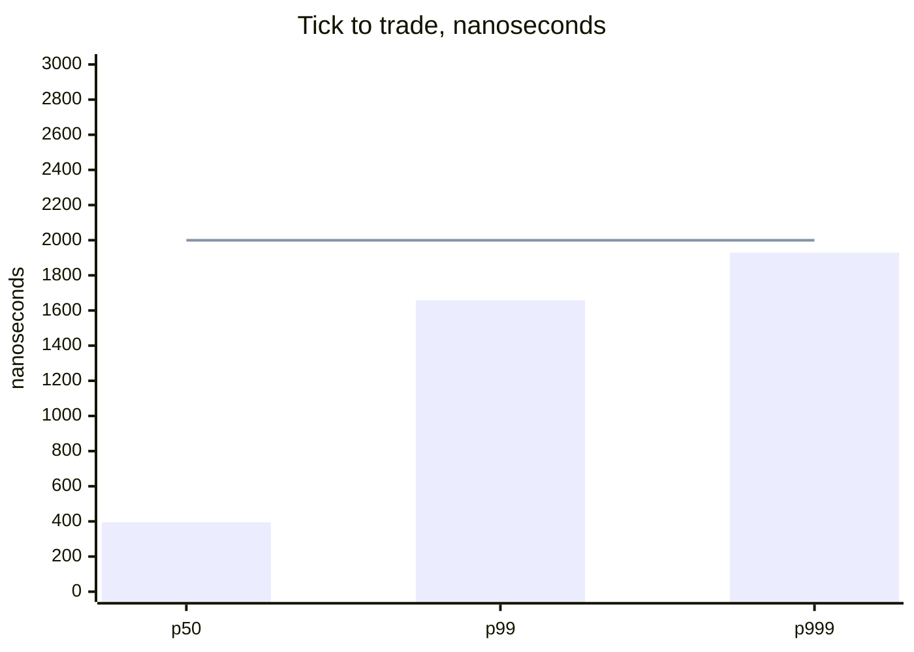

In the same run the paper center measured p50 hop_md 80 cycles, hop_book 96, hop_strat 288, hop_match 384, and hop_tick 832.

Measured in a Docker container on an Intel Xeon E5-2667 v2 at 3.30 GHz (two sockets, eight cores each, 32 threads, two NUMA nodes), three processes pinned to cores 0, 2, and 4, 2000 samples per batch. The container had no isolated cores, no reserved huge pages, a 64 KiB `RLIMIT_MEMLOCK`, and the `powersave` governor; cores ramped to about 3.6–3.7 GHz during the run. The host checklist tightens the tail.

The default build uses `-O3`, `-fno-exceptions`, `-fno-rtti`, `-march=native`, and LTO. Use `-DPITLANE_NATIVE=OFF` and `-DPITLANE_LTO=OFF` for another CPU or a toolchain without IPO. Profile-guided builds cover the core library, `pitlane_trading`, the CTP adapter, tests, and the bench; reuse one build tree so GCC finds the `.gcda` files:

```sh
cmake -S . -B build-pgo -DCMAKE_BUILD_TYPE=Release -DPITLANE_PGO=GENERATE
cmake --build build-pgo -j
./build-pgo/pitlane_trading_bench
(cd pitlane-trading && ../build-pgo/pitlane_trading --full conf/paper.conf)
cmake -S . -B build-pgo -DPITLANE_PGO=USE
cmake --build build-pgo -j
```

Train on the paths you care about; `USE` treats untrained code as cold instead of failing. In this container a profile from `trading_bench` plus a paper full run measured hop_tick p50 at 640 cycles, against 832 without PGO; clock and host load vary, so read it as directional. Hot-path packed clears, copies, and price compares use SSE2/SSE4.2/AVX2 intrinsics with scalar fallbacks, and AVX-512 stays out. Desk mappings and `ByteArena` default to explicit huge pages (hugetlbfs / `MAP_HUGETLB`, no THP) with a fallback to ordinary pages; `thp_disable`, `hugepage_count_ensure`, `mem_lock_all`, and NUMA membind complete the setup. Warnings stay on and are errors.

One build produces `libpitlane.a` and `libpitlane.so` with position-independent objects, so the static library can be linked into another shared library; `-DPITLANE_BUILD_SHARED=OFF` skips the shared one. Install places headers under `include/pitlane`. Link other programs with `-lpitlane` and make the shared object reachable at run time.

`pitlane_trading` is the runnable program: `--full` runs the paper center with the web console, `--serve` keeps a live console resident for manual and algo orders, `--backtest` replays a tape, `--research` sweeps the factor grid, and `--record` writes a tape; see `pitlane-trading/README.md`. `pitlane_trading_bench` times the paper-center path and links no broker library.

## Limits

Each ring has one writing process; each reader keeps its own read position. Do not initialize a mapping again after its magic is written. Paper matching instrument numbers must be below 256. Signals allow 128 subscriptions and a queue of 256; a signal is rejected once the queue is full.

## License

MIT. See `LICENSE`.
