# pitlane

C++17 头文件交易内核（header-only），外加 `pitlane-trading` 控制台：行情与订单簿、连续竞价与集合竞价撮合、风控、清算、回测、因子与配对价差策略、网页运维界面。热路径具有确定性。

### pitlane 交易台

`pitlane-trading/` 是自包含项目，也是本仓库唯一可运行的程序。`adapters/ctp/` 是基于 `MdEngine` 与 `TdClient` 实现的 CTP 网关，并承载 CTP 快照适配层，仅在 `PITLANE_TRADING_CTP=ON`（默认）且存在 CTP `_se` API 时编入 `pitlane_trading`。其他柜台放进同级的 `adapters/<name>/` 目录，自带 `config.hpp`，用系统 conf 里的 `adapter = <name>` 选择；它们的私有键从 `conf/adapters/<name>.conf` 加载，不写进核心 conf。库本身不链接券商柜台 API，也不包含其适配头文件。详见 `pitlane-trading/README.md`。

```bash
cmake -S . -B build -DCMAKE_BUILD_TYPE=Release && cmake --build build -j --target pitlane_trading
cd pitlane-trading
cp -n conf/live.conf.example conf/live.conf
cp -n conf/adapters/ctp.conf.example conf/adapters/ctp.conf   # 填密码
# 7×24 窗口（交易日 16:00 起）：
../build/pitlane_trading conf/live.conf
```

该项目也可单独构建：优先复用同级 pitlane 源码树，`-DPITLANE_SOURCE_DIR=<dir>` 指向别处，否则由 CMake 拉取上游仓库。

```bash
cmake -S pitlane-trading -B build-trading && cmake --build build-trading -j
```

### 网页控制台

一个页面覆盖整个交易台：策略实例与配对价差卡片、人工配对包与信用额度、研究网格、带净值与回撤曲线的回测、块式行情查看、按品种类别分组的行情图、按资金账号下单、盘前规则与告警、运维、清算与账号。页面本身是仓库根目录的 `client/index.html`。以下截图来自纸面盘运行：四个实例同时在运行，研究任务与回测均已完成，并加载了一段块式 tape：

| 策略 | 研究 |
| --- | --- |
| 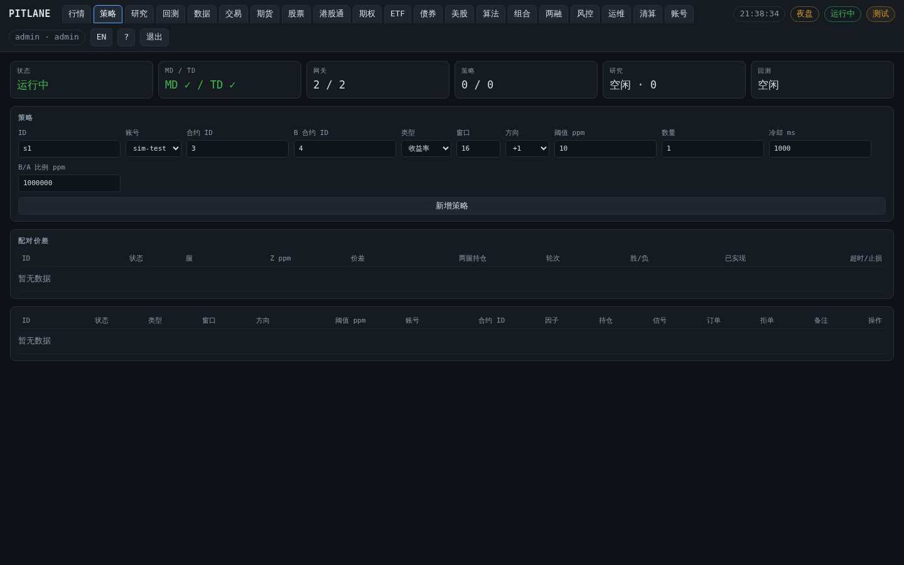 | 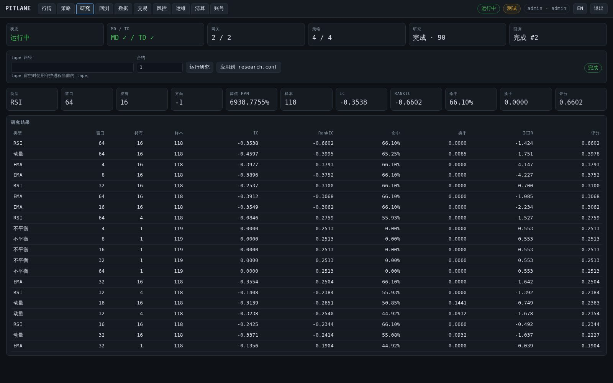 |
| 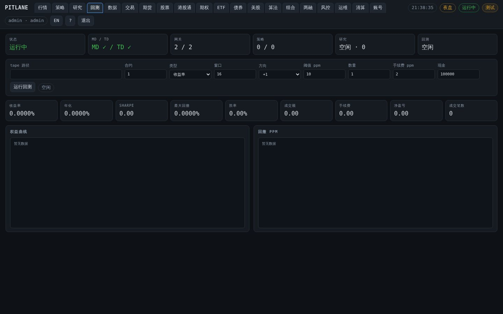 | 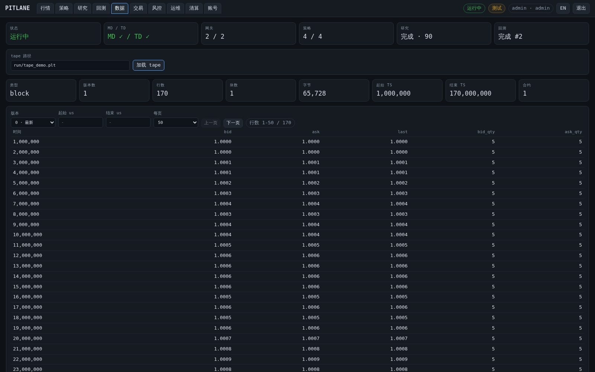 |
| 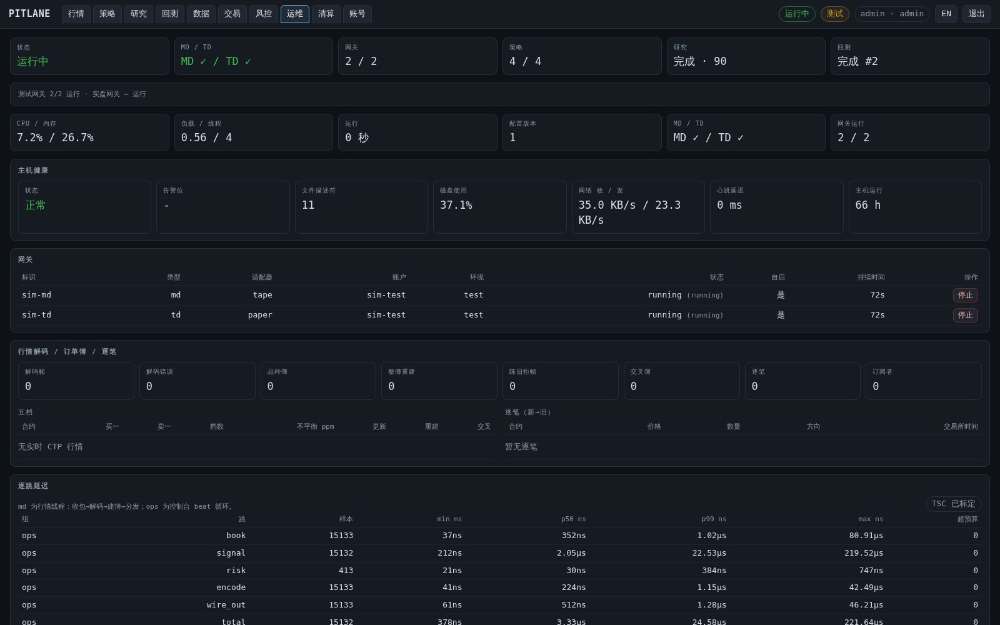 | 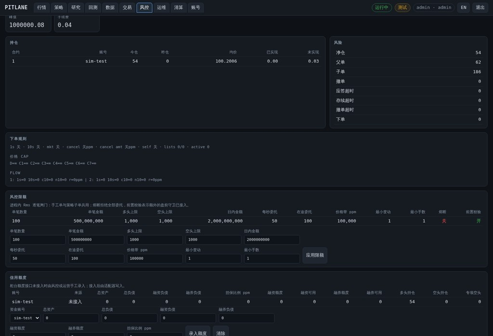 |
| 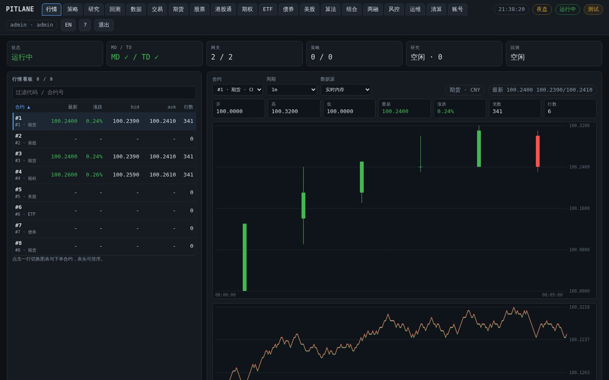 | 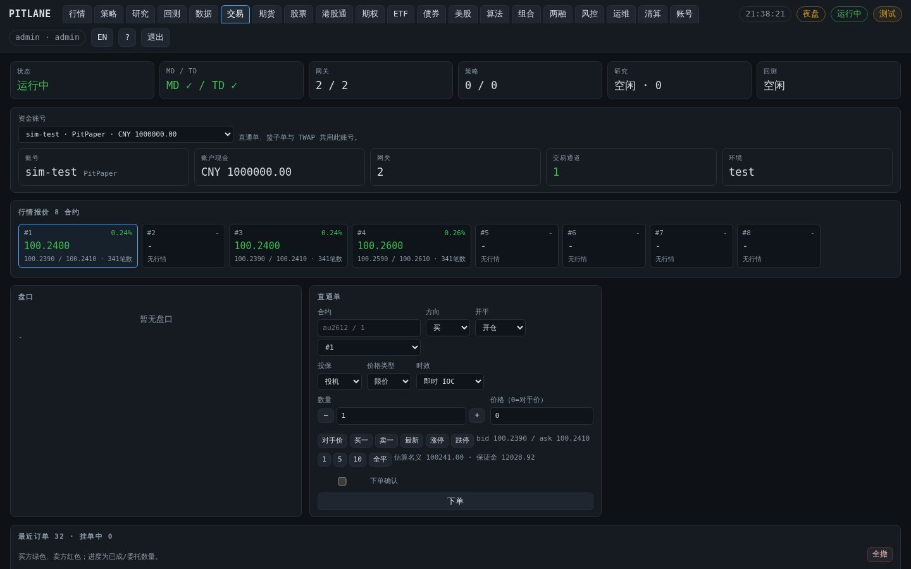 |
| 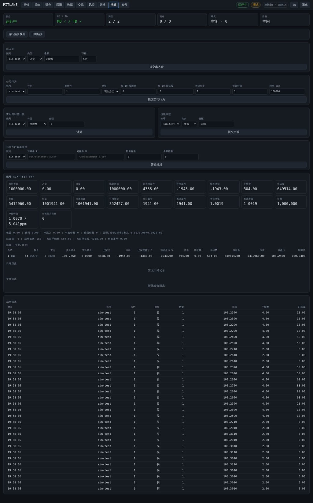 | 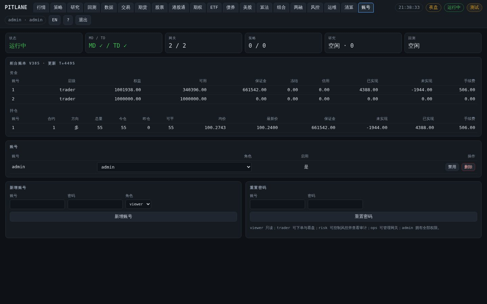 |

调用约定见 `doc/API_CN.md`，请求参考见 `doc/web-api_CN.md`。带侧栏的静态文档在 `doc/site/zh/`：可打开本地文件、安装后的 `share/doc/pitlane/site/zh/`，或仓库的 GitHub Pages（在 `github.com/.../blob/...` 里点开 HTML 只会看到源码）。改库后请更新文档并执行 `python3 doc/gen_site.py`。

```cmake
find_package(pitlane REQUIRED)
target_link_libraries(your_target PRIVATE pitlane::pitlane)
```

pitlane 是面向**同一台机器或同一组机器**上多个交易进程的 C++17 辅助库：一块定容共享工作区，负责委托、持仓、交易日和纸面撮合。价格用整数，时间用微秒。它不连接交易所，也不接券商柜台 API；可选的 UDP 链路只承载 pitlane 与 pitlane 之间的消息。

名字取自赛道边的维修通道：委托和行情从这里进来，检查、排队、撮合后再交回柜台或策略。

## 架构

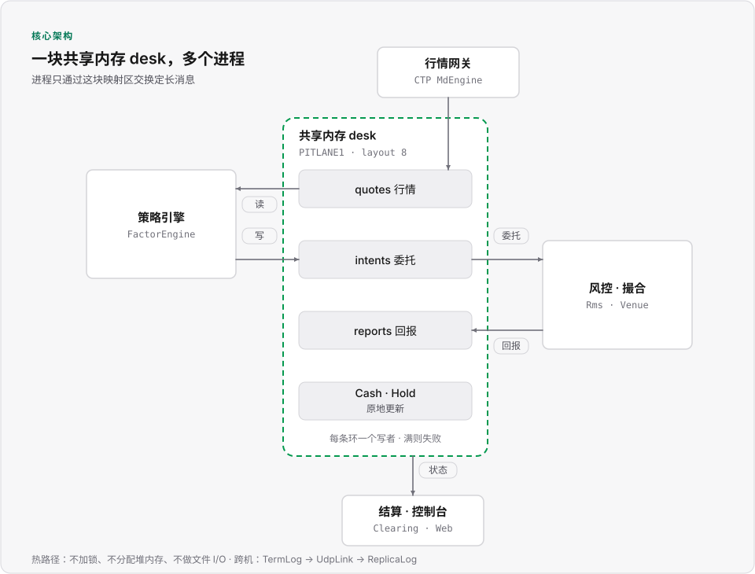

行情、策略、风控与清算通常分属不同进程。它们不互相调用，而是共享同一份 `PITLANE1` 映射：行情网关写 `quotes`，策略读取行情并写 `intents`，风控与纸面撮合读取委托并写 `reports`，清算读取回报以及原地更新的 `Cash`/`Hold` 行。每条环只有一个写入者，每个读者各有自己的读取位置；环满时这次写入失败，不扩容，也不覆盖未确认的槽位。热路径不加锁、不分配堆内存，也不做文件 I/O。可选的跨机层用 `TermLog`、`UdpLink`、`ReplicaLog` 承载同样的帧。

## 它做什么

行情、策略、委托常分属不同进程。它们通过同一份内存映射 desk 交换委托、回报、行情、信号和查询：消息定长，容量编译期固定；环满即写入失败（不扩容、不覆盖未确认槽）。委托槽、账本和在途单都在定长数组里，资金与持仓原地修改，临界区很短。

包含 `pitlane/pitlane.hpp`，链接 `libpitlane.a`（或 `libpitlane.so`），类型都在命名空间 `pitlane`。这是同机与跨机共用的交易枢纽接口，提供自己的一套定长类型：各进程通过共享区或 C ABI 接入。

发行版 **1.0.0**（`pitlane::kVersion`），是第一个达到可交付标准的版本。soname 为 `libpitlane.so.1`，desk 布局为 `kDeskVersion` 8，标的与行情池 `Yard`（魔数 `PITYARD2`，`kYardVersion`）为 2。

1.0.0 覆盖完整的柜台枚举：开平直接采用 CTP 的 0–6 七个码（含强平 `ForceClose`、强减 `ForceOff`、本地强平 `LocalForceClose`）；`Intent::biz` 提供证券信用业务轴（融资融券、还款还券、担保品划转、锁定解锁、拆分合并委托），纸面撮合按业务记录、CTP 对非普通买卖明确拒绝；价格类型在限价、市价之外包含对方最优与本方最优；套保包含备兑，行权不再写死投机。同时包含五档市价、期权行权通道、清算合并与三类超时计数。

pitlane 控制台打通了从 tape 到运行中策略的完整链路。`study/factor_lab.hpp` 在 kind × window × horizon 网格上扫描，按 IC、rank IC、命中率、上下分位、换手和 8 段 ICIR 打分；`study/backtest.hpp` 用一组整数费用参数回放 tape，输出收益、年化、Sharpe、最大回撤、胜率、暴露、换手、净盈亏和净值/回撤曲线；`ops/strategy.hpp` 管理 8 个策略槽，带状态机、定长命令环和 seqlock 行快照。研究与回测只在后台 worker 线程运行；策略实例在交易线程上用固定 `FactorEngine` 环驱动，热路径不加锁、不分配堆内存、不做文件 I/O。

`study/block_tape.hpp` 按列记录逐笔：只追加的 64 KiB 块（8 列 int64 × 1024 行）、64 字节文件头，以及每次提交发布一个不可变版本的 64 字节提交记录。读取方可查询旧版本、投影列、按时间跨块跳过并在块内二分；读用 `pread`，文件不做映射，截断的尾部不会触发 `SIGBUS`。`study/tape_source.hpp` 把整份版本或尾部适配成 `Quote` 行，现有研究与回测代码无需改动。可选 C ABI（`include/pitlane/capi/pitlane_c.h`，编成 `libpitlane_c.so`）提供打开/关闭、meta、rows、describe、write、单合约回测、版本号、单调时钟，以及策略桥：`pl_bridge` 由一条无等待事件环、一条无等待命令环和一条有界日志环组成，单向送出行情、重建、逐笔委托与成交、委托与算法响应、信号与批量信号、资产、持仓、篮子、定时、控制、属性、日志与参数/日期生命周期事件，反向接收下单、撤单、暂停、订阅、资产与持仓查询、算法单插入与撤销、数据源查询、日志级别与控制回复，并把策略日志送回引擎；队列满时丢弃并计数，不阻塞。`python/pitlane` 用 ctypes 封装 tape 接口，并以 `Bridge`、`Event`、`Cmd`、`Log`、`Context`、`Strategy`、`pump`、`run`、`now_us` 暴露策略桥，策略上的 `info`、`warn`、`error`、`debug` 各写一行日志；引擎从不回调 Python。网页端新增 Data 页签，复用同一组接口。

本机与跨机职责都由库内实现：`seed_facts` / `seed_hours` / `seed_holidays` 写入合约与日历；`TopicBus` + `RouteBook` 做本机 topic 分发与算法路由；`TermLog` + `UdpLink` + `ReplicaLog` 负责跨机帧与确定性复制。启动阶段允许分配内存或建立 mmap；辅助层热路径不分配、不释放资源。

启动配置使用可选的 INI 文件（键见 `desk/config.hpp` 中 `PitConf` 的成员初值，`pitlane-trading/conf/paper.conf` 是一份可用配置）。`conf_load` 叠加默认值（空值保留默认），`conf_normalize` 把不安全取值压入合法范围并写出提示行，`conf_map_opt` / `conf_arena_opt` / `desk_apply_conf` / `conf_venue_cfg` 在建图时应用一次。热路径不再读文件。

代码按区域分层：`desk` 放共享区及记录，`book` 放行情、交易日与纸面撮合，`order` 放委托生命周期、检查、持仓、OMS/EMS/SOR/PMS/RMS 与执行节奏，`time` 放时钟与延迟记录，`study` 放特征、事后偏移与因子评估，`net` 放帧、term log、UDP 与复制，`util` 放数值、文本、组帧与定长缓冲，`host` 放亲和性、调度、IRQ、大页、`mlockall` 与 NUMA。有编译单元的区域在 `src` 下按同名目录组织，测试在 `tests` 下同名目录，延迟程序是 `tests/time/perf.cpp`。单独包含时写上区域，例如 `pitlane/order/sheet.hpp`。

辅助层的覆盖面有意做宽：价格窗与可见量求和、fill/fan 环、快照窗、自旋锁、DAG 排序、带类型的票据、序号门控、令牌桶、报文模板、稀疏价位块、命令快照、母单日程、K 线、公司行为因子、周期读取、延迟直方图、轨迹 tape 与主机调优调用。它们要么是定长表，要么是对调用方数据的纯函数；不建立会话、不读取行情、不发单、不撮合。逐文件说明见 `doc/API_CN.md`。

## 共享区

映射文件以魔数 `PITLANE1` 开头，布局版本为 8（`kDeskVersion`）。布局 8 增加了 `Intent::biz` 与 `Intent::px_mode`；布局 7 增加了 `execs` 行权环与 64 字节回报，布局 6 增加了跨进程查询的完整账本行、控制回执与柜台订单快照三条环。共享同一区域的进程必须一起重启。`desk_view` 只在魔数与布局都相符时打开文件，空白文件在允许创建时初始化一次，版本不同的旧文件不会被当作当前布局。

| 内容 | 容量 |
| --- | ---: |
| 委托（intents） | 32768 |
| 回报 | 32768 |
| 行情 | 8192 |
| 算法单 | 32768 |
| 控制 | 16384 |
| 控制回执 | 4096 |
| 行权请求 | 1024 |
| 柜台订单 | 16384 |
| 推送 | 4096 |
| 逐笔 | 4096 |
| 查询 | 1024 |
| 账本资产 | 2048 |
| 账本持仓 | 2048 |
| 篮子请求 | 2048 |
| 篮子应答 | 16384 |
| 日志 | 2048 |
| 订阅 | 2048 |
| 信号 | 4096 |
| 市场委托 | 4096 |
| 重建行情 | 2048 |

资金 512 行、持仓 4096 行。`conf_normalize` 可在启动时把环的可用深度调小，但不会超过编译期上限。每条环只有一个写入者，每个读者自己记住读取位置。发布时可指定必须确认的读者；不指定时，第一个确认的读者取走消息；指定后，所有被指定的读者都确认完，槽位才能复用。会话循环使用读者位 7，发给它的消息必须带这一位或不指定读者。控制消息种类为 1 时停止会话循环，重复间隔为 0 的定时器只触发一次。大于槽位的负载必须走调用方自己的环，超长发送失败。

## 委托、持仓与行情

订单号是 64 位位域：站点、种类、交易日个位、十秒时段、序号，种类由调用方定义。合约目录最多 1024 个合约名，编号从 1 开始，可记录关联、标的、衍生品与跟踪关系；夜盘允许开市晚于收市。

报单前先归一化开平与方向。股票、债券、基金、科创板、指数和回购按开仓；上期所与能源中心把普通平仓改为平昨，其他期货交易所把平今与平昨合为普通平仓。买入、融资买入、买券还券、申购为多头；卖出、融券卖出、卖券还款、赎回为空头。限价 0 拒绝。

期货数量有三种拆分方式：先平今再平昨、剩余开仓；只平仓；只平昨。每段不超过最大手数，小于最小手数不发。向目标持仓调整时一次只发一笔，今昨分账时先平昨，商品期货检查开仓上限，股指按净仓且只平昨。平今、平昨与普通平仓冻结不同持仓；股票卖出扣减可卖量；成交按当时的开平与方向写回今仓、昨仓与总仓。

每笔意图在 `Intent::off` 里带上开平（CTP 七个码 `Open 0`、`Close 1`、`ForceClose 2`、`CloseToday 3`、`CloseYday 4`、`ForceOff 5`、`LocalForceClose 6`），手工单、篮子分段和算法子单因此可以平仓而不只是开仓；该字段复用槽位原有的填充字节，记录仍为 56 字节。强平原因放在 `Intent::force_reason`（CTP `THOST_FTDC_FCC_*`），回报在 `Report::cause` 原样带回，`Report` 为 64 字节。篮子与 T0 子单若减少净仓即标记为平仓，并截断到可平数量，超出部分留到后续节拍按开仓发出。CTP 适配器把开平映射到 `CombOffsetFlag`，把委托方式映射到柜台条件：`Day` 与 `Passive` 为 GFD 限价，`Immediate` 为 IOC 限价（FAK），`All` 为 IOC 全成或全弃（FOK），`BestFive` 为最优五档即时成交剩余撤销。`Intent::hedge` 携带投机、套利、套保或备兑，映射到 `CombHedgeFlag`；C ABI 的 `pl_cmd` 与 Python 的 `insert` 暴露同一字节，未设置时保持投机。

Side 的扩展语义不共用同一枚举：方向仍是 `Side`，锁定、解锁、拆分、合并、分红在订单或清算层表达，行权是独立通道——`ExecNote` 经 `publish_exec` 进入 `execs` 环，由 `TdClient::exercise` 调 `ReqExecOrderInsert`。清算的公司行为支持现金分红、送股、拆股与合并（`kClrMerge`），按 `(name, event_id)` 幂等。合约事实可在盘中由 `reload_facts` / `reload_hours` 冷路径刷新，不新建槽位，未知合约直接失败；热路径只读。风控超时时按应答、存续、撤单三类计数，进入 `StatusSnapshot` 与控制台状态 JSON。

报柜台前可限制单笔数量、名义金额与在途笔数，并按未确认、存活期、撤单等待三条时限清理在途单。持仓与资金查询按引擎排队（32 个引擎、64 个账号），同账号请求合并，队列满则失败。

订阅默认接收全部合约，也可只接收事先允许的合约。涨跌停缺失时用调用方备用价补齐，原始价除以调用方给定的分母，`S` 会话切换记录丢弃。行情时间归入所属交易日：8 点至 18 点不回退，18 点后周一减 3 天、其余减 1 天，凌晨周一减 2 天、其余减 1 天，再跳过周末与休市日。纸面报单与撤单时延在 9:30 前为 0，之后按 10:00、10:30、11:00、11:30、13:30、14:00、14:30、15:00 分成九段，也可用采样点插值；报单时延为负表示该委托未进入盘口。

## 纸面撮合

纸面撮合同时处理 256 个合约、1024 笔在途委托。新单先经过报单时延，再按当时盘口决定成交、挂出或过期；撤单同样要经过撤单时延。当日单触及自身限价时剩余全部成交，可多于可见量；仅被动挂单的委托一旦会穿越对手价即过期；立即成交单只成交可见量；全成或全弃单在可见量不足时整笔过期。成交价取被动方价格，某档数量归零即删除，同账户买卖自成交时该委托停止撮合。集合竞价取成交量最大的价格，并列时取较高价或更接近参考价者。挂单后逐笔成交减少其前方数量，同向主动成交不与该单成交，后续档位变化不重复扣减。

## 运维控制台

`ops/status.hpp`、`ops/command.hpp`、`ops/control.hpp`、`ops/http.hpp`、`ops/host.hpp`、`ops/auth.hpp`、`ops/gateway.hpp` 与 `ops/series.hpp` 构成 desk 之上的控制面。封存状态板、按序号应答的操作员环，以及暂停/熔断/风控阻断/停止/重载标志的唯一写入者，让策略、手工单与网页看到同一状态。

`order/flowgate.hpp` 按账户与市场维护滚动一秒的下单、撤单与名义金额窗口；`order/precheck.hpp` 按固定顺序检查熔断、开平黑名单、分类上限、账户与市场流量、带预热笔数的撤单率、撤单金额比与自成交，返回首个失败项。规则接在手工单 `Rms` 之后，零分配，上限为 0 即关闭。`ops/group_risk.hpp` 汇总各组的总额、净额与单账户上限；`time/replay_pace.hpp` 用整数速度区段把行情时间映射为墙钟。

一个 hub 服务多个角色的浏览器会话。账号存于 `run/users.conf`，为 PBKDF2-HMAC-SHA256（10000 轮、每人加盐），登录发放 64 个十六进制字符的 token（8 小时 TTL），同时写入 HttpOnly Cookie 与响应体，之后以 `Authorization: Bearer` 回传。除 `health` 与 `login` 外，每个 `/api/*` 都先检查权限位；交易路径不查这些位，权限门只在 HTTP。

| 角色 | 权限 |
| --- | --- |
| `viewer` | 行情、风控查看、运维查看 |
| `trader` | viewer + 手工单、篮子、算法 |
| `risk` | viewer + 控制动作、审计、清算与告警 |
| `ops` | viewer + 网关启停、审计 |
| `admin` | 全部，含账号管理 |

`run/gateways.conf` 声明 `gateway = <id> <md|td> <adapter> <acct> <auto 0|1> [test|live]`；hub 维护 `stopped`/`starting`/`running`/`failed` 四种状态，网页通过带审计的命令通道启停网关，`auto=1` 表示随 hub 启动。`run/accounts.conf` 把资金绑定到模式与网关：`account = <id> <display> <class> <ccy> <cash> <test|live>`，现金单位为 1e-6。`run/instruments.conf` 描述 `instrument = <name> <class> <ccy> <tick> <mult> <margin_ppm> <fee_ppm>`，可选 `min_fee`、`stamp_ppm`、`short`、`gw`、`close_fee_ppm`、`close_today_fee_ppm`、`fx_ppm` 与 `lot`/`min_qty`/`max_qty`/`tickb`。`short=1` 才允许开空，否则净卖出不得超过 `long - short`。会话登录时选择 **test** 或 **live** 并保持不变，所有对象按模式过滤，跨模式请求返回 `409`。

`ops/alarm.hpp` 按类别（`reject`、`risk`、`stale`、`jump`、`link`、`gateway`、`order`、`clearing`）记录 `info`/`warn`/`critical`。被拒手工单把原因回传页面并产生告警。行情跳变或过期达到阈值的三分之二时告警；达到完整阈值时，hub 撤掉该合约在所有网关上的委托、停止其交易网关、写审计并产生严重告警；回放模式豁免。

`clear/clearing.hpp` 按多空两侧分别维护 FIFO 批次（含成交价、结算价与今昨标记），平仓按最早反向批次、昨仓优先，结算时将全部持仓转为昨仓。费用含每笔最低、平仓与平今费率及卖方印花税；估值给出已实现、结算后已实现、浮动与结算后浮动。现金是含入金、出金、分红、费用、融资利息与申赎的流水账，盈亏剔除出入金与申赎流水。公司行为（现金分红、送股、拆并股）按 `(name, event_id)` 幂等，份额、净值与回撤共用同一组数字。每次结算追加一条保留 32 天的日记录，`clr_period` 汇总当日、7 日、30 日与年初至今，快照经 seqlock 发布；`?run=1` 写 CSV，`?settle=1` 按结算价估值并关账。`clear/statement.hpp` 导入托管方对账单并做两方或三方对账；`clear/report.hpp` 把净值环折成日、周、月、年报表。`ops/health.hpp` 采样 CPU、内存、负载、线程、文件描述符、磁盘、网络、运行时长与心跳年龄，80% 告警、100% 升级。

手工单与策略共用 `Rms`、`Oms`、`Pms` 与 `IdMint`：直接单每次发一笔，篮子每个节拍只发目标与净持仓之差，算法单按时间跨度均分。手工与网页篮子单次最多 8 条腿；程序化 `BasketBook` 单账本最多 2048 条腿，更大的批次走调用方 `Parcel` 环。熔断停止策略母单、撤掉手工在途单，并保持到恢复。

库调用方可用 `order/algo.hpp` 做 TWAP、成交量曲线 VWAP 或不定时直通，含挂单/吃价切换、重挂间隔、参与率与单笔上限、封板一次触及与涨跌停停止；`basket_child` 提供单腿控制；`order/auction.hpp` 处理集合竞价；`book/sessions.hpp` 回答会话时钟问题；`ops/instruments.hpp` 提供交易参数与分档 tick。这些都只返回子单决策，记账与路由仍由调用方完成。

HTTP 服务是单 `poll` 线程、每连接一请求、8 KB 请求上限，启动时把 `index.html` 读入内存并固定。页面含登录页、常驻总览条和十个页签（行情、交易、风控、运维、账号、清算、策略、研究、回测、数据），每个页签只在具备对应权限时出现，总览每两秒轮询。

| 方法 | 路径 | 权限 | 用途 |
| --- | --- | --- | --- |
| GET | `/api/health` | 无 | 存活探针 |
| POST | `/api/login` | 无 | `{"user","password","mode"}` 返回角色、权限、模式与 token |
| GET | `/api/status` | 行情 | 封存快照：状态、链路、计数、风控、主机、持仓与委托 |
| GET | `/api/system` | 行情 | 总览条计数 |
| GET | `/api/instruments` | 行情 | 分类、币种、tick、乘数、费率、做空标志与交易参数 |
| GET | `/api/accounts` | 行情 | 当前模式的资金账户及其网关 |
| GET | `/api/gateways` | 运维查看 | 网关状态、备注、账户与自启动 |
| POST | `/api/gateway` | 网关 | `{"action":"start\|stop","id":...}`，仅同模式 |
| POST | `/api/order` | 交易 | `{"name","side","qty","px","acct","off"}`，`px` 为 0 取对手价，`off` 取 0–3 表示开仓、平仓、平今、平昨 |
| POST | `/api/basket` | 交易 | `{"legs":[{"name","target"}],"acct"}` |
| POST | `/api/algo` | 交易 | `{"action":"create\|pause\|resume\|cancel\|update","id","name","side","qty","horizon_ms","slice_ms","t0"}` |
| POST | `/api/control` | 风控控制 | `pause`、`resume`、`halt`、`resume_risk`、`reload`、`cancel_all`、`stop` |
| GET | `/api/clearing` | 清算 | 按账户报表；`?run=1` 写 CSV，`?settle=1` 关账 |
| GET | `/api/clearing/history` | 清算 | 每账户最多 32 条已结算日记录 |
| GET | `/api/clearing/period` | 清算 | 当日、7 日、30 日与年初至今盈亏 |
| GET | `/api/ledger` | 风控 | 柜台完整资金与持仓快照；`?tier=`、`?acct=`、`?name=`、`?direction=` |
| POST | `/api/clearing/cash` | 清算 | 入金或出金 |
| POST | `/api/clearing/corp` | 清算 | 幂等公司行为 |
| POST | `/api/clearing/reconcile` | 清算 | 三方对账 |
| GET | `/api/host/health` | 风控查看 | 主机采样、限额、级别与触发位 |
| GET | `/api/alarms?since=N` | 风控查看 | 增量告警与下一游标 |
| GET | `/api/events?since=N` | 运维查看 | 增量审计与下一游标 |
| GET | `/api/series` | 行情 | OHLC 与最新行情 |
| GET | `/api/ticks` | 行情 | 实时环中的最近逐笔 |
| GET | `/api/history` | 行情 | 从 tape 文件读回逐笔 |
| GET | `/api/tape/meta` | 行情 | 块式 tape 文件头 |
| GET | `/api/tape/rows` | 行情 | 指定版本并按列投影 |
| GET | `/api/tape/describe` | 行情 | 逐列统计 |
| GET | `/api/strategies` | 行情 | 当前模式的策略行 |
| POST | `/api/strategy` | 交易 | `add`、`remove`、`start`、`stop`、`pause`、`resume` |
| GET | `/api/research` | 行情 | 最近一次研究结果 |
| POST | `/api/research` | 运维查看 | 入队研究，返回 `202` |
| POST | `/api/research/apply` | 网关 | 用最优行写 `research.conf` |
| GET | `/api/backtest` | 行情 | 最近一次回测指标与曲线 |
| POST | `/api/backtest` | 运维查看 | 入队回放，返回 `202` |
| GET | `/api/users` | 用户 | 账号、角色与启用状态 |
| POST | `/api/user` | 用户 | `add`、`remove`、`role`、`password`、`enable`、`disable` |

完整字段见 `doc/web-api_CN.md`。`strategies.conf` 使用 `strategy = <id> <acct> <instrument> <kind> <window> <sign> <threshold_ppm> <qty> <cooldown_ms> [test|live] [b=<instrument> ratio=<ppm>]`；`kind` 1–8 为因子类策略，9 为配对价差，其中 `instrument` 是 A 腿，`b=` 与 `ratio=` 指定 B 腿；`window` 取 2–256。网页增删只改当前进程，不回写文件。`run/ops.conf` 含端口、文档根、手工限额、日亏损、回撤、拒单率、过期阈值、行情安全阶梯与 `pre_*` 规则；`reload` 重新读取。返回码：0 接受、1 格式错误、2 被阻断、3 被拒、4 环满、5 未知命令。

纸面回放，并在 tape 结束后保持页面打开：

```bash
cd pitlane-trading
../build/pitlane_trading --backtest --tape run/tape.csv --web 8080 conf/paper.conf
TOKEN=$(curl -s -X POST -d '{"user":"admin","password":"pitlane","mode":"test"}' http://127.0.0.1:8080/api/login |
        sed -n 's/.*"token":"\([0-9a-f]*\)".*/\1/p')
curl -s -H "Authorization: Bearer $TOKEN" http://127.0.0.1:8080/api/status
curl -s -H "Authorization: Bearer $TOKEN" -X POST -d '{"name":1,"side":1,"qty":2,"acct":"sim-test"}' http://127.0.0.1:8080/api/order
```

首次启动会创建 `run/users.conf`（`admin` / `pitlane`），对外暴露前请修改。控制台默认只绑回环；需要从其他主机访问时加 `--web-bind 0.0.0.0` 或在 `run/ops.conf` 设置 `bind`，并把网络视为可信：除非反向代理补 TLS，会话走明文 HTTP。

## 构建和安装

需要 CMake 3.16 或更高版本，以及支持 C++17 的编译器。在仓库根目录执行：

```bash
cmake -S . -B build
cmake --build build
cd build && ctest --output-on-failure
```

共享或虚拟化主机请在配置时加 `-DPITLANE_RELAX_LATENCY=ON` 再跑 `ctest`；默认的严格构建会执行行情到委托的上限，需要 [doc/HOST_TUNING_CN.md](doc/HOST_TUNING_CN.md) 中的静默主机配置。需要地址错误与未定义行为检测时，用 `-DPITLANE_SANITIZE=ON` 另建一个构建目录。安装用 `cmake --install build --prefix /opt/pitlane`。

`ctest` 还会跑 `perf` 与 `perf_shared`：先丢弃一段预热，再记录最小、中位数、99 分位和 999 分位周期数；名次保持顺序、更长的空转抬高中位数，且中位数低于宽上限才通过。同一次还会测量环、委托检查、纸面撮合，以及纸面中心的行情、订单簿、策略与撮合各段；`trading_bench` 在不链接券商库的情况下重复这组测量。

同一次测试还会用三个进程在同一块共享映射上测量从行情到委托的延迟：行情进程发布行情，引擎更新订单簿并询问策略，风控与委托单执行，报单进程在委托可见时取周期戳。样本取自行情戳到报单戳，回报不计入，周期用测量段外的比例换算。优化构建要求中位数的 p99 不超过 2 微秒；p999 取决于主机的安静程度。本容器最新一批五次运行中，每一批的 p99 都在 1.65–1.68 微秒之间，p999 在 1.90–2.23 微秒之间。中位批次为 p50 395 纳秒、p99 1.66 微秒、p999 1.93 微秒，另有 2–6 个远高于主体的样本单独计数。下表列出全部五批及其中位数。严格构建对 p99 与 p999 都执行 2 微秒上限，适用于按 [doc/HOST_TUNING_CN.md](doc/HOST_TUNING_CN.md) 配置好的主机；共享或虚拟化主机可加 `-DPITLANE_RELAX_LATENCY=ON` 配置，CI 即如此。检测构建同样使用更宽上限。

| 批次 | p50 纳秒 | p99 纳秒 | p999 纳秒 | 原始 p999 纳秒 | 单独计数 |
| --- | ---: | ---: | ---: | ---: | ---: |
| 1 | 391 | 1657 | 1929 | 5172 | 3 |
| 2 | 395 | 1658 | 1898 | 2206 | 2 |
| 3 | 394 | 1653 | 2204 | 12469 | 3 |
| 4 | 397 | 1670 | 1901 | 13002 | 6 |
| 5 | 413 | 1684 | 2227 | 12055 | 3 |
| 中位数 | 395 | 1658 | 1929 | 12055 |  |

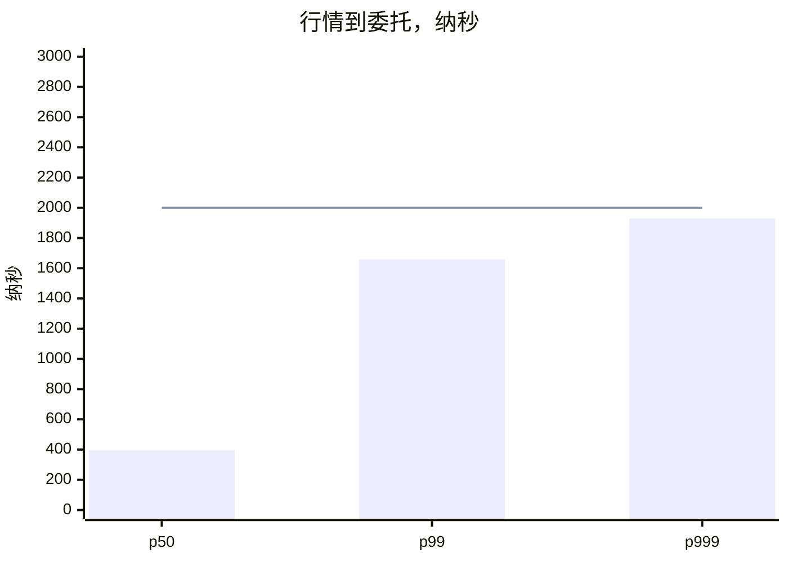

同一次运行中，纸面中心的中位数为 hop_md 80 周期、hop_book 96、hop_strat 288、hop_match 384、hop_tick 832。

测试环境：Docker 容器，Intel Xeon E5-2667 v2 @ 3.30 GHz（两路、每路 8 核、32 线程、两个 NUMA 节点），三个进程钉在 0、2、4 号核，每批 2000 个样本。容器未隔离核、未预留大页，`RLIMIT_MEMLOCK` 为 64 KiB，调频为 `powersave`；运行期间核心升至约 3.6–3.7 GHz。按主机清单配置可收紧尾部。

默认构建使用 `-O3`、`-fno-exceptions`、`-fno-rtti`、`-march=native` 与 LTO。换 CPU 或工具链不支持 IPO 时用 `-DPITLANE_NATIVE=OFF` 与 `-DPITLANE_LTO=OFF`。配置指导优化（PGO）覆盖核心库、`pitlane_trading`、CTP 适配器、测试与 bench；两次构建必须复用同一个构建目录，GCC 才能找到 `.gcda`：

```sh
cmake -S . -B build-pgo -DCMAKE_BUILD_TYPE=Release -DPITLANE_PGO=GENERATE
cmake --build build-pgo -j
./build-pgo/pitlane_trading_bench
(cd pitlane-trading && ../build-pgo/pitlane_trading --full conf/paper.conf)
cmake -S . -B build-pgo -DPITLANE_PGO=USE
cmake --build build-pgo -j
```

训练要覆盖你关心的路径；`USE` 会把未训练到的代码当作冷路径，不会因此构建失败。本容器上用 `trading_bench` 加一次纸面盘全流程训练后，hop_tick 的 p50 为 640 周期，未启用 PGO 时为 832；主频与主机负载会波动，按方向性结果理解。热路径的打包清零、拷贝与价格比较使用 SSE2/SSE4.2/AVX2 内建函数，并提供标量回退，不使用 AVX-512。共享区与 `ByteArena` 默认走显式大页（hugetlbfs / `MAP_HUGETLB`，不用 THP），不可用时回退普通页；`thp_disable`、`hugepage_count_ensure`、`mem_lock_all` 与 NUMA membind 共同完成进程环境配置。警告保持开启并视为错误。

一次构建得到 `libpitlane.a` 与 `libpitlane.so`，目标文件位置无关，静态库也可再链入其他动态库；只需静态库时加 `-DPITLANE_BUILD_SHARED=OFF`。安装会放入 `include/pitlane` 下的头文件。其他程序用 `-lpitlane` 链接，并确保运行时能找到 `libpitlane.so`。

`pitlane_trading` 提供这几种运行方式：`--full` 启动带网页的纸面中心，`--serve` 让实盘控制台常驻、接受手工与算法单，`--backtest` 回放 tape，`--research` 扫描因子网格，`--record` 录制 tape；各模式见 `pitlane-trading/README.md`。`pitlane_trading_bench` 量纸面中心路径，不链接券商库。

## 使用限制

每个环只能有一个写入进程，读者各自保存读取位置。写好魔数的映射不要再次初始化。纸面撮合的合约编号必须小于 256。信号最多 128 个订阅、队列 256 条，写满后新信号被拒绝。

## 许可证

MIT。见仓库根目录 `LICENSE`。
