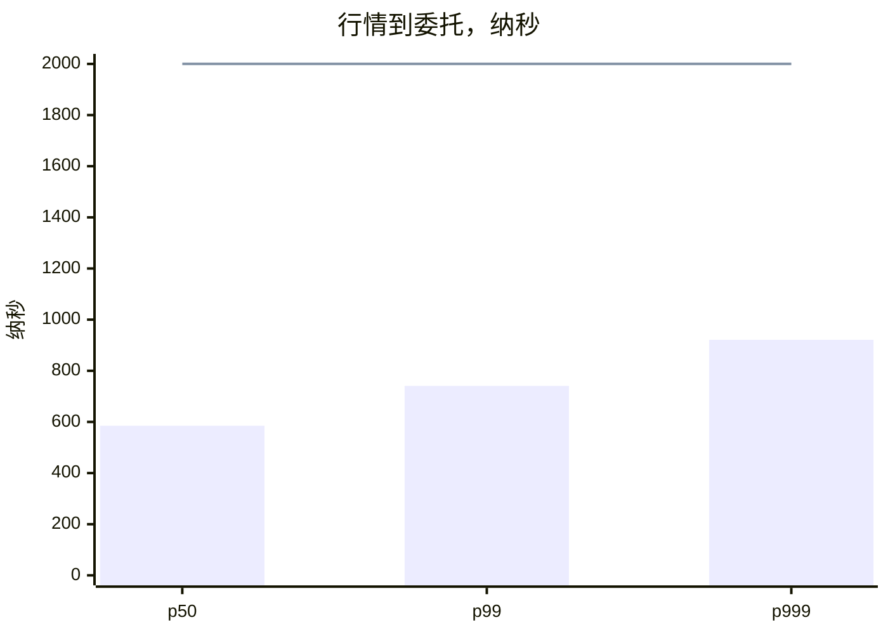

# pitlane

英文介绍是 `README.md`。API 用法见 `doc/API.md` 和 `doc/API_CN.md`。可浏览的静态网页在 `doc/site/`：请打开**本地** `doc/site/index.html`、安装树里的 `share/doc/pitlane/site/`，或本仓库的 **GitHub Pages**。在 `github.com/.../blob/...` 里点开 HTML 只会看到源码，GitHub 不会在那里渲染页面。用 `python3 doc/gen_site.py` 重新生成。库有变动时，成对文档一起改并重新生成站点。

用 CMake 消费：

```cmake
find_package(pitlane REQUIRED)
target_link_libraries(your_target PRIVATE pitlane::pitlane)
```

pitlane 是一个 C++17 静态库。它给同一台机器上的交易进程准备一块共享工作区，并在这块工作区上处理委托、持仓、交易日和纸面撮合。价格用整数，时间用微秒。

名字来自赛车场的维修通道。委托和行情先进入这条通道，完成检查、排队和撮合，再交给外面的柜台或策略。库本身不连接交易所。

## 它做什么

策略、行情和报单常常分属不同进程。pitlane 让这些进程通过同一个文件映射交换委托、回报、行情、信号和查询。消息长度固定，容量在编译时确定。一条环写满时，新的写入直接失败，不会扩容，也不会盖掉还没有被确认的消息。

委托槽、账本行和未完成订单都放在固定数组里。资金和持仓在原位置修改，临界区很短。

使用时包含 `include/pitlane/pitlane.hpp`，链接 `libpitlane.a`。类型和函数都在命名空间 `pitlane` 中。这套接口是单独设计的，不能用来替换已经在运行的其他交易库。

库的发行版本是 2.13.0。`version.hpp` 里的 `pitlane::kVersion` 是同一串文字。动态库文件名带这个版本，soname 保持 `libpitlane.so.1`。工作区布局版本是 `kDeskVersion`，当前是 3。标的/行情池（`Yard`，魔数 `PITYARD2`，`kYardVersion` 2）是独立的启动期映射，对齐 startup pool 量级池。

启动配置是可选的 INI 风格文件（见 `examples/pitlane.conf`）。`conf_load` 把键叠到代码默认值上；值为空则保留默认。`conf_normalize` 把不安全的取值压到合法范围（例如环容量取不超过编译期上限的 2 的幂），并把提示行写入调用方缓冲。`conf_map_opt` / `conf_arena_opt` / `desk_apply_conf` 只在建映射 / 初始化 desk 时生效；热路径不再打开配置文件。

头文件和源文件按区域再分一层目录。`desk` 放共享区和上面的记录。`book` 放行情、交易日和纸面撮合。`order` 放委托生命周期、检查和持仓。`time` 放时钟和延迟记录。`study` 放特征、事后偏移和调用方决策辅助。`util` 放数值、文本、组帧和定长缓冲。`host` 放进程侧的 `sched_setaffinity`、调度策略、IRQ 亲和性、显式大页池、`mlockall` 与 NUMA membind。某个区域若有编译单元，源文件在 `src` 下的同名目录里。某个区域的测试在 `tests` 下的同名目录里。延迟程序是 `tests/time/perf.cpp`。单独包含某个头文件时写上区域，例如 `pitlane/order/sheet.hpp`。`version.hpp` 和 `pitlane.hpp` 放在同一层。

`PriceWindow` 在固定的价格步长上存放数量。最优价沿着占用位往前找，空档按字跳过。`publish_batch` 一次写入多条环槽，尾指针只推进一次。其中一条还忙着，整批都不写入。`SlotPool` 用固定槽保存调用方的记录，并按编号查找。`margin_both` 取按金额和按手数两笔保证金里较大的一笔。`right_value` 给出认购或认沽处于实值的幅度。这些调用都不发单。

`FillRing` 在本端缓存对端序号；仅当本地副本表明环满或环空时，才重新加载共享序号。每个槽独占一条缓存行。`take_span` 一次复制多条已发布槽，消费者序号只持久化一次。`ack_span` 连续确认一段环下标，遇本读者无法确认的位置即停。`shown_before` 对价格窗内严格优于给定价格的数量求和。`ExtremeWindow` 在固定容量的单调双端队列上维护最近推入价格的极值。`TimeLine` 按到达顺序保存同一价格上的编号。`cover_qty` 对满足限价的可见数量累加，达到目标数量即停；买入与卖出分属两条循环。AVX2 一次比较四个价格，SSE4.2 比较两个，其余用四级展开的标量收尾。`touch_lines` 按缓存行预取并加载。`map_create` / `map_attach` 默认按内核 Hugepagesize 对齐映射长度，优先在 hugetlbfs（默认 `/dev/hugepages`）上建立显式大页文件映射；不可用时回退普通页并置 `fallback`。不用 THP / `MADV_HUGEPAGE`。默认还会对映射 `mlock` 并预触碰每一页；`numa_node >= 0` 时做 `MPOL_BIND`。`ByteArena` 默认同样走大页 / `mlock` / 预触碰。进程级 `mem_lock_all` 仍是先抬高 `RLIMIT_MEMLOCK` 的 host 辅助。`SpinLock` 为独占缓存行的 TTAS 自旋锁。`DagPlan` 以灰/黑染色求拓扑序。类型态票据以编译期标签禁止非法成交调用。`OwnPair` 保存调用方本地双边最优价；`SlotGate` 在丢包后置 `need_seed`，须 `seeded` 后才再接受行情。`SendJoinRing` 为多生产者满环失败的发送环。`SigBook::find4` 在比对前预取两侧桶。`SeqPublishRing` 为无背压序号发布环，读者落后时允许覆写未消费槽；`FanRing` 与 `FillRing` 满环仍失败并保持原内容。原生构建将自动向量宽度限制在 256 位（`-mno-avx512f`）。`global_scale_set` 写入进程内共享的整数 TSC 周期换算系数。`DecideScratch` 仅暂存并比较调用方给出的候选评分。`FanRing::claim` 原地填槽。`SeqField`、`LatestKeep`、`DualLane`、`PaceLatch`、study 的 `OfiWin`/`SecMove`、mold 存在位与 `IntEma` 构成 2.8.0 拓展。`PrioSnap` / `PinBank`（按槽引用计数的多读者快照）、`PhaseGate` / `ActiveSum`、`IdClaim`、`infer_lots`、`FifoLot` / `AcbBook` 与 `IntEmaDev` 构成 2.9.0 拓展。`risk_merge` / `AcctRiskTab`、扩展后的 `gate_ask`、`BasketBook`、`TraderAcctTab` / `acct_idle`、整手与 `MarginBook`、`QueryFold` 的 kind/page、`LaneBook`、`inflight_scan`、PullWait 下部分撤、`sign_begin` / `cash_enough`、`QuoteFold::apply_ordered` 与 `MacAllow` / `RoleBits` 构成 2.10.0 拓展。`ObjectPool` / `StickyCounter` / `CoreBank` / `WirePx` 是更早的辅助。 `batch_size_for` 按积压自适应微批大小。`RankBits` / `QuadTab` 提供有界编号稠密下标与四键缓存行静态表。`host/` 提供 `sched_setaffinity`、实时调度、IRQ 亲和、`nr_hugepages` / `thp_disable`、`mlockall` 与 NUMA `mbind`。`util/hint.hpp` 与 `util/simd.hpp` 提供分支提示、冷热布局、预取、打包清零、非时间性存储与打包拷贝。这些调用都不撮合成交。

## 共享区

映射文件以魔数 `PITLANE1` 开头。工作区布局版本是 3，记在 `kDeskVersion` 里。`desk_view` 只打开魔数和这个布局版本都相符的文件。文件仍是空白，并且调用时允许创建，才会初始化一次。版本不同的旧文件不会被当作当前布局使用。

一块共享区里有八条环。

| 内容 | 容量 |
| --- | ---: |
| 委托 | 1024 |
| 回报 | 1024 |
| 行情 | 2048 |
| 算法单 | 256 |
| 控制 | 256 |
| 信号 | 512 |
| 逐笔 | 512 |
| 查询 | 256 |

资金和持仓各有 256 行。

每条环只有一个写入者。每个读者自己记住下一次要读的位置。发布时可以指定必须确认的读者。不指定时，第一个确认的读者取走这条消息。指定之后，这些读者都确认完，槽位才能再次使用。会话循环使用读者位 7。要让它看到的消息，发布时带上这一位，或者不指定读者。

控制消息的种类为 1 时，会话循环停止。定时器的重复间隔为 0 时只触发一次。

比这些槽位更大的数据包不放进共享区。调用方用自己的环发送，长度超出给定容量时发送失败。

## 委托、持仓和查询

订单号是一个 64 位整数，按位分成站点、种类、交易日个位、十秒时段和序号，不是把这几段数字直接拼在一起。种类由调用方定义。

合约目录最多保存 256 个名字，编号从 1 开始。每个名字可以关联其他合约，也可以记下它的标的、衍生品和跟踪关系。夜盘允许开市时间晚于收市时间，表示这段时间跨过午夜。

报单写入之前会整理开平和方向。股票、债券、基金、科创板、指数和回购都按开仓处理。上期所和能源中心把普通平仓改成平昨，其他期货交易所把平今和平昨收成普通平仓。买入、融资买入、买券还券和申购记为多头，卖出、融券卖出、卖券还款和赎回记为空头。限价单价格为 0 时拒绝。

期货的一笔手数可以拆成几张单，有三种方式：先平今，再平昨，剩下的开仓；只平仓，不开新仓；只平昨。其他方式返回失败。每一段不超过最大手数，小于最小手数的一段不发。

把持仓调向目标数量时，一次只给出一笔委托。今仓和昨仓分开记账时先平昨。商品期货还会检查这次开仓是否超过开仓上限。股指按净仓计算差额，并且只平昨仓。这里的昨仓等于持仓减去当日已经开出的数量。

平今、平昨和普通平仓冻结的是不同的持仓。股票卖出扣减可卖数量。成交回报再按当时的开平和方向，写回今仓、昨仓和总仓。

报给柜台之前，可以限制单笔数量、名义金额和尚未结束的委托笔数。已经发出的委托按三条时限检查：长时间没有确认、存活时间已经到期、撤单请求等待过久。到期的委托从在途名单中去掉。

持仓和资金查询按引擎分别排队，最多 32 个引擎、64 个账号。同一账号上的请求合成一次查询。队列满时，新的请求写入失败。下一页什么时候再查，由调用方决定。

## 行情和交易日

订阅默认接收全部合约，也可以改成只接收事先允许的合约。涨跌停缺少时，用调用方给出的备用价格补上。原始价格按给定的分母缩小。标记为 `S` 的记录表示会话切换，接收时丢掉。

行情时间要归到它所属的交易日。8 点到 18 点不往前调。18 点之后，周一往前调 3 天，其余日子往前调 1 天。凌晨则周一往前调 2 天，其余日子往前调 1 天。调完以后再跳过周末和休市日。

模拟报单和撤单可以按一天里的时段使用不同时延。9 点 30 分之前时延为 0。之后以 10:00、10:30、11:00、11:30、13:30、14:00、14:30 和 15:00 为界，分成九段，15:00 以后使用最后一段。也可以改用一组采样点做插值。报单时延算出来是负数时，表示这张单没有进入盘口。

## 纸面撮合

纸面撮合同时处理 48 个合约，未完成委托最多 192 张。一张新单要等报单时延过去，才按当时的盘口决定成交、挂出或过期。撤单同样要等撤单时延过去。

当日有效的单打到自己的限价时，剩余数量全部成交，可以多于该价格上看到的数量。只想被动排队的单，一旦会打到对手价就过期。要求立即成交的单只吃当时看得到的数量，剩余部分过期。要求一次全部成交的单，可见数量不够整张时整张过期。

成交价用被动一方的价格。某个价格上的数量变成 0 时，这一档马上去掉。同一账户的买和卖互相打到时，这张单停止。集合竞价选择能够成交最多的价格。两个价格的成交量一样时，可以取较高的价格，也可以取更接近参考价的价格。

单子挂上以后，逐笔成交用来减少排在它前面的数量。主动方向和这张单相同的成交不拿来成交它。某个价格上的挂单量后来发生变化时，已经计入的成交不会再被减一次。

## 行情、交易和柜台可以用的辅助函数

这些调用放在共享区旁边。行情进程、报单进程和柜台适配都可以用。库仍然不连接交易所。

行情簿按一批价位变更更新。这一批里有一条不合法，整批都不写入，原簿保持不变。逐笔记在自己的记录里，不会改行情簿上的数量。分钟滚动保留高、低和成交量，时钟往回走的消息会被丢掉。

价格按最小变动价位跨档移动。时段函数说明某一分钟落在哪一段，包括跨过午夜的夜盘。

委托只能按状态表里允许的路径迁移。保证金和费用按品种大类计算。拆单、对冲、手数门槛和追价只准备下一张子单，发不发仍由调用方决定。

对照表把本地单号和柜台单号连起来，并暂存先到的成交或先到的终态。通道规则列出这条通道接受的价格类型和开平。本地拒绝和柜台拒绝使用同一套分段编号。

名单、流速、比例、价格偏离和自成交这些函数只返回原因。组帧在正文写完后回填长度。序号监视报告缺口，短窗口按序号把先到的消息排回去。耗时记录把几个节点的时刻留在消息旁边。

另一组调用只处理调用方已经拿在手里的数据。报文模板改几个固定偏移，块长度让旧的读取方跳过自己不认识的字节。排队时长只有在整段窗口里都偏晚时才丢掉这一条。稀疏价位和撤单句柄是定长表。命令快照只在版本号还没被后来的事实改过时才能退回。母单日程给出下一张子单的数量和到期时刻。成交对齐、按到期时刻放出的队列、K 线和公司行为因子都只根据传入的数字给出结果。它们不建立会话，不读取行情，也不决定这张单发不发。

再一组调用只碰调用方自己的缓冲区和计数。字节流按帧切开，校验算法跟着这家柜台走。序号门先把缺口后面的编号留在旁边，等缺口按顺序补上。令牌桶和理论到达时间按一个键控制节奏。多处检查可以给同一张单签字，开仓额度会把没用掉的数量退回。下单确认和撤单确认各自计时。调用方自己记下耗时、半个往返的时钟差，并发布一份已经写完的快照。定长桶先用短签名找键。静默代只回答每个读者是否都已经走过。这些调用不打开套接字，也不替调用方发单。

一张委托单上留着这张单的状态、数量、原因，以及确认和完成要用的时刻。`gate_ask` 依次走名单、通道规则、价格偏离、自成交和流速，返回第一个原因。前面的检查通过之后才改流速窗口。底下的函数仍然可以单独调用。

`study_step` 是写策略的入口。它先更新行情簿，填好价差、中间价、不平衡和微价格，再调用调用方自己给的函数。这个函数返回一笔委托，或者放弃。返回的委托可以先检查，再记到一张委托单上。库不决定方向，也不决定价格，这次调用也不发单。旁边还有一张关联表、一块固定的因子板、一个回放游标，以及四个时间上的价格偏移，给研究用。这些调用都不读文件。

还有一组调用测量周期，并保存调用方在自己的线程上推进的定长表。`cycles_read` 和 `cycles_ordered` 读取处理器周期计数。调用方自己写入独占一行的微秒槽，并给出把周期换成纳秒的整数比例。按数量级分桶的直方图给出中位数和尾部。时间轮、分阶段环、序号窗口、读者窗口、原地填充环和每核轨迹都是定长表。库不启动线程，不打开套接字，也不发单。

## 构建和安装

需要 CMake 3.16 或更高版本，以及支持 C++17 的编译器。在仓库根目录执行：

```bash
cmake -S pitlane -B pitlane/build
cmake --build pitlane/build
cd pitlane/build && ctest --output-on-failure
```

测试要在构建目录里运行。打开地址错误和未定义行为检测时，另外构建一份：

```bash
cmake -S pitlane -B pitlane/build-san -DPITLANE_SANITIZE=ON
cmake --build pitlane/build-san
cd pitlane/build-san && ctest --output-on-failure
```

`ctest` 里还有 `perf` 和 `perf_shared`。它们先丢掉一段预热，再记下最小、中位数、99 分位和 999 分位的周期数。名次保持顺序、更长的空转有更高的中位数、并且中位数落在一条很宽的上限以内，这一次才算通过。

同一次测试用三个进程在一块共享映射上量行情到委托。行情进程发布一笔行情。引擎从映射里读出它，把买价和卖价写进订单簿，算出价差，再问测试里的策略要不要买。策略给出买量之后，做风控和委托单，并把委托交给报单进程。报单进程一看到这张委托就取周期戳。样本是行情戳和这个报单戳之间的间隔。把报单戳送回去的那份回报不计入这段时间。周期用测量段外面取到的比例换成纳秒。普通优化构建里，重复运行的中位数要求 99 分位和 999 分位都不超过 2 微秒。比分布主体高出数倍的样本单独计数，只允许少量这样的样本。打开检测的构建仍走同一条路径，上限放宽。

在一台 3.30 GHz 的 Intel Xeon E5-2667 v2 上，三个进程钉在同一颗处理器的 0、2、4 号核，一次普通优化运行的结果如下。每一批留下 2000 个样本。下面的 99 分位和 999 分位是去掉少数远高于主体的样本之后的路径。原始 999 分位仍保留那些样本。通过线用的是五批的中位数，这个中位数低于 2 微秒。

| 批次 | p50 纳秒 | p99 纳秒 | p999 纳秒 | 原始 p999 纳秒 | 单独计数 |
| --- | ---: | ---: | ---: | ---: | ---: |
| 1 | 578 | 1168 | 1287 | 12514 | 6 |
| 2 | 589 | 814 | 936 | 12654 | 6 |
| 3 | 577 | 708 | 896 | 13341 | 7 |
| 4 | 591 | 677 | 865 | 13164 | 5 |
| 5 | 585 | 741 | 921 | 13285 | 5 |
| 中位数 | 585 | 741 | 921 | 13164 |  |



柱是上面的中位数。折线是 2 微秒的上限。

默认构建使用 `-O3`、`-fno-exceptions` 和 `-fno-rtti`，并打开 `-march=native` 与链接时优化。二进制要跑在别的 CPU 上，或者工具链没有 IPO 时，用 `-DPITLANE_NATIVE=OFF` 和 `-DPITLANE_LTO=OFF` 关掉。配置指导优化先用 `-DPITLANE_PGO=GENERATE` 跑一轮，再用 `-DPITLANE_PGO=USE`。热路径上的打包清零、拷贝和价格比较在头文件里用 SSE2/SSE4.2/AVX2 内建写好，并带标量回退，不依赖编译器自动向量化。不用 AVX-512。共享区与 `ByteArena` 默认走显式大页（hugetlbfs / `MAP_HUGETLB`），不用 THP；不可用时回退普通页。可用 `thp_disable`、`hugepage_count_ensure`、`mem_lock_all` 与 NUMA membind 配齐进程环境。带检测的构建保持 `-O1`，并且不开 LTO。常规警告仍然打开，并当作错误。安装到指定目录：

```bash
cmake --install pitlane/build --prefix /opt/pitlane
```

同一次构建会得到静态库 `libpitlane.a` 和动态库 `libpitlane.so`。库内代码按位置无关的方式编译，因此静态库也可以再链接进别的动态库。只要静态库时，配置加上 `-DPITLANE_BUILD_SHARED=OFF`。

其他程序继续包含同一套头文件。链接动态库时使用 `-lpitlane`，运行时要能找到安装目录里的 `libpitlane.so`。安装结果还包括 `include/pitlane` 下的头文件。

`examples/` 里是链接本库、并自己检查结果的小程序。`demo` 往临时映射写入一张买单，并在纸面撮合里成交。`desk` 走名称、资金、环的批量写入和一次会话节拍。`book` 走行情、价格窗、交易日和限价簿。`order` 走检查、订单表和手数拆分。`study` 走特征和调用方给出的决定。`time` 走周期换算、时钟页和成交环。`lane` 走柜台检查、迟到的成交和通道。`own` 走调用方自己保存的编号、切片和一笔柜台成交。`pace` 走组帧、快照和固定表。构建完成后可以运行：

```bash
./pitlane/build/pitlane_demo
./pitlane/build/pitlane_desk
./pitlane/build/pitlane_book
./pitlane/build/pitlane_order
./pitlane/build/pitlane_ex_study
./pitlane/build/pitlane_time
./pitlane/build/pitlane_lane
./pitlane/build/pitlane_own
./pitlane/build/pitlane_pace
```

## 使用时的限制

每个环只能有一个写入进程。读者各自保存自己的读取位置。

已经写好魔数的映射不要再次初始化。

纸面撮合使用的合约编号必须小于 48。信号最多 128 路订阅，队列最多 256 条，写满以后新的信号会被拒绝。

## 许可证

MIT。见仓库根目录 `LICENSE`。
