# pitlane API

This is the call guide. The project introduction is `README.md` in the repository root.

Include one header:

```cpp
#include "pitlane/pitlane.hpp"
```

Everything is in the namespace `pitlane`. Link `libpitlane.a`, or link the shared library with `-lpitlane`. The shared library's soname is `libpitlane.so.1`. The headers are the same for both.

The release is `kVersion`, currently 1.0.0, also split into `kVersionMajor`, `kVersionMinor`, and `kVersionPatch`. `kDeskVersion` is the desk mapping-file layout and is currently 8. `kYardVersion` is the separate symbol/quote yard layout and is currently 2. A new library release can leave either layout number where it is.

A browsable static site with a left-hand section list is generated into `doc/site/en/` (`python3 doc/gen_site.py`). Open a local `doc/site/en/index.html` or the GitHub Pages deployment — viewing the file on `github.com/.../blob/...` shows source only. Startup settings are covered under **Startup configuration**.

Headers live under `pitlane/desk/`, `pitlane/book/`, `pitlane/order/`, `pitlane/clear/`, `pitlane/match/`, `pitlane/strat/`, `pitlane/time/`, `pitlane/study/`, `pitlane/net/`, `pitlane/util/`, and `pitlane/host/`. `version.hpp` stays beside `pitlane.hpp`. The table below names the area in the path. The venue adapters (`adapters/ctp/decode.hpp`, `adapters/ctp/book.hpp`, `adapters/ctp/fanout.hpp`, `adapters/market_view.hpp`) belong to `pitlane-trading/` and are not installed with the core library; another venue is a sibling `adapters/<name>/` directory selected by `adapter = <name>` in the conf.

Prices and quantities are integers. Timestamps are microseconds. A side value of 1 buys and 2 sells. Most calls report failure by a `false`, a negative count, or a `Why` other than `Why::None`. They do not throw for ordinary rejects. A full ring or a full queue fails the write and leaves the previous contents in place.

## Architecture

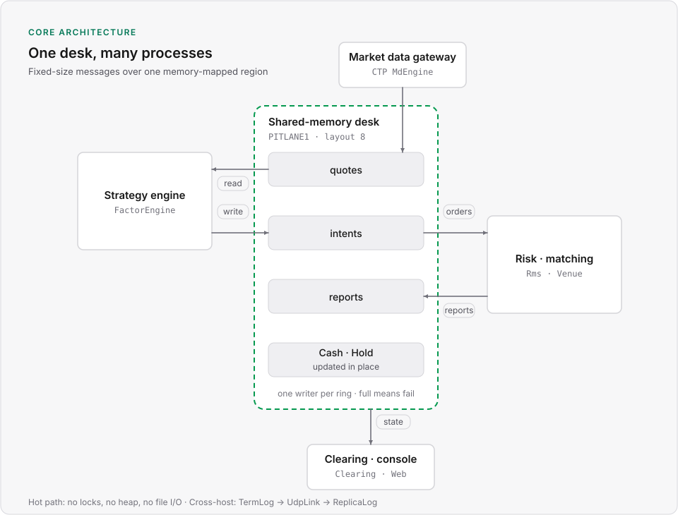

One file mapping (`PITLANE1`, `kDeskVersion` 8) holds the rings and the cash/hold rows. `desk_view` attaches only when the magic and layout match; every ring then has a single writer and one cursor per reader. A write to a full ring fails and leaves the ring unchanged — nothing grows and no unacked slot is overwritten. The sections below open that mapping, publish and read messages, run the session loop, and put orders through the paper venue.

## Console screenshots

The web console in `pitlane-trading` (page at `client/index.html`) is one page over the same rings, books, and strategy slots the C++ calls use below. These frames come from paper runs; most show four instances (one pair-spread, three factors), a finished research grid, a finished backtest, and a loaded block tape, while the trade, risk, clearing, and accounts frames are from a later session.

| Strategies | Research |
| --- | --- |
| 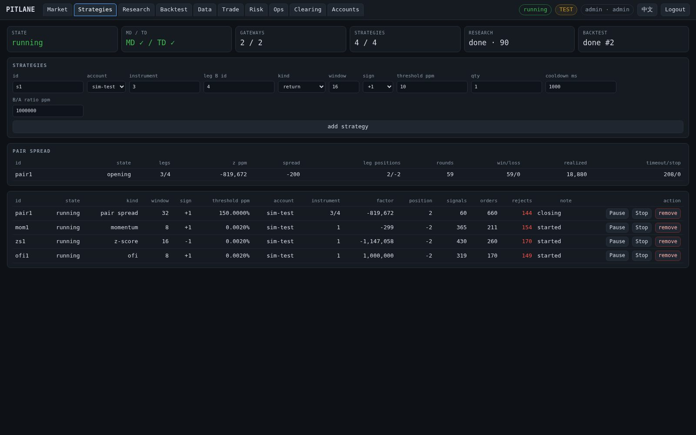 | 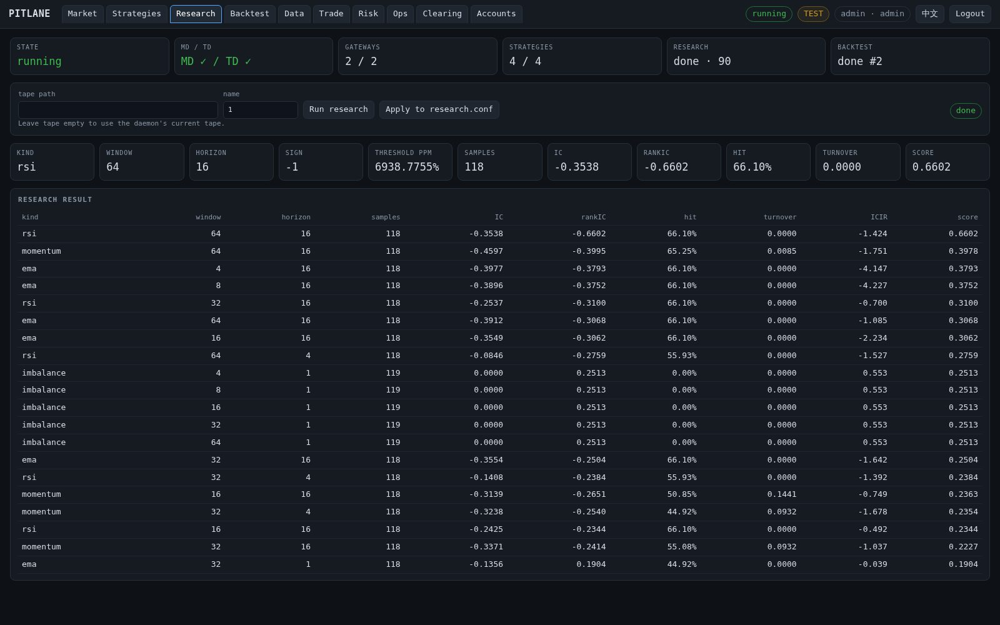 |
| 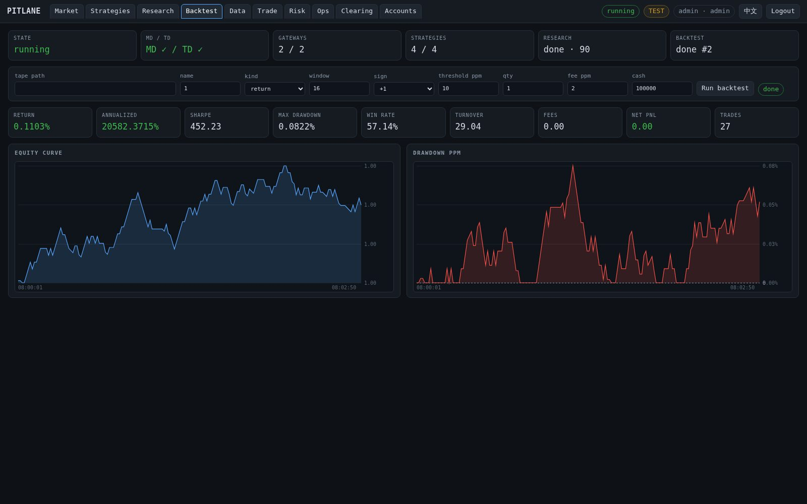 | 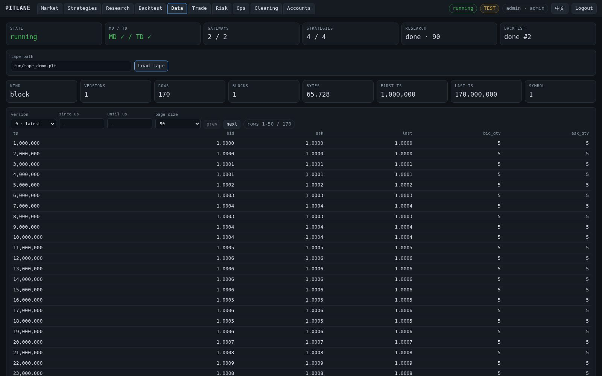 |
| 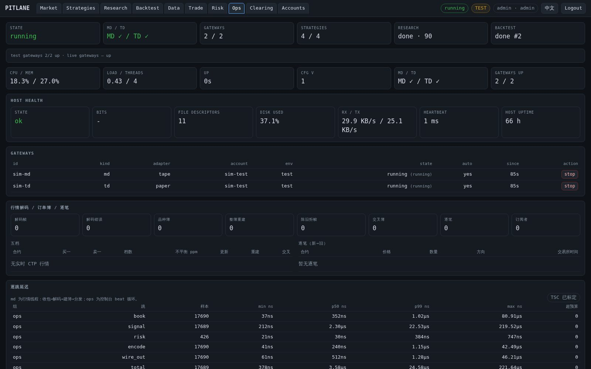 | 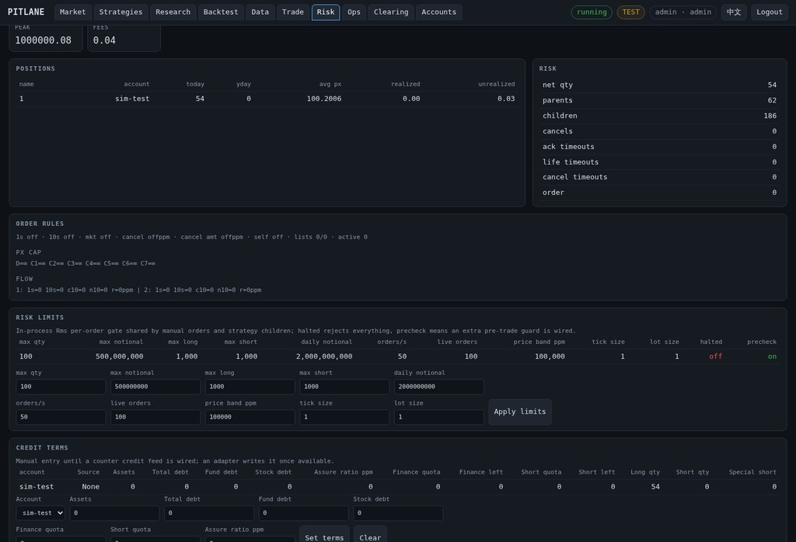 |
| 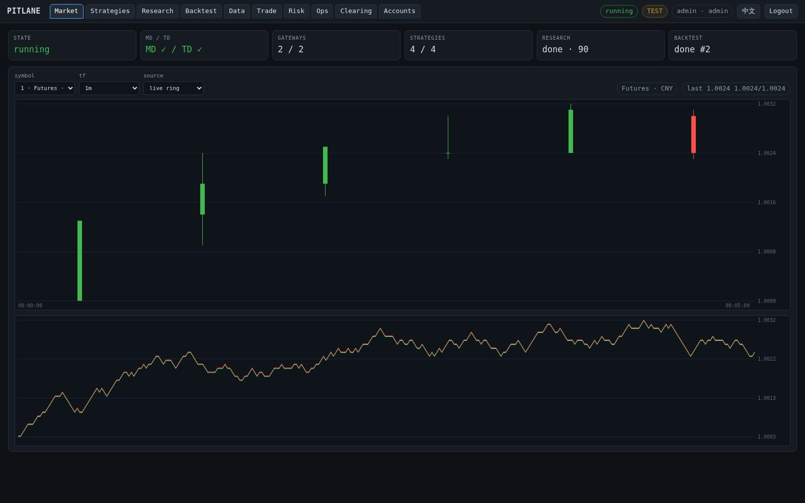 | 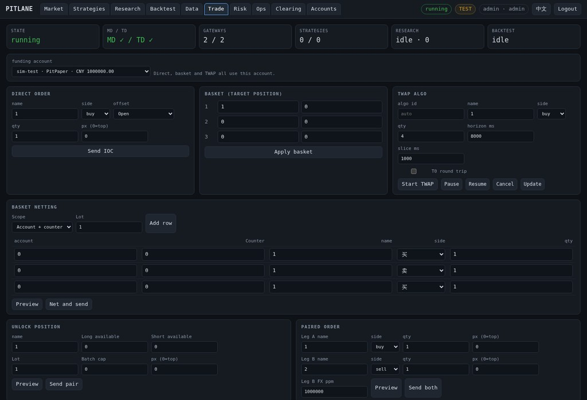 |
| 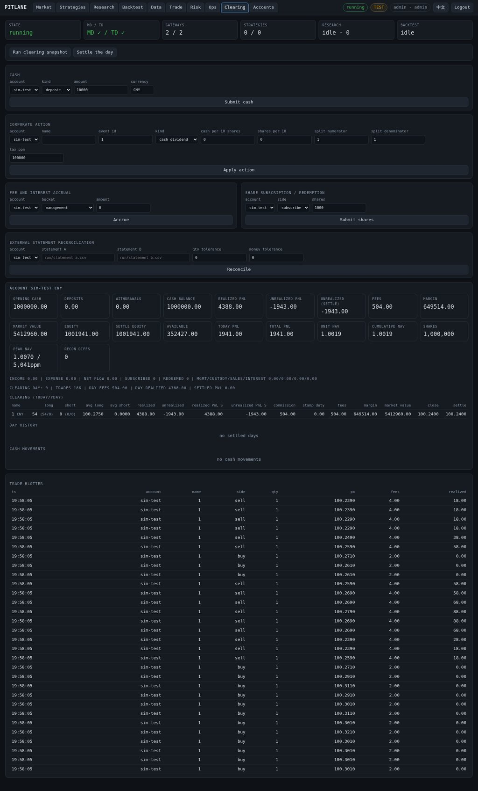 | 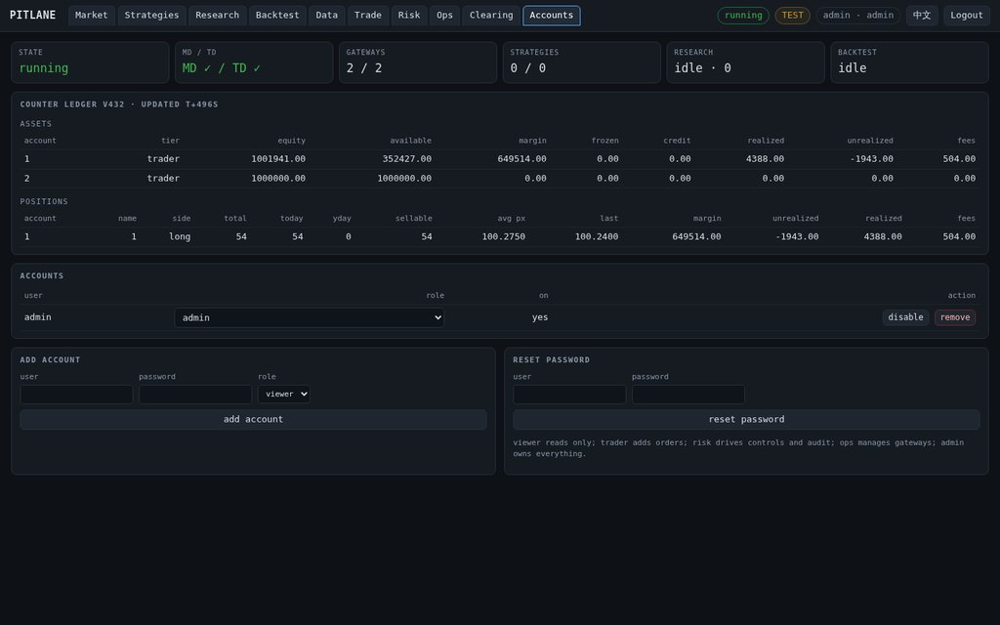 |

The Strategies tab shows the pair-spread card (spread, mean, `z` in ppm, both legs, rounds, wins, realized) next to the single-leg factor table. Research and backtest read the same tape API documented under **Tape**, and Data renders `GET /api/tape/meta`, `/rows`, and `/describe` from a block tape.

## Startup configuration

All tunables that the library accepts at process start live in an optional INI-like file (`pitlane-trading/conf/paper.conf` is a working program config). Defaults are the member initializers on `PitConf` in `desk/config.hpp`. Omit a key, or leave the value empty, to keep that default. Unknown keys are ignored. Hard parse errors (truncated line, non-numeric where a number is required) make `conf_load` return false.

Broker `ack_limit_us` / `life_limit_us` / `pull_limit_us` default to `60000000` (60s), matching a typical 60-second heartbeat. Set a limit to `0` to turn that axis off. Host defaults enable `thp_disable` and `mlockall`. Desk FanRing soft caps stay at the compile-time maxima (`kIntentCap` …). Large symbol/quote pools live in the separate `[yard]` / `Yard` map (sized once at startup; hot path does not allocate). Basic-data tables and topic routing are local (`seed_facts` / `TopicBus` / `RouteBook`); the library stores no connection strings or broker URIs.

`conf_normalize` runs once after load. It clamps ring capacities to a power of two in `[2, compile-time Cap]`, restores compile-time-only sizes (`QueryFold`, `BrokerWatch::kCap`) with a hint, and writes one human-readable line per adjustment into a caller buffer. Print those lines at startup. The hot path never opens the file again.

```cpp
pitlane::PitConf conf{};
if (!pitlane::conf_load("/etc/pitlane.conf", conf)) return 1;
char hints[1024]{};
if (pitlane::conf_normalize(conf, hints, sizeof hints) > 0) {
    std::fputs(hints, stderr);
}

pitlane::MapOpt mop = pitlane::conf_map_opt(conf);
pitlane::MapInfo map{};
if (pitlane::map_create("desk.bin", pitlane::desk_bytes(), &map, mop) != 0) return 1;
pitlane::Desk* desk = pitlane::desk_view(&map, 1);
if (!desk) return 1;
if (!pitlane::desk_apply_conf(*desk, conf)) return 1;  // FanRing::tune, empty desk only
```

`conf_map_opt` / `conf_arena_opt` / `conf_risk_caps` / `conf_yard_plan` / `conf_study_plan` copy the normalized fields into the option structs used by map, arena, risk, yard, and study helpers. `desk_apply_conf` calls `FanRing::tune` on each desk ring while the ring is still empty. Soft capacity never grows past the compile-time slot array; the on-disk `Desk` layout stays `kDeskVersion`.

| Section | Keys (summary) |
| --- | --- |
| `[map]` | `hugepage`, `lock`, `prefault`, `numa_node`, `hugepage_dir` |
| `[arena]` | `hugepage`, `lock`, `prefault`, `numa_node` |
| `[desk]` | `intent_cap` … `query_cap`, `cash_cap`, `hold_cap` |
| `[broker]` | `max_qty`, `max_notional`, `max_live`, `*_limit_us`, `watch_cap` (hint-only) |
| `[query]` | `engines`, `accounts`, `queue`, `kinds` (hint-only; compile-time) |
| `[host]` | `cpu`, `policy`, `priority`, `nice` / `set_nice`, `hugepages`, `thp_disable`, `mlockall`, `numa_node`, `irq_list` |
| `[shed]` / `[pace]` | StayShed / TokenBook–GCRA defaults for the caller to construct |
| `[yard]` | `sym_slots`, `quote_lanes`, `quote_depth`, `order_*` / `trade_*` / `rebuild_*` / `mix_*` lanes and depths (depths power-of-two), `base_info_cap`, `trade_time_cap` |
| `[study]` | `signal_pools`, `sample_pools`, `factor_pools`, `nonstruct_pools`, `sample_depth`, `factor_depth`, `nonstruct_depth` |

`conf_load_ex` reports the failing 1-based line. `conf_apply_host` is best-effort. `cash_apply_conf` / `hold_apply_conf` soft-tune row boards.

## Open a shared desk

One file mapping holds the desk. The writer creates it. Other processes attach to the same path.

```cpp
pitlane::MapInfo map{};
if (pitlane::map_create("desk.bin", pitlane::desk_bytes(), &map) != 0) return 1;
pitlane::Desk* desk = pitlane::desk_view(&map, 1);
if (!desk) return 1;
```

`map_create` creates or extends the file and does not wipe an existing mapping. The default `MapOpt` uses explicit huge pages only: length rounds to Hugepagesize, and the file is placed on hugetlbfs (default `/dev/hugepages` as `pitlane_<basename>`), or at the caller path when that path is already on hugetlbfs. THP / `MADV_HUGEPAGE` are never used. When explicit pages are unavailable the mapping falls back to the caller path and sets `MapInfo::fallback`. `mlock` is attempted by default; `numa_node >= 0` binds the range with `MPOL_BIND`. `desk_view` returns the desk only when the magic is `PITLANE1` and the layout version is `kDeskVersion`, which is 8. The second argument formats a still-blank file when it is non-zero. A file with the wrong magic is left untouched and the call returns null. After the magic is written, do not format the mapping again.

Another process attaches with `map_attach` and passes 0 to `desk_view` (same logical path so both sides resolve the same hugetlbfs file). `map_release` unmaps; if the mapping was locked it calls `munlock` first, then closes the file. Each ring has one writer. Readers do not share a cursor.

`desk->clock_us` is the session clock in microseconds. `DeskLoop::beat` stores the time it is given there.

## Symbol / quote yard

`Yard` is a separate startup map (magic `PITYARD2`, layout `kYardVersion` 2) for startup-sized pools: dense symbols, quote / order / trade / rebuild / mix tapes, plus `YardFacts` and `YardHours` tables. Defaults: (`sym`/`quote` 150000×256, order/trade lanes 10×32768, rebuild 10×128, mix 10×32768, facts 35000, hours 500). `yard_open` sizes once; claim / bind / publish / latest paths never allocate. Full pools fail closed. Names are pitlane-owned (`YardTick`, `YardPrint`, `YardFacts`, `YardHours`).

```cpp
pitlane::YardPlan plan = pitlane::conf_yard_plan(conf);  // or a tiny plan in tests
pitlane::YardView yard{};
if (pitlane::yard_open("yard.bin", plan, &yard, pitlane::conf_map_opt(conf), 1) != 0) return 1;
uint32_t id = pitlane::yard_claim_sym(yard, "IF2501");
if (!id || !pitlane::yard_bind_quote(yard, id) || !pitlane::yard_bind_order(yard, id)) return 1;
pitlane::YardMark mark{/* bid/ask px qty, ts_us */};
if (!pitlane::yard_publish(yard, id, mark)) return 1;
pitlane::YardTick tick{/* px qty side ts_us */};
if (!pitlane::yard_publish_tick(yard, id, tick)) return 1;
```

`conf_study_plan` copies study-scale defaults for caller-side `FactorSeries` / `NamedFactorRing` sizing (not a shared mmap).

## Publish and read

`Desk` contains nineteen rings: `intents`, `reports`, `quotes`, `algos`, `controls`, `ctl_acks`, `ext_ords`, `pulses`, `prints`, `queries`, `ledger_assets`, `ledger_positions`, `pack_reqs`, `pack_rsps`, `logs`, `subs`, `signals`, `mkt_ords`, and `rebuilds`. Compile-time capacities track trade / package scale: `kIntentCap`/`kReportCap`/`kAlgoCap` 32768, `kQuoteCap` 8192, `kControlCap`/`kExtOrdCap` 16384, `kPulseCap`/`kPrintCap`/`kSigCap`/`kMktCap`/`kCtlAckCap` 4096, `kQueryCap` 1024, `kPackReqCap`/`kLogCap`/`kSubCap`/`kRebuildCap`/`kLedgerCap` 2048, `kPackRspCap` 16384. Soft capacity after `desk_apply_conf` / `FanRing::tune` is at most that size and is reported by `capacity()`. Cash and positions occupy `cash` (`kCashCap` 512) and `hold` (`kHoldCap` 4096).

`publish` takes the message and a reader mask. A mask of 0 means the first reader to acknowledge the slot claims it. Any other mask lists the readers that must acknowledge before the slot can be reused. Reader numbers are 0 through 63. The session loop is reader 7, `kLoopReader`.

```cpp
pitlane::Intent in{};
in.tag = 1;
in.name = 1;
in.acct = 2;
in.px = 100;
in.qty = 5;
in.stamp_us = 1;
in.side = static_cast<uint8_t>(pitlane::Side::Buy);
in.act = static_cast<uint8_t>(pitlane::Act::Enter);
in.style = static_cast<uint8_t>(pitlane::Style::Day);
in.off = pitlane::Off::Open;

const uint64_t readers = 1ull << pitlane::kLoopReader;
if (!desk->intents.publish(in, readers)) {
    // The ring is full. The new order was not stored.
}
```

A reader copies one slot with `at`. The position is absolute, starting at 0. `fresh` is true when this reader has not acknowledged it. `ack` records that acknowledgement. `latest` copies the newest published item. `tail` is the next position a writer will use.

```cpp
pitlane::Intent got{};
bool fresh = false;
if (desk->intents.at(0, pitlane::kLoopReader, got, &fresh) && fresh) {
    desk->intents.ack(0, pitlane::kLoopReader);
}
```

`Intent::off` is one of the seven CTP offset codes — `Open 0`, `Close 1`, `ForceClose 2`, `CloseToday 3`, `CloseYday 4`, `ForceOff 5`, `LocalForceClose 6` — that decides whether the child opens or closes, and it occupies bytes the record already reserved, so an `Intent` stays 56 bytes. The force reason sits in `Intent::force_reason` (CTP `THOST_FTDC_FCC_*`) and comes back in `Report::cause`; a `Report` is 64 bytes. `ManualBook::direct` takes an offset, a basket or T0 child whose side reduces the signed net is marked `Close` and capped to the closable quantity, and a plain close is normalized to the product class at the counter. `Intent`, `Report`, and `Quote` are defined in `desk/types.hpp`. `Intent::hedge` selects speculation, arbitrage, hedge, or covered. The other slot types — `AlgoJob`, `AlgoRung`, `ControlNote`, `ControlAck`, `ExecNote`, `ExtOrder`, `LedgerAssetNote`, `LedgerPositionNote`, `Pulse`, `TapePrint`, `QueryNote`, `SubNote`, `SigNote`, `MktNote`, `PackageNote`, and `LogNote` — are defined in `desk/wire.hpp`. `publish_exec` publishes an exercise (kind 1) or abandon (kind 2) request that `TdEngine` hands to `TdClient::exercise`. A payload larger than those slots uses `Parcel<Bytes>` on a ring the caller owns. `publish_parcel` fails when the length is greater than `Bytes`. Hot path may `desk_log_publish` a `LogNote`; cold side drains the `logs` ring. `WireLog` is the process logger: `log` packs one `PackedLine` (literals via `lit`, dynamic strings copied, scalars memcpy'd) into a fixed fail-full ring and does not format. A background thread, or `flush` in caller mode, turns the slot into text. Put the file on tmpfs when the disk must stay off the hot path.

## Run the session loop

`DeskLoop` drains the rings as reader 7, fires timers, and stops when it sees a control message whose `kind` is 1. `beat` returns immediately once the loop has stopped. A timer id of 0 is rejected. A timer with `every_us` of 0 fires once. There are 32 timer slots.

```cpp
void on_quote(void*, const pitlane::Quote&) {}

pitlane::DeskLoop loop;
loop.add_timer(1, /*when_us=*/1000, /*every_us=*/0);
pitlane::LoopHooks hooks{};
hooks.on_quote = on_quote;
loop.beat(*desk, /*now_us=*/1000, hooks);
```

The hooks are function pointers: `on_quote`, `on_report`, `on_pulse`, `on_print`, `on_algo`, `on_query`, `on_pack_req`, `on_pack_rsp`, `on_log`, `on_control`, and `on_timer`. Only the hooks you set are called. Messages published for this loop must include reader bit 7, or use a mask of 0.

## Prepare an order

`IdMint` builds a restart-safe id. The fields are site, kind, the last digit of the trading day, a ten-second slot, and a serial number, packed into one 64-bit integer. The kind is defined by the caller.

```cpp
pitlane::IdMint mint(/*site=*/1, /*kind=*/1);
uint64_t tag = mint.next(/*day_index=*/4, /*sec_of_day=*/10 * 3600);
```

`normalize_gate` fixes offset and direction before an order is stored. Cash products are forced to open. On SHFE and INE a plain close becomes close-yesterday. On the other futures exchanges, close-today and close-yesterday become a plain close. Offsets use the seven CTP codes (open, close, force close, close today, close yesterday, force off, local force close); the force codes book as a close but keep their own value. Wire sides 0–7 are ordinary and credit trades (buy, sell, margin buy, short sell, sell-to-repay, buy-to-cover, subscribe, redeem), 8–14 are cash repay, return stock, odd-lot transfer, collateral in/out, lock, and unlock, and 17–18 are split and merge orders; only the first eight carry a direction and the rest land in `GateResult::biz`. Price modes are limit, market, opposite-best, and own-best, and only a limit needs a price. A limit price of 0 is rejected. `Why` on the result says why.

```cpp
pitlane::GateForm form{};
std::snprintf(form.symbol, sizeof form.symbol, "rb2410.SHF");
form.side = static_cast<uint8_t>(pitlane::Side::Sell);
form.off = static_cast<int8_t>(pitlane::Off::Close);
form.px_mode = static_cast<int8_t>(pitlane::PxMode::Limit);
form.px = 3500;
form.qty = 2;
pitlane::GateResult gate = pitlane::normalize_gate(form);
```

`split_lots` turns one futures quantity into slices. The modes are `TodayThenYdayThenOpen`, `CloseOnly`, and `YdayThenStop`. Any other mode returns -1. A slice above the maximum lot is cut, and a slice below the minimum lot is dropped. `split_against` closes the opposite book first. `CloseStyle::SplitYday` (SHF, INE) separates today and yesterday. `Plain` uses one close. Quantity that those closes cannot cover opens, still cut by the maximum lot.

`commodity_plan` and `index_plan` each return one next order toward a target. Where today and yesterday are split, yesterday is closed first. `index_plan` uses yesterday equal to position minus quantity opened today. `plan_px` uses the ask for a buy and the bid for a sell. `next_child_qty` sizes the next child from the completion curve. A lag is shared by `share_ppm`. Once the parent is ahead by about a tenth, counting quantity already in flight, the next child is zero. `price_at_quote_vwap` is the touch VWAP, or one rung on the side the order would take, aligned to the tick. `pre_px`, `post_px`, and `chasing_px` return a price from that book only.

`lock_future` and `lock_cash_sell` freeze the quantity a close or a stock sell needs. `book_fill` applies a fill back onto today, yesterday, and the total. `apply_open_fill` increases the total and leaves yesterday unchanged, so the new quantity is today. `apply_close_fill` reduces the total; a plain close consumes free yesterday first, and a close-today leaves yesterday alone. `roll_session` moves the whole remaining book into yesterday. `add_session_us` adds time only inside continuous sessions.

## Match on the paper venue

`PaperVenue` handles 256 names, `kNames`, and 1024 live orders, `kTickets`. A name must be less than 256. An order is judged only after its send delay has elapsed, against the book at that moment. A cancel waits for its cancel delay.

```cpp
pitlane::VenueCfg cfg{};
cfg.lot = 1;
pitlane::PaperVenue venue(cfg);
const pitlane::Rung asks[] = {{100, 5}};
venue.set_levels(1, nullptr, 0, asks, 1);

pitlane::Report reps[4]{};
pitlane::VenueOut out = venue.admit(in, in.stamp_us, reps, 4);
```

`on_ext` matches resting orders to prints that carry a sequence and bid/ask order numbers. `print_hits` requires the print to be at or after the order, and strictly through the slipped limit when `rigid` is set. `same_side_print` is true when that side's order number is the later one. A same-direction print still counts, filled at the print price. The other direction counts at the order price. `match_quote` is the active path: a buy that reaches the ask, or a sell that reaches the bid, takes shown size. One print's quantity is shared across resting orders.

`admit` writes reports into the caller buffer and sets `out.why`. With `VenueCfg::trade_open=0`, new enters fail with `Why::Closed`. `on_clock` promotes staged orders whose delay has elapsed and completes cancels that are due (skipped while `hang` sticky). `on_print` and `on_tape` reduce the quantity ahead of a resting order; with `VenueCfg::rigid` set, `tape_keep` drops same-side aggressor prints. `force_fill` / `force_pull` / `force_deny` / `drill_apply` cover forced injects via `DrillCue` (`Closed` = 10, session closed). `TouchMode` / `resolve_px` pick opp/own/last/mid/best5. Aggressor 0 keeps every print. `on_shown` applies later displayed-size changes without double-counting a trade.

PitConf `[venue]` takes nine go/pull lags as integer microseconds (`go_usN` / `pull_usN`) or fractional seconds (`go_secN` / `pull_secN`), plus `rigid`, `tape_first`, lot/rate/notional, and `cancel_pow_x1000`. Use `conf_venue_cfg` to build a `VenueCfg`.

`Center::step` is the trading-center loop (trading-center process role): optional `TapeMd` or a live `MdEngine`, quote tops into `PaperVenue`, `StratEngine`, then a ready `TdEngine` or `TradeLane`. It stores `now_us` on the desk clock. `RouteAllow` with zero bits is NoFilter. A heartbeat publishes a `Pulse` on topic `hb`. `TapeMd` replays a caller-owned quote array.

`Engine` is the shared process role: `set_up`, `pre_run`, `loop_task`, `post_run`, timers, control notes, a symbol table, and `housekeep`. `MdEngine` drains `subs` (quote, signal, rebuild, market order, market trade). Five failed subscribes in a row stop further sends. `copy_subs` copies the id list before a later send. `write_quote`, `write_print`, `write_signal`, `write_factor`, `write_mkt`, and `write_rebuild` are the gateway writes. `TdClient` is the counter surface a gateway implements (`insert`, `cancel`, `on_algo`, `query_asset`, `query_position`). `TdEngine` runs orders, then asset and position queries, then algo jobs, then `BrokerWatch` timeouts. `risk_filter` can deny an enter before the client is called. `StratEngine` is the strategy and its context: it picks reports, quotes, rebuilds, market orders, prints, algo jobs, query replies, and signals, and it publishes orders, subscriptions, and queries. `order_precheck` drops a child with a bad size, side, id, or time. Broker sockets are not in this library. A CTP gateway belongs in the program that subclasses these types, as `pitlane-trading/adapters/ctp` does.

`SimRole` names the four paper roles (tape, quote adapter, trader, matcher). `order_delay` and `tape_speed` control replay timing. `timer_due` runs due matches and cancels. `adjust_offset` is the derivative close-then-open split.

Composition helpers (still allocation-free on the hot path): `FeedHub` into Yard/Desk; `TradeLane::lane_beat` for paper TD; `StratHook` onto `DeskLoop` (including algo/package/log/pause); `seed_cash` / `seed_hold` for account rows; `seed_facts` / `seed_hours` / `seed_holidays` plus cold `load_facts` / `load_hours` / `load_holidays` for local basic-data tables; `TopicBus` for same-machine topic pub/sub; `RouteBook` for strategy→algo binding. `pulse_bridge` fans `PulseBoard` into desk `pulses`.

`Style::Day` fills the whole remainder at its limit, even past the size shown there. `Style::Passive` expires if it would cross. `Style::Immediate` keeps only the shown size. `Style::All` expires the whole order when the shown size is short. `Style::BestFive` takes up to the shown size on the five best opposite levels and expires the rest. A self-trade against the same account stops the order.

Before 09:30 the delay tables are zero. After that, `session_band` splits the day at 10:00, 10:30, 11:00, 11:30, 13:30, 14:00, 14:30, and 15:00. `SimClock` uses those nine bands unless sample points are loaded. A negative result from `SimClock::go` means the order did not reach the book. The caller applies that result. `admit` does not read the clock itself.

`auction_clear` picks the price with the largest matched quantity. `tie_higher` selects the higher price on a tie. Otherwise the price closer to the reference is used.

## Names, signals, and the counter

`NameBook` stores at most 1024 instruments. `insert` writes an id starting at 1, and returns false when the symbol already exists or the book is full. `link` records a relation: 0 related, 1 underlying, 2 derived, 3 track underlying, 4 track derived. `set_session` allows the open minute to be later than the close minute for a session that crosses midnight.

`PulseBoard` keeps 128 subscriptions and a queue of 256. `watch` starts a subscription. `offer` fails when nothing matches or the queue is full. `drain` copies the queued pulses out.

`BrokerWatch::screen` checks quantity, side, notional, and the number of live orders. `remember` tracks a sent order. `expire` drops orders that missed their acknowledgement limit, passed their lifetime, or waited too long after a cancel. A limit of 0 or less turns that check off.

`QueryFold` accepts at most 32 engines and 64 accounts, with 16 queued requests per engine and 8 query kinds. `push(engine, acct)` keeps the old acct-only path. `push(engine, acct, kind, page)` stores an optional page token; out-of-range engine, account, kind, or a full queue fails closed. `fold` merges the queues. `pending` lists each account once. `pending_kind` lists distinct `(acct, kind)` rows with the last page token; a short output buffer returns -1. The library does not sleep between pages. The caller decides when to query again.

`session_date` moves a clock reading onto its trading day. From 08:00 through 18:00 the shift is 0. After 18:00, Monday shifts back 3 days and other days shift back 1. In the early morning, Monday shifts back 2 days and other days shift back 1. Weekends and days in `ClosedDays` are then skipped.

## Helpers

`QuoteFold::apply` writes a batch of `Add`, `Set`, and `Del` edits. One invalid edit leaves the previous levels in place. `copy` returns the best price first. `PrintLog::push` stores a print and does not take a book. `DayRoll::on_msg` updates the current minute and returns false when the timestamp moves backward. Time is microseconds. A minute older than one day is dropped.

```cpp
pitlane::QuoteFold<8> book;
const pitlane::FoldEdit edits[] = {{pitlane::FoldOp::Add, 1, 10, 4}};
book.apply(edits, 1);
```

Side 1 is the bid and side 2 is the ask. `Add` fails when that price already exists. `Set` with quantity 0 removes a level. `Del` of a missing price succeeds.

`band_at_hold` keeps a price that sits exactly on the next band's start in the lower band. `walk_up` and `walk_down` then take ticks from that band. After a step lands on the next start, later steps use the new band. `clamp_px` applies only when the upper limit is above the lower limit. `TickGrid` holds up to ten bands plus limit prices and caches the last band index on the hot path. `span_index` returns the span that contains a minute, or -1. An overnight span has an end at or before its begin. `session_part` returns open, lunch, or closed for a `SessionRow`.

`life_next` returns the next `Phase`. `Phase::None` means the event is not allowed from that phase. A fill while a cancel is waiting stays in `PullWait`. `Resume` and `ResumePartial` move a rejected cancel back to working or partial.

`margin_need` is multiplier times price times quantity times the margin numerator, divided by the margin denominator. `charge_class` uses the cash formula for stock, bond, fund, tech, index, and repo, and the rate formula for the other products. `scale_of` supplies the multiplier and the margin fraction.

`rest_room` is the quantity still allowed to rest on one leg. When both legs are sent together the result is 0. `cut_hedge` reduces the other leg after one leg is cut. `slice_weight` rounds half up and returns false when the new slice is not positive. `align_leg` divides by the feed coefficient and rounds to the tick, half up. `pair_qty_ok` requires 180 on a 688 or 689 code and 80 on other Shanghai or Shenzhen codes. `chase_px` walks the price up for a buy and down for a sell.

`IdBind::put` stores a pending link and fails when the table is full or the counter key already exists. `confirm` marks it linked. `erase` leaves a tomb so a later put can reuse the slot. A local id of 0 is rejected.

`bind_fill` accumulates quantity and amount on the early fields while the order is still unset, sent, or acknowledged. `bind_status` copies those fields into the order and turns an acknowledgement with a fill into a partial. `bind_final` holds a filled or cancelled status while the local remainder is still above the counter remainder. `bind_catchup` applies that status once the remainder is 0. `quote_repost` is false while a cancel is out and the new price equals the fill price.

`lane_accepts` reads a `LaneRule`. A pull needs `pull`. An enter needs the price type and the offset bit. `lane_can_amend` reads `amend`. `Cause` values from 10 are field checks, from 40 are cash and position, from 70 are risk, and from 100 are outside this process. `cause_band` returns that group. `cause_text` is a short fixed word.

`list_cause` checks the open list or the close list. `FlowWindow::allow` counts the new event and allows it only while the count is still below `limit`. The span is in the same unit as the timestamps. `count_ratio_ok` passes when the sample is still below `min_n`, and a ratio equal to the cap also passes. `cash_ratio_ok` fails when the cash ratio is equal to the cap. `cancel_ok` and `reject_ok` fail on an equal ratio. `fill_ok` passes on an equal floor. `px_shift` is the signed distance from the last price, scaled by `den`. `deviation_cause` uses the absolute distance. `wash_hit` matches the same instrument and the opposite side when the account matches, or when the group is not 0 and matches. The prices must meet or cross.

`ByteFrame::begin` reserves four bytes. `end` writes the payload length there and returns the total size, or -1. `frame_read` fails when the buffer is shorter than that length. `seq_feed` returns 0 for the next id, a positive gap when ids were skipped, and -1 for an old id. The first id starts the watch. `SeqHold::start` sets the next id that `take` will release. `offer` keeps an id only inside the next `Cap` ids. `SpanMark::mark` rejects a negative tick. `between` fails while either node is unset.

## Caller-owned helpers

These calls do not attach to the desk. The caller keeps the storage, passes the numbers, and decides what to do with the result.

`IdSlip::issue` returns the next id. `undo` returns that id only while it is still the latest one and `keep` has not been called. `WireMold::seal` copies a prefix into the caller's buffer. `put_u64` and `put_i64` write little-endian bytes at an offset inside that prefix. `read_block` accepts a block at least `know` bytes long and rejects a shorter one. `block_end` steps past the declared block, including bytes this build does not read.

`StayShed::drop` uses the caller's time unit. A stay below the target clears drop mode. The first stay at or above the target starts the window and is kept. After the window, a late item is dropped. A stay below the target leaves drop mode.

`floor_chunk` moves a negative tick away from zero to the block start. `ChunkMap<Ticks,Blocks>` keeps quantity in blocks of `Ticks` prices, with at most `Blocks` blocks. `Ticks` is 8 to 256 and a multiple of 64. `Blocks` is 1 to 64. A quantity of 0 clears a tick. A new block is taken only for a positive quantity. A full directory fails and leaves the old quantities in place. `chain_link` appends a caller-owned node and returns a slot plus its reuse count. `chain_unlink` fails when the reuse count does not match. `chain_zero` leaves the node linked with quantity 0. `chain_take` reduces that quantity.

`ticket_pull` and `ticket_amend` run only from `Working` or `Partial`. Each one stores the previous ticket and bumps the revision. `ticket_rewind` restores that snapshot only while the revision is still the one written by the command. `ticket_fill` also bumps the revision, so a fill blocks a pending rewind. A fill during `PullWait` stays in `PullWait`.

`slice_open` divides a parent quantity by the number of intervals in the horizon, at most one million cuts. When one cut would be below the lot and the total still covers one lot, the plan becomes a single cut. The last cut receives the remainder. `slice_poll` waits until the due time. `slice_restore` returns an unfinished child to the pool. `slice_late` adds the fill, takes what it can from the pool, and returns how much was removed from children already scheduled. `basket_make` accepts `Create`, `Pause`, `Resume`, `Stop`, and `Update`. The kind is at most 15 characters. A byte count above `max_bytes` fails. The payload itself is not stored.

`recon_fill` applies one venue fill id once. An unknown order is built from `size` and reported as an acknowledgement, then a fill. Quantity past the order increments `over` and is not added to `filled`. A repeated id emits `Dup` and does not change the order. `recon_cancel` marks a known, unfinished order cancelled.

`FlightQueue<Cap>` holds 2 to 64 commands, ordered by due time. `push` fails when the queue is full, or when the tag or the instrument is 0. `take` removes only commands for that instrument whose due time has arrived.

`BarFold` ignores a tick the caller marks as not tradable, a non-positive price, a negative quantity, or a negative timestamp. The bucket is the timestamp minus its remainder modulo the span. A later bucket closes the current bar. An older tick is rejected and the bar stays. Empty spans are not created. `seal` emits the bar that is still open.

`act_mul` uses `jump_den / jump_num` as the price multiplier. A cash dividend changes that factor only when `income` is set, and only when the previous close is above the dividend. `mul_fold` multiplies actions whose `ymd` is at or before the as-of date. `scale_px` truncates toward zero. `traded_move` returns the price change after the raw jump is removed. A 1-into-2 split uses jump `1/2`. When the ex price is exactly half of the previous close, the traded move is 0.

## Frames, pacing, and snapshots

These calls do not open a socket and do not send an order. The caller keeps the bytes, the clock, and the decision.

`digest_of` covers the bytes it is given. `Sum8` is the low 8 bits of the sum. `Crc16` is CRC-16/CCITT-FALSE. `Crc32` is the ISO-HDLC CRC-32. `digest_write` stores that value little-endian. `StreamAsm<Cap>` appends into its own buffer, with `Cap` from 16 to 65536. `FrameSpec` reads a little-endian body length at `len_off` inside a header of 4 to 32 bytes. `pull` waits until the header, body, and checksum are all present. A body longer than `max_body`, or a frame that cannot fit, returns `BadLen` and leaves the buffer unchanged. A bad checksum returns `BadDig`, drops that frame, and keeps the bytes after it. A good frame stays at the front until `commit`. `append` fails while a frame is still held.

`SeqGate<Cap>` keeps 2 to 64 later sequence numbers. `start` sets the next expected number, and 0 is rejected. `live` releases a number only when it is exactly the next one. A hole records the missing range and parks the later number. A live number inside the open hole is ignored. `replay` accepts only the next missing number. When the hole is filled, consecutive parked numbers are released, and a later hole is opened if the side list still has one. A full side list or a short output buffer leaves the gate unchanged. The gate does not send a resend request.

`token_open` fills a bucket to `burst`. `token_take` adds `rate` tokens for each `per` units of time, capped at the burst. Time that moves backward does not add tokens. A request above the burst fails. `gcra_open` stores an interval and a tolerance. `gcra_allow` passes when `now + tolerance` reaches the theoretical arrival time, then moves that time forward by one interval. `TokenBook` and `GcraBook` hold 1 to 64 keys. Key 0 is rejected. A new key is refused when every slot is still inside the idle time. An idle time of 0 never reuses a slot. A failed first take does not keep the new key.

`sign_ready` is true when the reject count is 0 and the pass count has reached `need`. A later pass does not clear a reject. `sign_reset` clears both counts and leaves `need` as it is. `hold_reserve` on an opening order takes the quantity and one cancel credit. A closing order takes neither. `hold_cancel` applies to an opening hold and returns the unfilled quantity. The cancel credit is returned only when `rejected_here` is set. `hold_done` returns that credit when an opening order is fully filled and the fill is not marked outside. `hold_late` on an opening order returns the unfilled quantity and the credit. On a closing order it only clears the hold. `hold_cancel_late` returns the credit and leaves the hold open, so a later full fill does not return it again.

`key_num` and `key_text` keep the interface name with the counter key. A numeric key and a text key are not the same. Text longer than 23 characters, or an interface name longer than 15, is rejected and the previous key is left unchanged. `AckBook<Cap>` holds 2 to 64 rows. `put` fails when the table is full or the key is already present. `link` moves a row from waiting for a place acknowledgement to linked. `arm_cancel` starts the cancel clock from the linked state. `sweep` lists due local ids and does not change the rows. A row is due when its age is greater than its own limit. A second sweep inside `gap` returns no rows. A short output buffer leaves the sweep clock unchanged.

`lat_mark` stores a non-negative tick only when marking is enabled. `lat_span` fails while either node is unset. `skew_sample` stores half of the desk time minus the local time, with integer division toward zero. `skew_apply` adds that integer. `LatHist<Buckets>` uses 4 to 32 buckets. A value of 0 or 1 lands in bucket 0. Larger values use the highest power of two that is still inside the value, and the last bucket holds anything above it. `cum` adds the counts from bucket 0 through the given bucket.

`SnapPub<T, Slots>` stores 2 or 3 inline slots. One writer calls `begin_write`, fills that slot, and `publish` makes it visible. `pin` holds the published slot for one reader. A second pin fails until `unpin`. With 2 slots, a write fails while the reader still holds one and the other is published. With 3 slots, the writer may replace a slot that was published and then passed over. The library does not start a thread.

`SigBook<Buckets, Keys>` uses a power-of-two bucket count from 2 to 256, and 1 to 1024 keys. Each bucket has 8 slots. A signature of 0 means empty, and a computed 0 is stored as 1. The signature is written after the key index. `find` returns a 1-based index, or 0. `find4` looks up four keys; both buckets for each key are prefetched before matching. With SSE2, all eight signatures in a bucket are compared in one vector step. `put` of a key that is already present returns true. When both buckets are full, an insert moves an older key toward its other bucket at most 8 times. If that fails, the previous keys remain. One writer inserts.

`Grace<Readers>` tracks 1 to 64 readers. `online` records the current epoch. `offline` stores 0 and that reader no longer blocks. `quiesce` records the epoch after the caller has dropped shared pointers. `bump` advances the epoch and returns the new value. `elapsed` returns false while any online reader is still behind, and it does not wait. A caller who is also in the reader list must `quiesce` before `elapsed`, otherwise that caller is still behind. `RetireList<Cap>` holds 2 to 64 tokens in insertion order. `reap` releases a prefix of tokens that have elapsed and stops at the first one that has not. A short output buffer leaves the list unchanged. The list does not free the caller's memory.

## Cycles and fixed low-latency tables

These calls do not open a socket, do not send an order, and do not start a thread. The caller owns the storage and the thread that advances it.

`cycles_read` reads the cycle counter. `cycles_ordered` reads it after earlier instructions have retired. `cycle_gap` fails when the end is earlier than the start. `load_fence`, `compiler_fence`, `cpu_relax`, and `keep` sit around a measurement. `CycleProbe::arm` names how many warmup samples to drop. `begin` fences and reads. `end` returns 1 when the sample should be kept, 0 during warmup, and -1 when the read fails or moves backward.

`UsSlot` occupies one cache line. `us_store` publishes a microsecond count with release. `us_load` reads it with acquire. The caller writes the slot. A probe does not call a clock.

`scale_set` stores a multiplier and a shift from a cycle count and a nanosecond count the caller measured. Both counts must be positive, and the cycle count must fit the wide division. `scale_ns` computes `(cycles * mult + half) >> shift`, rounding to the nearest nanosecond. `scale_span` converts a forward cycle gap and fails when the end is earlier.

`DutyPace::open` stores a fast gap, a slower gap, and how many cycles make one millisecond. `step` returns skip, fast, slow, or timeout. It does not poll a descriptor. `deadline_at` adds an offset to an origin and fails on overflow. `before_deadline` is true while that deadline is still ahead.

`lap_ns` subtracts two timestamps. A negative stamp is unset, and an end earlier than the start fails. `hop_ns` subtracts the trigger time from the time the record was written. `order_to_ack`, `tick_to_trade`, and `tick_to_cancel` use the same rule on the stamps the caller stored.

`MagHist` keeps one count per magnitude bucket. Adding a value that falls outside the table fails and leaves the counts unchanged. Percentile 0 is the smallest sample. Percentile 100 is the largest. A rank in between is the lower edge of the bucket that crosses it, with the rank rounded up. `mag_report` fills the count, the minimum, the maximum, the median, the 99th, and the 999th. `note_paced` records a duration. When the duration covers more than one interval, it also records each remainder that is still at least one interval. It keeps at most 64 notes. A longer stall returns -1 after those 64. A note that returns false stops the series.

`clock_publish` writes a cycle scale onto a page. The generation is stored odd, the fields are written, then the generation is stored even. Generation 0 means the page has never been published. A tick count of 0, or a tick count that does not fit the wide division, is rejected and the page is left unchanged. `ClockView::refresh` copies a stable even generation and stores the integer multiplier and shift. It returns false when the page is unpublished, when that scale cannot be formed, and after repeated reads that stay odd. `to_wall` converts a cycle stamp with that multiplier and shift. It does not divide on the conversion. Nanoseconds are then folded into the second.

`TickWheel<Cap>` holds 8 to 4096 timers. The free list and the pending stack each occupy their own cache line. Tag 0 is rejected. `arm` inserts on the calling thread. `post` may run on another thread. The next `take` links those timers. A timer that is not strictly after the wheel's current tick is moved to the next tick. `take` advances to the given limit and writes due tags. A short buffer stops and leaves the remaining timers in place. `cancel` removes one already linked tag. `next_deadline` is the next occupied near bucket, or the next point where a farther bucket is brought in.

`StageRing<T, Cap>` uses 4 to 1024 slots, a power of two. `acquire` fails when every slot is still owned. `finish` at stage 0 stores the body. `take` returns the next sequence of that stage. A later sequence that finishes first waits. Stage 1 publishes the freed count. Only stages 0 and 1 are accepted.

`SeqWin<Cap>` uses a window of 8 to 1024, a power of two. Token 0 is rejected. `push` returns `In`, `Dup`, `Busy`, or `Far`. A duplicate keeps the first token. A sequence more than two windows ahead is `Far` and is not stored. `pull` copies a ready prefix and then the contiguous head, and stops at a hole. When the side queue cannot hold a slide, `push` returns `Busy` and does not store the new token.

`ReadWin` tracks 8 readers. `open` rejects a window below 4. `limit` is the slowest joined position plus the window. A reader that is not sticky, and that stays behind by more than a quarter of the window for the whole hold, leaves the set. With nobody left, `limit` fails. The call does not write the caller's bytes.

`core_slot` returns the address of one core inside a block the caller owns. The stride is at least 64 bytes and a multiple of 64. A core outside the count fails.

`Urgent` occupies one cache line and holds one non-zero tag. `post` fails while a tag is still there. `take` returns the tag, or 0 when the slot is empty.

`TraceGate` occupies one cache line. `arm` stores a 16-bit event id and an on bit. `CoreTape<Cap>` writes only while the gate is on. The record index sits on its own line. The capacity is 16 to 4096 and a power of two. A full tape overwrites the oldest record. `at` fails for a record that has not been written or has already been overwritten. `SegTape<Seg, N>` uses 2 to 16 segments and 4 to 1024 records in each. A full segment is sealed when the next segment has been returned with `give`. Otherwise the writer restarts the current segment, increments the overrun count, and the push returns false. `SpikeRing<Cap>` records a gap strictly above the limit. A gap that is not above the limit returns false and does not count as a drop. A full ring increments the drop count, which sits with the writer, and returns false. The reader index sits on its own line.

`FillRing<T, Cap>` has one producer and one consumer, with 2 to 1024 slots. `claim` returns the next slot, or null when a claim is already open or the ring is full. `publish` makes that slot visible. `cancel` drops the open claim and does not publish it. `take` copies the next published slot. `take_span` copies several and advances the consumer once. Each slot occupies its own cache line.

`SendJoinRing<T, Cap>` has many producers and one consumer, with 2 to 65536 slots (power of two). `try_push` fails when the next index would catch the head. The tail word packs a generation above a 16-bit index so a wrap does not match an old compare-exchange. The payload is written after the claim; `ready` is stored with release. `try_pop` moves a cell only after an acquire load sees ready, then advances the head.

`hex_encode` writes lowercase hex and a trailing NUL. The buffer must hold both. A short buffer returns -1 and leaves the previous text. `hex_decode` checks every digit before it writes. An odd length or a bad digit returns -1 and does not write. `bytes_diff` returns the first index that differs, -1 when the ranges match, and -2 when a pointer or a length is unusable.

`Mix64` draws from the seed the caller stores. `below` consumes one draw. A limit of 1 or less returns 0. A larger limit returns a value strictly under it. `span` returns a value from the low bound through the high bound, and fails when the high bound is below the low bound. The mix is not a cryptographic generator.

`TextBuf<Cap>` holds 8 to 4096 bytes, including the NUL. A failed `put`, `put_i64`, or `put_hex` leaves the previous text. `put_char` rejects a zero byte. `put_hex` takes a width from 1 to 16 and rejects a value that needs more digits.

`SampleBox<Cap>` holds 2 to 256 samples. The mean divides toward zero. A percentile uses the nearest rank, rounded up. Percentile 0 is the lowest sample and percentile 100 is the highest. A full box, or a sum that would overflow, fails and does not store the new sample.

`StepClock::step` moves forward and rejects a negative step or a step that would overflow. `jump` may move to any time. `FailBudget::arm` allows that many successes, then `allow` returns false. `StepList<Cap>` requires a non-zero tag and a time that is not earlier than the previous push. `take` copies a prefix of due tags. A short buffer leaves the rest. `ladder_check` accepts an empty ladder. A bid must be strictly descending. An ask must be strictly ascending. A non-positive price or quantity fails. `intent_make`, `report_make`, and `quote_make` zero the output when they reject it. A quote with a bid above the ask is rejected. A bid equal to the ask is kept.

## One order sheet

`phase_text` names a phase. `sheet_open` stores a local id, a side, a price, and a quantity on a sheet the caller owns. A zero id, an unknown side, or a non-positive price or quantity is refused, and the previous sheet stays. `sheet_bind` stores a counter id once. A second, different id is refused.

`sheet_apply` moves the sheet through the life table. An event the table refuses leaves every field unchanged. A fill larger than the quantity still open is refused the same way. A fill that takes the whole remainder lands on partial, with nothing left. Finish is a separate event. Reject stores the cause the caller passes. The first non-negative stamp is kept for send, accept, and the finishing events. A negative stamp does not write. `sheet_ack_ns` and `sheet_done_ns` subtract those stamps. `sheet_line` replaces a text buffer with one line of id, side, phase, cause, quantity, filled, and left. A local id that does not fit a signed 64-bit value is refused, and the previous line stays.

`gate_ask` runs the checks for one enter or one pull and returns the first cause. A null list, rule, wash table, cash row, lot book, risk caps, watch, or flow window is skipped. An enter with a limit price requires a positive price and quantity. A symbol on the list is blocked. A channel that refuses a pull returns the pull-cap cause. A channel that refuses the price mode returns the price cause. Any other channel refusal is blocked. Deviation runs for a limit enter when the cap is zero or positive. Wash runs for an enter when the table is present. When `cash` and `cash_need` are set, `cash_enough` must hold. When `lots` and `lock_qty` are set, inventory is checked read-only (`lock_future_ok` or `lock_cash_sell_ok`). A short today book returns `NoToday`. A short yesterday book returns `NoYday`. A short total returns `NoPos`. The name list is the block list. When `fee_den` is positive on a limit enter, the freeze is notional plus the class fee (`prelock_ok`). When `risk` is set, qty / notional / live caps are applied (via `BrokerWatch::screen` when `watch` is set). The flow window is updated only after those checks pass; any earlier failure leaves the flow window and inflight side state unchanged. A window that is already at the limit returns the order-flow cause, or the pull-flow cause for a pull, and is left unchanged. The call does not send the order.

`risk_merge` takes the stricter positive limit on each axis (zero means that axis is off). `AcctRiskTab` stores per-account caps; a miss is fail-closed. `sign_begin(need)` resets a slip and sets how many modules must `sign_pass` before `sign_ready` (typical need=3 for global / account / lane). A reject sticks until reset.

`PreTradeGuard` is the counter-side rule pipeline that sits after `Rms`. Its order is fixed — input, halt, open or close blacklist, class notional cap, account flow at 1 s and 10 s, market flow at 1 s, lifetime cancel ratio with a warm-up count, cancelled-amount ratio over a rolling window, then self-trade — and the first failure names the reason (`pre_code_name`). `FlowGate` backs the windows with 16 one-second buckets per account and per market; a query touches at most 16 cells and a stale bucket is ignored by epoch, so no clearing pass is needed. `on_submit` records the order and, for a resting order, its place in a 128-slot active table; when self-trade protection is on and that table is full the check returns `ActiveFull` rather than lose cover. `on_cancel` and `on_done` keep the cancel side and the active table current. Nothing allocates, and a zero limit disables that rule.

`GroupRiskBook` folds signed quantity times mark into a per-account notional, then per group into gross, net, and largest-account figures. It runs at 1 Hz on a cold thread, keeps breach bits until the next clear, and answers gross and net headroom.

`ReplayPace` maps media time to wall time for a replay loop. Speed is an integer multiple of real time in ppm (1,000,000 is 1x); up to 16 ordered segments override the default, which covers the pre-open lull, the lunch break, and the overnight gap. `due` advances a cursor, so a forward stream pays O(1) and only a rewind recomputes from the origin.

## Research and a caller decision

`feat_of` reads the top of a book the caller already holds. It returns the spread, the mid, the imbalance, and a microprice. The microprice weights each price by the size on the other side and divides with a wide product, so the quotient is a whole price. A book with no size on either side uses the mid. A bid that is missing, or an ask below the bid, is refused.

`horizon_ticks` turns up to four later prices into whole ticks, truncated toward zero. A negative later price is unset and is written as zero, which is also the result of a flat move. The caller knows which horizons were filled. A buy gains when the later price is higher. A sell gains when it is lower.

`RelBook` stores one underlying for each name, up to 64 names. A later bind for the same name replaces the underlying. `related` copies the names that point at one underlying until the buffer is full. `FactorBoard` stores four latest values for each of 64 names. A later put replaces that slot. `Replay` walks a table the caller already holds. It does not open a file.

`study_step` applies one quote batch, then fills the feature from the new top. The book is updated before the feature is judged. A null choice, or a choice that returns false, leaves the sheet unchanged. A choice that returns an order is checked with `gate_ask` when a gate is present, and then staged on the sheet when a sheet is present. A refused order leaves the sheet unchanged. A local id of zero is refused when a sheet is present. The call does not send the order. The function the caller passes is the place a strategy is written. The library does not choose the side or the price.

## A price window, a slot pool, and two charges

`PriceWindow<Cap>` covers `Cap` ticks from a lower price, `Cap` a multiple of 64 from 64 to 4096. `reset` sets the lower price and the step, and clears the window. `set` writes one side's quantity. Quantity 0 clears that tick. A price that is not on the step, or that falls outside the window, is refused and the previous quantities stay. `best` reports the highest occupied bid and the lowest occupied ask. Empty ticks are skipped a machine word at a time. `shown_before` sums quantity strictly better than a price: higher bids, or lower asks. The quantity at that price is left out. A sum that would overflow leaves the output unchanged and returns false.

`publish_batch` writes from 1 to `Cap` slots that share one reader mask, then stores the tail once. A busy slot makes the call return 0. Slots already in the ring stay as they were. `ack_span` acks consecutive positions for one reader and stops at the first position that reader cannot ack. Positions already acked stay acked.

`SlotPool<T, Cap>` stores trivially copyable records. `Cap` is a power of two from 2 to 1024. `take` refuses id 0, a duplicate id, and a full pool. `drop` returns the slot to the free stack. `find` returns a pointer into the pool. That pointer is valid until the id is dropped.

`margin_both` returns the larger of `price * quantity * multiplier * money_num / money_den` and `per_lot * quantity`. A bad argument returns 0. Overflow returns the maximum signed value. `right_value` uses right 1 for a call and right 2 for a put. An unknown right or a negative price returns -1.

`FillRing` is one producer and one consumer. `claim` returns a slot to fill in place. `publish` makes that slot visible. `cancel` drops a claim that was not published. `take` copies the oldest published slot. `take_span` copies up to a caller-chosen count and stores the consumer index once. Each slot occupies its own cache line. The producer remembers the consumer index it last observed, and the consumer remembers the published index. A shared index is read again only when the local copy says the ring is full or empty. A full ring or a second claim fails, and nothing is overwritten.

`ExtremeWindow<Cap>` keeps the high and the low among the last `Cap` positive prices, `Cap` a power of two from 4 to 256. A non-positive price is refused and the window stays. `clear` drops every price. The window does not choose a trade.

`TimeLine<Cap>` stores ids at one price, oldest at the front. `Cap` is a power of two from 4 to 256. `push` refuses id 0, a duplicate, and a full line. `pop` removes the front. `erase` removes one id and keeps the order of the rest. A refused call leaves the line unchanged.

`cover_qty` walks prices and quantities the caller already holds. A buy counts a price at or below the limit. A sell counts a price at or above it. Buy and sell are separate loops. On SSE4.2 each step compares two prices in one packed compare. A four-wide scalar peel finishes the rest. Non-positive prices and quantities are skipped. The sum stops at `need`. The arrays stay as they were.

`touch_lines` prefetches and loads each cache line of a range, including the last byte. On SSE2 the load is a packed 16-byte read. A null pointer or a zero length does nothing.

`util/hint.hpp` holds `likely` / `unlikely`, hot and cold placement, `assume_aligned`, cache-line size, and prefetch. With `PITLANE_NATIVE` on x86_64, builds add `-mprefer-vector-width=256 -mno-avx512f`. `util/simd.hpp` holds packed `zero_i64`, `zero_i64_stream`, `copy_bytes`, `bytes_eq`, and the buy/sell cover helpers. AVX2 clears and compares four int64 values when the build defines it. Both keep a scalar body when the ISA is missing. `ByteArena` is a fixed-capacity anonymous bump arena; by default it maps with `MAP_HUGETLB` (no THP) and falls back to ordinary anonymous pages with `fallback` set when none are reserved; `mlock` and NUMA bind are attempted by default. A full arena fails the next take. `batch_size_for` picks an adaptive micro-batch size from backlog. `RankBits` builds dense ranks with word prefixes and popcount; `QuadTab` seats static keys four per cache line. `SpinLock` is a TTAS lock on its own cache line. `util/bound.hpp` holds one-compare index checks and a walk budget. `DagPlan` builds a grey/black topological order. Typed tickets make illegal fills uncallable at compile time. `OwnPair` keeps two local tops. `pick_cut` and `tandem_lat` report how to cut a path from intervals the caller already measured. `SeqPublishRing` is a no-backpressure sequence ring that may overwrite unread slots. `global_scale_set` stores a process-wide integer TSC cycle scale. `DecideScratch` holds scored candidate intents the caller arms. `host/` provides `sched_setaffinity`, scheduling policy and nice, IRQ `smp_affinity_list`, `nr_hugepages` / `thp_disable`, `mlockall`, and NUMA `mbind`; refused privileged calls return false.

## Durable state, snapshots, and tail evidence

`wal_open` maps a fixed-size, file-backed log. `cap` is the number of records, each with a 128-byte payload. The head holds a magic, version, payload size, capacity, a committed tail, and a sync count. `wal_append` writes the body, computes CRC32C over the fields, then publishes the tail; a record that is not committed is invisible. `wal_append_item` accepts any trivially copyable type up to the payload size. `wal_recover` replays committed records in order and stops at the first bad sequence, length, kind, or checksum, then moves the tail back to the last good record. `wal_sync` is an explicit group commit. The log does not choose record meanings; the caller writes its own Intent, Report, cash, or position payloads and applies them in the recovery callback.

`SnapRing<T, Cap>` is a single-writer, multi-reader snapshot ring. The header is 64 bytes; each cell is a sequence word followed by `T`, and cells start at offset 64. `publish` makes the sequence odd while the body is copied and even again before the published count advances. `read` copies a record and retries if the sequence changed. `snap_open` maps the file and `snap_view` validates magic, version, slot size, stride, and capacity. A reader in another language maps the same file and reads `magic`, `version`, `slot_bytes`, `stride`, and `cap`; it never needs the C++ type.

`TscClock::calibrate` samples TSC and `CLOCK_MONOTONIC_RAW` over a short window and stores a `CycleScale`. `now_ns` and `now_us` read `rdtsc` only. `publish(Desk&, offset_us)` writes the desk clock at the publish boundary; the offset is applied once, outside the measured section. `publish(UsSlot&)` writes a standalone slot.

`TailBoard` holds one `Wait` and one gap histogram per lane, a note count, a stall count, and the maximum cycles. `tail_note` records a sample and returns true only on the sample that crosses the armed trigger. `tail_report` returns percentiles. `TailTape<Cap>` is a small event tape that freezes on demand, so a sidecar can read the last events without stopping the writer.

`ShadowStats` compares a real fill with a shadow fill. A buy's slippage is `real_px - sim_px`; a sell's is `sim_px - real_px`. Positive means the real execution was worse. `ShadowBook` keeps one row per execution algorithm. `report` returns counts, signed and absolute slippage, notionals, and percentiles.

`ReplayTape` stores a bounded sequence of ring positions and items. `replay_capture_all` copies a published range. `replay_ring` republishes in order and `FaultPlan` can drop a publish or leave a slot unacked. An unacked run eventually makes `publish` fail, so the replay stops instead of overwriting live data.

`MboBook` stores live orders in fixed slots and indexes them by id with fixed bucket chains. `apply` accepts add, modify, cancel, and trade. `best`, `depth`, `qty_at`, and `invariant` derive the view from the live orders. `RouteBook::unbind` removes one binding, `generation` advances on every change, and `route_control` parses `strategy|algo` control text. `StratEngine::routes` applies those notes and `pin_cpu` pins the strategy thread at setup.

`net_pack` / `net_unpack` put a fixed desk record behind a 32-byte `NetHeader` with magic, version, length, and CRC32C. `TermLog` is a single-writer, multi-reader term log: data, pad, and heartbeat frames; a term rotates with a pad frame; each reader owns one absolute position; `publish` fails closed when the slowest reader would be overwritten. `UdpLink` is a non-blocking IPv4 datagram socket for pitlane-to-pitlane traffic; `open` / `close` belong to startup and teardown. `ReplicaLog` is a leader/follower log: `follower_append` validates `prev_index` / `prev_term`, the leader commits at a quorum of `match` positions, and `apply` returns committed entries in index order. `RemoteHub` drains desk reports and quotes into the outbound log and publishes decoded remote `Intent` frames into `Desk::intents`, so the local `Center` remains the hub.

`Oms` keeps caller-owned orders in a fixed pool. `submit` / `ack` / `fill` / `cancel` / `confirm_cancel` / `reject` / `amend` move `Phase`, reject duplicate venue fill ids, and keep `filled`, `leaves`, and `avg_px`. `parent_progress` aggregates children. `sor` compares venues by effective buy or sell price including taker fees, respects venue caps and lots, allocates passive quantity by fill weight, and `ShownHold` accounts for visible quantity already sent. `Ems` opens a parent slice plan, emits child slices through the SOR when `slice_poll` cuts one, and records fills. `Pms` uses average cost for long and short positions with today/yesterday quantity, realized PnL, fees, and unrealized PnL. `Rms` is a pure pre-trade check over quantity, notional, daily notional, position, live orders, order rate, price band, cash, and a halt flag. A sell beyond the net long reports `RmsCode::Short` unless `RmsReq::allow_short` is set, which is how a product keeps shorting off without a special venue rule.

`clear/clearing.hpp` holds `ClearingBook`, the clearing and settlement path. Fills open FIFO lots on both sides; a close consumes the oldest opposite lot, so lots opened before the last settle (yesterday) are closed before today's. Each lot keeps the trade price (close basis) and a settlement price (settlement basis). `settle(now, marks, n)` marks open lots to the settlement price, books that move as settled PnL, rebases the lot, flips every lot to yesterday, zeroes the day counters, and appends a day record; `settle(now)` rolls the day without revaluation. Fees use `fee_ppm` for opens, `close_fee_ppm` (default `fee_ppm`) for yesterday closes, and `close_today_fee_ppm` (default the close fee) for today closes, with a per-fill minimum and the sell-side stamp duty kept apart. Cash is `set_cash` plus a `deposit` / `withdraw` ledger read by `cash_moves_since`, and the same ring carries dividends, accrued fees, financing interest, and share movements. `cash_balance` is the opening balance plus deposits, less withdrawals, plus income, less expense, plus subscriptions, less redemptions; `equity` is `cash_balance + realized - fees + unrealized`; `equity_settle` values the book on the settlement basis; `today_pnl` excludes deposits, withdrawals, and share movements since the last settle; `total_pnl` is equity less the capital that funded it, so income and expense stay in the number. `accrue_expense(kind, amount, now)` books management, custody, sales, or other fees and `accrue_interest(amount, now)` books financing cost; a negative amount is a reversal and is stored as given. `apply_corp(ClrCorp, now)` books a cash dividend (`per10_cash` in 1e-4 units, withholding at `tax_ppm`, a net short books a negative payable), a stock dividend (`per10_stock`, zero-cost lots, a net short is blocked), or a split/merge (`new = old * num / den`, saturating, a zero quantity fails the event); one `(name, event_id)` is booked once. `subscribe` / `redeem` use the unit NAV before the movement, update `shares`, `shares_in`, and `shares_out`, and reject a redeem above the current shares. `set_shares` turns equity into a unit NAV; `cumulative_nav` adds `distributions_ppm`, which a cash dividend raises by `gross * 1e6 / shares`. Each settle keeps 32 day records with equity, cash, NAV, PnL net of flows, income, expense, and cumulative NAV, and `clr_period` folds them into today, seven-day, thirty-day, and year-to-date sums. Rows carry today/yesterday quantities, both PnL bases, marks, margin, market value, and their currency; `ccy_id` / `set_rate` convert totals to the base currency and `fx_missing` counts unmapped rows. `report` also reconciles net cleared quantity against `Pms` per account. `ClearingBoard` publishes a report through two slots so a reader never blocks the trading thread.

`clear/statement.hpp` imports a custodian statement and reconciles it. `StmtBook::load_csv` reads `name,qty,equity,realized,unrealized` rows, tolerating `#` comments, blank lines, CRLF, and omitted money columns; a repeated name keeps the last row. `recon_three_way(report, a, b, qty_tol, money_tol, out)` lines the internal book up with statement A and statement B, reports each name's three quantities and equities (`INT64_MIN` when a source has no row), the pairwise differences internal−A, internal−B, and A−B, and sets `qty_bad` / `money_bad` beyond an inclusive tolerance. `recon_csv` writes the table.

`clear/report.hpp` turns a settled NAV series into a period report. `NavTrack<Cap>` is a fixed ring; a repeated timestamp replaces the tail, an older timestamp is refused, and `since` copies the points at or after a start. `report_fold` returns return, annualised return, mean and mean-absolute interval return (volatility), Sharpe as mean over volatility, maximum and real-time drawdown, hit rate, best and worst interval, benchmark return, excess, tracking error, information ratio, and fees, all in integer ppm. `rpt_since` resolves a UTC day, a Monday-based week, a month, or a year, and `report_csv` writes one row. The console feeds the ring from clearing snapshots on its own thread.

`order/algo.hpp` is the adaptive parent executor. `ExecCfg` sets the style (straight-line TWAP, volume-curve VWAP, untimed pass-through), total, horizon, lot, tick, clip and minimum clip, participation, catch-up band, reorder lag, late tolerance, quote staleness, passive and aggressive steps, the locked-market one-touch flag, and the optional up and down limits. `target_at` returns the cumulative quantity due from a linear or weighted curve. `poll` emits at most one place or cancel: a child below the schedule crosses with `Style::Immediate`, one on schedule joins the touch with `Style::Day`, a working child older than `reorder_us` is pulled once and reposted, a stale quote parks the schedule, and the end plus `timeout_us` forces the remainder. A buy at the down limit or a sell at the up limit latches a stop unless `allow_at_limit` is set. `on_ack`, `on_fill`, `on_cancel`, `on_reject`, `pause`, `resume`, and `stop` complete the machine, and `row` reports progress, average price, and counters. `BasketLegCtl` and `basket_child` apply the same controls per basket leg against a signed net position.

`book/sessions.hpp` answers the trading-clock questions in whole minutes. `session_total_min`, `session_elapsed_min`, `session_remaining_min`, `session_open_at`, `session_next_open_min`, and `session_next_close_min` work on the same `Span` table as the calendar, including a `Span` that wraps midnight. `session_add_min` and `session_sub_min` move through open spans, skip lunch and the overnight break, wrap at midnight, and return how many clock days were crossed in `day_shift`. An empty table, a zero-length span, a negative delta, and `INT64_MIN` are all defined.

`order/auction.hpp` works an opening or closing call auction. `AucCfg` carries the side, kind, window, total, lot, tick, optional band table, and the up and down limits. `px_mode` selects a specified limit aligned on the aggressive side of the grid, the opposite touch walked by `adjust_ticks`, or the mid aligned to the aggressive side. `poll` places one child at a time, waits while it works, replaces a rejected or cancelled child with a fresh id, clips to `max_clip` and whole lots, and latches a stop when a buy reaches the down limit or a sell reaches the up limit unless `allow_at_limit` is set. Past the window the machine either stops or enters `Roll`, where `roll_out` returns the untouched quantity for a continuous-session parent. `AucRow` reports progress, average price, and counters.

`order/unlock.hpp` releases a locked position, meaning a long leg and a short leg on the same name that are closed together. `UnlockPlan::open` takes the quantity available on each side and sets the paired goal to the smaller one rounded down to whole lots. `step` emits the sell on the long side and the buy-back on the short side, but only for a leg that is still short of the goal, so a fill or cancel that lands on one side alone is completed on the next call instead of leaving the lock half open. `clip` limits each leg per step, `on_fill` clamps at the goal, and `on_cancel` or `on_reject` returns the quantity for re-emission. `row` reports both locked quantities, the goal, the done and pending quantities, the residual left by the smaller side or the lot remainder, and the counters.

`order/netting.hpp` folds a basket before any child is sent. Buys and sells of the same key cancel, and the difference leaves as one net leg per key. The key is the account and counter, the account across its counters, or the name across accounts when the caller is allowed to net that way. Rows keep their first-seen order, a key whose net comes to zero is dropped, and `lot` rounds the rest down with the remainder reported rather than sent. The book is fixed at construction: a new key beyond capacity is counted as overflow while later rows on existing keys still merge, and `legs` reports gross, net, residual, saved, and the row counts.

`ops/instruments.hpp` holds reference data per name: class, currency, scalar tick, multiplier, margin and fee rates, optional whole lot, minimum and maximum order quantity, and up to eight tick bands from `tickb=<lo>:<hi>:<step>,...`. `px_step(px)` and `qty_ok(qty)` answer the two pre-trade questions, and `InstrumentRegistry` forwards them by name.

`ops/health.hpp` samples the host. `health_sample` reads `/proc/stat`, `/proc/meminfo`, `/proc/loadavg`, `/proc/self/status`, `/proc/self/fd`, `statfs("/")`, `/proc/net/dev`, and `/proc/uptime`, and turns the network counters into rates against the previous call; `health_beat` records a heartbeat whose age becomes `heartbeat_us`. `health_eval` sets a bit per tripped metric and a level: 1 at 80% of a limit, 2 at the limit, with bits recomputed on every call so recovery clears them.

`FactorEngine` keeps one fixed price ring and one quote ring and derives Return, Momentum, Volatility, ZScore, Ema, Rsi, Ofi, and Imbalance in integer scaled units. `FactorEval` records factor/forward-return pairs and reports Pearson IC, Spearman rank IC, hit rate, and quintile returns. `FactorPipeline` runs the same factor path in Research, Backtest, Paper, and Live stages; only Research and Backtest evaluate, and `signal` emits a `SigNote` in any stage when the factor clears a threshold.

## Research grid, backtest, and strategy instances

`FactorLab` sweeps a fixed grid of factor kind, window, and horizon over a quote tape. `sweep` covers kinds 2, 4, 5, 6, 7, and 8, windows 4/8/16/32/64, and horizons 1/4/16, which is 90 rows; pass a buffer of at least `kMaxRows` (96) and it returns the row count. `eval_combo` evaluates one combination. Each `LabRow` carries `n`, `ic_ppm`, `rank_ic_ppm`, `hit_ppm`, `top_ppm`, `bottom_ppm`, `turnover_ppm`, `icir_milli`, and `score_ppm`; the ICIR splits `[t_begin,t_end)` into eight segments and divides the mean segment rank IC by its deviation. `sort` orders by score and then by absolute rank IC, both descending. `pick` takes the 75th percentile of `|factor|` (at least 1) as the threshold and the sign of the rank IC, and fills `LabPick` with `sign`, `threshold_ppm`, `trigger`, and `ready`.

`Backtester<Cap>` replays one instrument from ticks. `run(tape, n, cfg, out)` reads every tick into the factor engine and evaluates every `stride` ticks. The target is `sign * factor`: at or above `threshold_ppm` it is `+qty`, at or below the negative it is `-qty`, otherwise flat. A buy pays `ask + slip_ticks * tick`, a sell receives `bid - slip_ticks * tick`, and a side without a valid touch skips that rebalance. Fees are `notional * fee_ppm / 1e6`, rounded up and raised to `min_fee`. `BtMetrics` reports `points`, `trades`, `round_trips`, `wins`, `gross_pnl`, `fees`, `net_pnl`, `turnover`, `return_ppm`, `annual_ppm`, `sharpe_ppm`, `max_dd_ppm`, `win_ppm`, `exposure_ppm`, `final_equity`, `peak_equity`, and `span_us`. `curve` copies the sampled equity and drawdown points in time order, at most `Cap`. Invalid parameters (window outside 2..256, `qty <= 0`, `cash <= 0`) or fewer than two usable samples return false.

`StrategyRegistry` holds eight strategy instances. A `StratSpec` names an id, account, instrument, factor kind and window, sign, threshold, quantity, cooldown, and mode; a slot moves `Idle -> Running -> Paused -> Running` and to `Stopped`, with `Failed` as the error state. `submit` pushes a `StratCmd` into a fixed 32-entry SPSC ring from the HTTP side, `take` drains it on the trading side, and `apply` returns the slot or -1 with a reason in the row note. Add rejects a duplicate id or a full table; a command carrying the other mode's `env` is refused. `publish` and `read` move a `StratRow` through a seqlock, so readers never see a torn row. `save` writes the configuration for a worker or shutdown path; the trading thread never touches a file. Kind 9 is a pair: `instrument_b` and `ratio_ppm` extend the spec, and the row carries the second-leg position, spread, mean, standard deviation, rounds, wins, losses, timeouts, stop hits, and a ready flag. The console wraps the cold path in `pitlane-trading/jobs.hpp`: one worker thread, an eight-entry request ring, seqlock-published results, and a deterministic synthetic tape when the tape file is missing.

## Block tape and C ABI

`study/block_tape.hpp` stores recorded ticks in an append-only, columnar file. The writer batches rows and publishes a version:

```cpp
pitlane::BlockTapeWriter w;
w.open("ticks.plt", 1);          // symbol 1; creates the file
w.append(ticks, n);              // copies rows into a staging block
w.commit();                      // flushes the partial block, appends a commit, fsyncs
```

`append` writes a block whenever 1024 rows are staged. `commit` is the only call that `fsync`s and the only one that publishes a version; a writer that never commits leaves no visible version. `rows()` and `versions()` report progress and the destructor closes the file.

```cpp
pitlane::BlockTapeReader r;
if (!r.open("ticks.plt")) return 1;           // bad magic, bad header, or truncated tail
pitlane::TapeMeta m{};
r.meta(m);                                     // versions, blocks, symbol, rows, bytes, first/last ts
pitlane::TapeTick buf[256];
uint32_t n = 0;
r.rows(0, INT64_MIN, INT64_MAX, 0, 256, pitlane::kTapeColLast, buf, 256, n);
```

`open` validates the magic, the format version, the column and block-row counts, and the whole commit chain; a missing file, a different format, or a truncated or trailing-garbage tail fails. `meta` fills `TapeMeta`. `describe(version, TapeStats&)` fills `version`, `rows`, and per-column `min`, `max`, `last`, and `mean` (a `double`). `load_quotes(version, Quote*, cap, n)` reads a whole version for the backtester. `blocks_read` / `reset_blocks_read` report how many blocks the queries touched.

### On-disk layout

| Part | Size | Contents |
| --- | ---: | --- |
| File header | 64 B | magic `PLTAPE01`, format version 1, 8 columns, 1024 block rows, symbol |
| Block | 64 B + 64 KiB | header (`PLBLK001`, row count, block sequence, first and last `exch_us`), then 8 columns × 1024 rows × 8 B in column-major order; unused tail rows are zero |
| Commit | 64 B | `PLCMT001`, version, cumulative rows, end offset, first and last `exch_us`, block count |

Blocks are immutable. A commit publishes version N over exactly the rows written so far; the next commit publishes N+1 over the same prefix. Version 0 means the latest, and a version in `1..versions` never changes. Reads take no lock and never map the file: `pread` fills one column run of one block at a time, so a file truncated after `open` cannot raise `SIGBUS`.

### rows() semantics

`rows(version, since_us, until_us, offset, limit, cols, out, cap, n)`:

- `version` 0 is the latest; a value below 1 or above `versions` fails.
- `since_us` / `until_us` are inclusive; `INT64_MIN` / `INT64_MAX` mean no bound. Blocks outside the range are skipped by their header timestamps and the edges are found by binary search inside a block.
- `offset` and `limit` apply after the time filter. `limit` 0 copies up to `cap`, which is also the hard ceiling of one call.
- `cols` is a bitmask in on-disk order: `kTapeColExch` (bit 0) through `kTapeColLastQty` (bit 7), with `kTapeColAll` (`0xff`); 0 selects all. Columns not selected keep whatever the output buffer held, so clear it when only part of a row is wanted.
- The call returns false on a bad version or an I/O error; `n` is the number of rows copied.

Timestamps must be non-decreasing, because the block header and the in-block binary search assume it.

### tape_source adapters

`study/tape_source.hpp` defines `TapeLoadFn` and `TapeSourceApi{name, load}`, so research code can take a function pointer instead of a concrete file. `tape_load_block` loads a whole version into `Quote` rows and reports the version read; `tape_tail_block` reads only the last `cap` ticks for live-style replay. Both return false when the path is missing, is not a block tape, or does not fit.

### C ABI

`include/pitlane/capi/pitlane_c.h` is an optional C surface built into `libpitlane_c.so`; it is never linked into the hot path. `pl_tick`, `pl_meta`, `pl_stats`, `pl_query`, `pl_bt_cfg`, and `pl_bt_metrics` are plain C structs; `pl_tape` is opaque. `pl_event` and `pl_cmd` are 64-byte records, `pl_log` is a 128-byte log line, and `pl_bridge` is an opaque handle over three bounded rings: two wait-free single-producer/single-consumer rings carry events from the engine to the strategy and orders and queries back, and one carries strategy log lines to the engine. A full ring drops and counts the record instead of blocking.

| Function | Returns | Purpose |
| --- | --- | --- |
| `pl_tape_open(path)` | `pl_tape*` | Open and validate a tape; `NULL` on a missing file, bad magic, or truncated tail |
| `pl_tape_close(t)` | `void` | Close and free the handle |
| `pl_tape_meta(t, out)` | 1/0 | Header summary |
| `pl_tape_rows(t, q, out, cap, n)` | 1/0 | Rows of `q->version` with time bounds, offset, limit, and projection |
| `pl_tape_describe(t, version, out)` | 1/0 | Per-column statistics |
| `pl_tape_write(path, symbol, ticks, n)` | 1/0 | Write `n` ticks as one committed version |
| `pl_backtest(path, cfg, out)` | 1/0 | Read the whole tape and run `Backtester` |
| `pl_version()` | `const char*` | Library version, for example `"1.0.0"` |

The bridge adds one handle and fifteen calls:

| Function | Returns | Purpose |
| --- | --- | --- |
| `pl_bridge_open(event_cap, cmd_cap)` | `pl_bridge*` | Allocate the rings; zero selects 4096 events and 1024 commands, rounded up to a power of two; the log ring holds 1024 lines |
| `pl_bridge_close(b)` | void | Free the handle and its rings |
| `pl_bridge_post(b, ev)` | 1/0 | Engine side: publish one event, 0 when full |
| `pl_bridge_poll(b, out, cap, n)` | 1/0 | Strategy side: drain up to `cap` events in order |
| `pl_bridge_send(b, cmd)` | 1/0 | Strategy side: publish one order or query, 0 when full |
| `pl_bridge_take_cmd(b, out)` | 1/0 | Engine side: take one command, 0 when idle |
| `pl_bridge_log(b, level, text)` | 1/0 | Strategy side: publish one log line, text truncated to `PL_LOG_TEXT`-1 bytes, 0 when full |
| `pl_bridge_take_log(b, out)` | 1/0 | Engine side: take one log line, 0 when idle |
| `pl_bridge_events_pending(b)` / `pl_bridge_cmds_pending(b)` / `pl_bridge_logs_pending(b)` | count | Queue depth |
| `pl_bridge_events_lost(b)` / `pl_bridge_cmds_lost(b)` / `pl_bridge_logs_lost(b)` | count | Records dropped on a full ring |
| `pl_now_us()` | microseconds | Monotonic clock shared by both sides |

`PL_EV_QUOTE`, `PL_EV_ORDER`, `PL_EV_TRADE`, `PL_EV_SIGNAL`, `PL_EV_ASSET`, `PL_EV_POSITION`, `PL_EV_PACKAGE_REQ`, `PL_EV_PACKAGE_RSP`, `PL_EV_TIMER`, `PL_EV_REBUILD_QUOTE`, `PL_EV_MKT_ORDER`, `PL_EV_MKT_TRADE`, `PL_EV_ALGO_REQ`, `PL_EV_ALGO_RSP`, `PL_EV_SIGNAL_BATCH`, `PL_EV_CONTROL_REQ`, `PL_EV_CONTROL_RSP`, `PL_EV_PROPERTY`, `PL_EV_LOG`, `PL_EV_NEW_PARAM`, `PL_EV_ONE_PARAM_DONE`, `PL_EV_NEW_DATE`, `PL_EV_ONE_DATE_DONE`, and `PL_EV_BACKTEST_DONE` tag events; `PL_CMD_INSERT`, `PL_CMD_CANCEL`, `PL_CMD_PAUSE`, `PL_CMD_RESUME`, `PL_CMD_SUBSCRIBE`, `PL_CMD_UNSUBSCRIBE`, `PL_CMD_QUERY_ASSET`, `PL_CMD_QUERY_POSITION`, `PL_CMD_SIGNAL_SUB`, `PL_CMD_SIGNAL_UNSUB`, `PL_CMD_INSERT_ALGO`, `PL_CMD_CANCEL_ALGO`, `PL_CMD_SUB_MKT_ORDER`, `PL_CMD_SUB_MKT_TRADE`, `PL_CMD_SUB_REBUILD`, `PL_CMD_QUERY_SOURCE`, `PL_CMD_SET_LOG_STATE`, and `PL_CMD_CONTROL_RSP` tag commands. Side is 0 none, 1 buy/long, 2 sell/short. Each record is a compact integer projection of the engine-side typed row, so the full ladder, order, algo, asset, and position fields stay in C++ while the wire record stays 64 bytes. `pl_now_us()` returns the monotonic clock in microseconds.

A `ctypes` caller maps the structs directly:

```python
import ctypes

lib = ctypes.CDLL("build/libpitlane_c.so")
lib.pl_version.restype = ctypes.c_char_p
print(lib.pl_version().decode())

class Tick(ctypes.Structure):
    _fields_ = [(name, ctypes.c_int64) for name in
                ("exch_us", "local_us", "bid_px", "ask_px",
                 "last_px", "bid_qty", "ask_qty", "last_qty")]

lib.pl_tape_open.argtypes = [ctypes.c_char_p]
lib.pl_tape_open.restype = ctypes.c_void_p
tape = lib.pl_tape_open(b"run/tape.plt")
```

`python/pitlane` does this and adds `version`, `Tick`, `Tape`, `write_tape`, and `backtest`. It also exposes the bridge as `Bridge`, `Event`, `Cmd`, `Log`, `Context`, `Strategy`, `pump`, `run`, and `now_us`: subclass `Strategy`, override any of the 24 handlers (`on_quote` through `on_backtest_done`), and call `self.ctx.insert`, `cancel`, `pause`, `resume`, `subscribe`, `unsubscribe`, `query_asset`, `query_position`, `signal_sub`, `signal_unsub`, `insert_algo`, `cancel_algo`, `subscribe_mkt_order`, `subscribe_mkt_trade`, `subscribe_rebuild`, `query_source`, `set_log_state`, `control_rsp`, or `log`; `self.info`, `warn`, `error`, and `debug` write one line to the bridge log ring alongside `bridge.log(level, text)`, and `bridge.take_log()` drains it on the engine side. `pitlane.run(strategy, bridge)` serves until `stop()`. The core stays header-only and the engine never calls into Python.

## Ledger rows, control replies, algo rungs, and counter orders

The scalar asset and position reply on the query lane stays. The gateway also publishes full ledger rows on `ledger_assets` and `ledger_positions` (`LedgerAssetNote`, `LedgerPositionNote`). Each note echoes the request `req`, carries a batch `seq`, and sets `last` on the closing row; an empty batch still closes. Write them with `TdEngine::write_ledger_asset` and `write_ledger_position`; a full ring refuses the write and the gateway counts the drop.

Every control an engine consumes produces a `ControlAck` on `ctl_acks`, with `code` 0 when applied. `publish_control_ack(desk, note, code)` is the free function and `Engine::ack_control` wraps it.

`AlgoJob` carries up to eight `AlgoRung` entries in `rungs`, selected by `rung_n`. Zero keeps the single `px/qty` path; more than eight is refused with `phase` 5.

`sheet_ext(sheet, name, acct, out)` converts a caller-owned `Sheet` into an `ExtOrder` with microsecond stamps (-1 stays unset), and `publish_ext_order(desk, order, need)` puts it on `ext_ords`.

## Web console

`pitlane_trading --web <port>` serves one page that drives every endpoint above. The layout is the same in test and live mode; the mode badge only changes what the page will let you touch. A paper run:


Market data is grouped by product class, with the class, currency, and jump state on each card, and the tape-backed chart below.


Tickets carry a funding account, and every response surfaces the backend message as a toast, so a rejected order shows its reason. The TWAP card names its parent id and can pause, resume, re-size, or cancel that parent after it is accepted, and a T0 flag turns it into a round trip that opens the position and unwinds it back to the entry net. The Trade tab also keeps manual pair packages: create a two-leg package, record per-leg fills, adjust the target, close it, or cancel it, and the book survives a restart.


The Risk tab keeps the alarm banner, the pre-trade limits, the rolling flow counters, and positions across accounts on one screen. It also carries the per-account credit terms table and the manual entry form used until a counter credit feed is wired.


Clearing shows the per-account totals, today/yesterday lots, both valuation bases, the day history, the cash ledger, and the run/settle buttons.

## Where the calls live

| Header | What it covers |
| --- | --- |
| `version.hpp` | The library release `kVersion` |
| `book/arrive.hpp` | Paper arrival fills: maker-only drops on a cross, a day order fills its remainder, and buys walk the rungs (`ArrivalHit`) |
| `book/bar.hpp` | Bars from ticks the caller marks tradable |
| `book/depth.hpp` | Fixed-depth display book and an aggregated side (`DepthBoard`, `AggSide`) |
| `book/gap.hpp` | Quantity ahead of a simulated resting order (`Gap`) |
| `book/calendar.hpp` | Trading days and session times |
| `book/sessions.hpp` | Session length, elapsed and remaining minutes, next open and close, and add or subtract that skips breaks |
| `book/slice.hpp` | Half-open time spans and latest-at-time lookup over stamp-ordered rows |
| `book/snapshot.hpp` | Ten-level snapshot ladder with day statistics, micro price, depth imbalance, and staleness |
| `book/cover.hpp` | Visible quantity that meets a limit |
| `book/cumtick.hpp` | Infer per-price lots from two cumulative volume/turnover snaps |
| `book/cross.hpp` | The limit book and the call auction |
| `book/lags.hpp` | Session bands and sampled delay |
| `book/ladder.hpp` | A fixed price window and the best occupied tick |
| `book/mbo.hpp` | Market-by-order book builder (`MboBook`) |
| `book/own.hpp` | Local tops of book the caller feeds |
| `book/quote.hpp` | Quote batches, ordered apply, the print log, and minute rolls |
| `book/steps.hpp` | Tick bands, price walks, and `TickGrid` with a cached band cursor |
| `book/touch.hpp` | `TouchMode` price resolution and the `TouchView` print filter |
| `study/factorcal.hpp` | Fixed-depth factor calendar series, calendar map, aligned store, and named rings |
| `study/faces.hpp` | Named factor, sample, and open-signal rings with independent drain cursors and a startup face pool |
| `book/extprint.hpp` | Print match by order number, active quote path |
| `book/venue.hpp` | `PaperVenue` |
| `book/tradelane.hpp` | Local TD `TradeLane` / `lane_beat` |
| `book/drill.hpp` | `DrillCue` / `DrillBook` |
| `desk/acct.hpp` | Trader→accounts table and `acct_idle` |
| `desk/broker.hpp` | `BrokerWatch`, `QueryFold`, and `QueryWant` |
| `desk/risk.hpp` | `risk_merge` and `AcctRiskTab` |
| `desk/cash.hpp` | Cash/hold boards and `cash_enough` |
| `desk/config.hpp` | Startup `PitConf` load, normalize, host apply, cash/hold soft tune, `conf_yard_plan` / `conf_venue_cfg` |
| `desk/feedhub.hpp` | Local MD `FeedHub` / `feed_push_*` |
| `desk/seed.hpp` | Startup `CashSeed` / `HoldSeed` |
| `desk/shelf.hpp` | Local basic-data seeds (`seed_facts` / hours / holidays / `load_facts` / `load_hours` / `load_holidays`) |
| `desk/bus.hpp` | Local topic bus (`TopicBus`) |
| `desk/routebook.hpp` | Local algo route table (`RouteBook`) |
| `desk/router.hpp` | Counter routing and request correlation (`RouteTable`, `route_binding`, `RequestBook`) |
| `desk/pulsehub.hpp` | `pulse_bridge` PulseBoard → desk pulses |
| `desk/yard.hpp` | Startup symbol/quote yard (`YardPlan`, claim/bind/publish/latest) |
| `desk/center.hpp` | `Center` in-process trading hub and the engine route allow table |
| `desk/instmap.hpp` | `InstMap` startup name table (1024 instruments) with open-addressed hot-path lookup |
| `desk/layout.hpp` | `Footprint` byte sizes of the desk, name book, and pulse board |
| `desk/session.hpp` | Broker-neutral session config (`Account`, `StratCfg`) read once at startup |
| `desk/store.hpp` | Cold-path column store (`Dict`, `Column`, `TimeIndex`) |
| `desk/tape_md.hpp` | `TapeMd` replay market-data engine over a caller-owned quote array |
| `desk/tape_rec.hpp` | `TapeRecorder` writes the quote stream to a replayable CSV tape |
| `order/prelock.hpp` | Two-phase freeze reserve / commit |
| `order/ledger_view.hpp` | Full asset and position snapshots by ledger tier, with normalized keys, paged queries, and folding |
| `order/ledger_feed.hpp` | `LedgerFeed` snapshot owned by the counter adapter and read by the console, guarded by a spin lock so the CTP response thread and the HTTP thread never share a torn row |
| `clear/clearing.hpp` | `ClearingBook` FIFO lots, today/yesterday, fees, cash ledger, corporate actions, income/expense, shares and NAV, dual valuation, settle, blotter |
| `clear/statement.hpp` | Statement import (`StmtBook`) and three-way reconciliation (`recon_three_way`, `recon_csv`) |
| `clear/report.hpp` | Fixed NAV ring (`NavTrack`), period fold (`report_fold`), period starts (`rpt_since`), and report CSV |
| `match/kernel.hpp` | One book for continuous trading and call auctions (`MatchingKernel`), queue position, bands, halts, cancel and amend |
| `ops/accounts.hpp` | `AccountRegistry` funding accounts bound to a mode and a gateway |
| `ops/alarm.hpp` | `AlarmBoard` fixed ring of info, warn, and critical events |
| `ops/auth.hpp` | `OpsUserStore` and `OpsSessionStore`: PBKDF2 users, roles, and 8-hour sessions |
| `ops/canary.hpp` | Canary plan, reject and slip gates, promote, and rollback (`Canary`) |
| `ops/command.hpp` | `OpsCommand`, `OpsResult`, risk-limit updates, and the audited command channel |
| `ops/control.hpp` | `ControlPlane` pause, halt, risk, reload, and manual intents |
| `ops/gateway.hpp` | `GatewayRegistry` market-data and trading gateway state |
| `ops/health.hpp` | Host health sampling (`health_sample`) and threshold evaluation (`health_eval`) |
| `ops/host.hpp` | `HostSample` counters from `/proc` |
| `ops/http.hpp` | `HttpServer` console server: one poll thread, 8 KB request cap |
| `ops/logsearch.hpp` | Fixed log ring with case-insensitive search (`LogIndex`) |
| `ops/policy.hpp` | `OpsPolicy` limits shared by the control plane and the risk guard |
| `ops/replayctl.hpp` | Replay timeline control (`ReplayCtl`) |
| `ops/seats.hpp` | Seat and channel registry (`SeatRegistry`), start, stop, fault, and per-second windows |
| `ops/series.hpp` | `SeriesRing` and `SeriesSet`: console ticks, OHLC, and taped history |
| `ops/sha256.hpp` | SHA-256, HMAC-SHA256, and PBKDF2-HMAC-SHA256 over caller memory |
| `ops/status.hpp` | `StatusBoard` sealed snapshot published under a seqlock |
| `order/credit.hpp` | `CreditTerms` and `CreditBook` broker credit view (debt, assure ratio, finance and short quotas) plus liability short pools and `option_free` |
| `order/pair_package.hpp` | `PairPackageBook` manual pair packages: create, update, cancel, close, per-leg fills, ratio-derived B target, and restore |
| `study/fair.hpp` | Integer fair, book bias, pressure score |
| `util/breach.hpp` | First-breach sticky flags and pool watermarks |
| `desk/codec.hpp` | Symbol class, offset, and direction |
| `desk/feed.hpp` | Subscription mask, price scale, and raw ticks |
| `desk/ids.hpp` | `IdMint` |
| `desk/logline.hpp` | `Log` |
| `desk/names.hpp` | `NameBook`, including duplicate-symbol, relation, and venue/product listings |
| `desk/region.hpp` | The desk, `MapOpt` file mapping, ring capacities, and the `kDeskVersion` 8 layout |
| `desk/ring.hpp` | `FanRing` |
| `desk/replay.hpp` | Deterministic ring replay and fault injection |
| `desk/snapring.hpp` | Fixed-layout cross-language snapshot ring |
| `desk/wal.hpp` | File-backed write-ahead log |
| `desk/runtime.hpp` | `DeskLoop` |
| `desk/signal.hpp` | `PulseBoard` |
| `desk/types.hpp` | `Intent`, `Report`, `Quote`, sides, offsets, business kinds, price modes, hedge flags, styles, phases, and `Why` |
| `desk/wire.hpp` | Algo, control, exercise, pulse, print, query, subscribe, signal, market-order, and parcel slots |
| `desk/engine.hpp` | `Engine` process role |
| `desk/md_engine.hpp` | `MdEngine` market-data gateway |
| `desk/td_engine.hpp` | `TdEngine` / `TdClient` trader gateway |
| `desk/plane.hpp` | `SimRole`, replay delay, and tape speed |
| `study/strat_engine.hpp` | `StratEngine` strategy and context |
| `study/shadow.hpp` | Shadow fill comparison and per-algorithm slippage |
| `host/affinity.hpp` | Set CPU affinity for the calling thread or process |
| `host/hugepage.hpp` | `nr_hugepages`, Hugepagesize, `thp_disable` |
| `host/memlock.hpp` | Process-wide `mlockall` / `munlockall` |
| `host/irq.hpp` | Read and write IRQ `smp_affinity_list` |
| `host/numa.hpp` | NUMA node query and range `mbind` |
| `host/priority.hpp` | `SCHED_FIFO` / `SCHED_RR` / `SCHED_OTHER` and nice |
| `order/ack.hpp` | Place and cancel acknowledgement timers |
| `order/bind.hpp` | Counter ids and out-of-order reports |
| `order/idclaim.hpp` | Fixed-capacity id state table (Wait / Live / Final) |
| `order/inbound.hpp` | Commands waiting for their due time |
| `order/judge.hpp` | List, flow, ratio, deviation, and self-trade checks |
| `order/inflight.hpp` | List-only inflight timeout scan |
| `order/lane.hpp` | Channel rules, `LaneBook`, and `Cause` |
| `order/latch.hpp` | Sticky pacing latches and a hysteresis gate (`PaceLatch`, `HysteresisGate`) |
| `order/manual.hpp` | `ManualBook` direct tickets, target baskets, and TWAP over one send callback |
| `order/notion.hpp` | `LinearBook` and `InverseBook` integer notional rates |
| `order/pace.hpp` | `PaceOrder` and `SliceCfg` pacing state machine that only returns decisions |
| `order/basket.hpp` | Per-name basket target ledger (up to 2048 legs per book), per-leg controls (`BasketLegCtl`), and the next child (`basket_child`) |
| `order/algo.hpp` | Adaptive parent executor (`ExecAlgo`): TWAP, curve VWAP, pass-through, catch-up, cancel and replace, participation, limit stops |
| `order/auction.hpp` | `AuctionAlgo` opening and closing call-auction executor with three price modes, band guard, retry, and remainder roll |
| `order/ledger.hpp` | Freezes, margin, fees, fills, login ids, and the working slot |
| `order/linkstate.hpp` | Order-link state machine (`OrderLink`): heartbeats, in-flight timeouts, sequence gaps, resend generations, degrade |
| `order/life.hpp` | Order transitions and phase names |
| `order/line.hpp` | Arrival order of ids at one price |
| `order/lots.hpp` | Lot split, board-lot, and margin quantity helpers |
| `order/parent.hpp` | Parent time slices, child quantity, and a basket control header |
| `order/quoteprice.hpp` | Book-only pre, post, and chase prices |
| `order/plan.hpp` | The next order, resting room, slices, and chase prices |
| `order/pool.hpp` | Fixed slots found by id |
| `order/recon.hpp` | Local and counter fill alignment |
| `order/shed.hpp` | Sojourn drop |
| `order/sheet.hpp` | Order sheet, partial cancel, and `gate_ask` |
| `order/sign.hpp` | Sign composition and opening quota |
| `order/ticket.hpp` | Command snapshot and revision |
| `order/typed.hpp` | Compile-time ticket tags |
| `study/acb.hpp` | FIFO lot queue and average-cost position book |
| `study/corp.hpp` | Corporate-action price factors |
| `study/decide.hpp` | Scored candidate intents: store and compare |
| `study/extreme.hpp` | High and low over the last fixed run of prices |
| `study/flow.hpp` | Integer microstructure helpers (`OfiWin`, `FootBin`, `TopSnap`) |
| `study/plan.hpp` | A grey-black factor order and a fixed act list |
| `study/perf.hpp` | `PerfCurve` integer equity statistics, Sharpe, and drawdown |
| `study/study.hpp` | Book features, markouts, relations, factors, replay, and one research step |
| `study/strathook.hpp` | Strategy façade `StratHook` / `strat_stage_*` |
| `time/clock.hpp` | A published cycle scale and wall time |
| `time/cut.hpp` | Solo versus split path choice from measured gaps |
| `time/cycle.hpp` | Cycle reads, an integer scale, and a cached microsecond |
| `time/global.hpp` | Process-wide integer TSC cycle scale |
| `time/lap.hpp` | Differences of timestamps the caller stored |
| `time/mag.hpp` | Magnitude buckets and paced notes |
| `time/sample.hpp` | A fixed list of samples |
| `time/simclock.hpp` | `SimClock` |
| `time/span.hpp` | Timestamps beside a message |
| `time/tape.hpp` | A gate, a per-core tape, sealed segments, and spikes |
| `time/tail.hpp` | Per-lane TSC tail histograms and a freeze-on-trigger tape |
| `time/hops.hpp` | Per-stage latency ledger (`HopLedger`) and per-order timestamp trails (`HopTrace`) |
| `time/baseline.hpp` | Baseline capture, serialisation, and tolerance-based regression comparison (`PerfBaseline`) |
| `time/flame.hpp` | Nested scope timing accumulated into folded stacks (`FlameBook`) |
| `time/trace.hpp` | Latency samples, clock offset, and buckets |
| `time/tsc.hpp` | Calibrated TSC microsecond clock and desk publish |
| `time/urgent.hpp` | One tag that does not wait in a queue |
| `time/wheel.hpp` | A tick wheel |
| `util/arena.hpp` | Fixed-capacity arena with default explicit huge pages |
| `util/batch.hpp` | Adaptive micro-batch size from backlog |
| `util/bound.hpp` | One-compare bounds and a walk budget |
| `util/corebank.hpp` | Caller-owned per-core fixed-stride bank |
| `util/chunk.hpp` | Sparse price blocks and cancel handles |
| `util/drill.hpp` | Clocks, budgets, ladders, and plain records for tests |
| `util/duallane.hpp` | `DualLane` monotonic request lane, contiguous report lane, and gap check |
| `util/ema.hpp` | `IntEma` and `IntEmaDev` Q16 integer smoothing |
| `util/fillring.hpp` | A slot filled in place |
| `util/authbits.hpp` | MAC whitelist (≤3) and role bit tests |
| `util/frame.hpp` | Frames, sequence gaps, and reordering |
| `util/grace.hpp` | Reader epochs and a retire list |
| `util/hex.hpp` | Hex and a byte compare |
| `util/hint.hpp` | Branch tips, hot and cold placement, and prefetch |
| `util/latest.hpp` | `LatestKeep` newest payload per key with a dirty-slot drain |
| `util/mix64.hpp` | A split mix |
| `util/mold.hpp` | Prepared frames, block length, and an id that can be returned |
| `util/objpool.hpp` | Thread-private fixed freelist pool |
| `util/numeric.hpp` | Wide products used by the checks |
| `util/page.hpp` | Ordinary and huge page sizes; byte round-up |
| `util/pace.hpp` | Token buckets and theoretical arrival times |
| `util/phase.hpp` | Signed-ticket PhaseGate; non-blocking flip_ready; ActiveSum counter rotate |
| `util/pinbank.hpp` | PrioSnap priority triple buffer; PinBank multi-reader snapshots with per-slot refcounts |
| `util/readwin.hpp` | The slowest reader plus a window |
| `util/seqgate.hpp` | Sequence gap recovery, `gap_width`, and `reset` |
| `util/seqpub.hpp` | No-backpressure sequence ring; may overwrite unread slots |
| `util/seqwin.hpp` | A sequence window that stops at a hole |
| `util/sendjoin.hpp` | `SendJoinRing` multi-producer send ring that fails when full |
| `util/seqfield.hpp` | `SeqField` seqlock for a small rarely written record |
| `util/rankbits.hpp` | `RankBits` dense ranks and `QuadTab` four-key lines |
| `util/sig.hpp` | Signature buckets |
| `util/simd.hpp` | Packed clear, packed copy, and cover helpers |
| `util/snap.hpp` | Snapshot slots published as a whole |
| `util/spin.hpp` | A TTAS spin lock on its own line |
| `util/stage.hpp` | A ring finished in claim order |
| `util/stream.hpp` | Frame checksums and byte-stream reassembly |
| `util/sticky.hpp` | Wait-free StickyCounter (final value visible to readers) |
| `util/stride.hpp` | The address of one core's slot |
| `util/textbuf.hpp` | A fixed text buffer |
| `util/textutil.hpp` | `CellGrid` and `FlatMap` text helpers |
| `util/touch.hpp` | Prefetch and load by cache line |
| `util/wirepx.hpp` | Mantissa/exponent wire price helpers |
| `util/wirelog.hpp` | `WireLog` async fixed-ring logger that never formats on the hot path |
| `net/frame.hpp` | `NetHeader`, `NetKind`, `net_pack`, `net_unpack`, CRC32C |
| `net/logbuf.hpp` | `TermLog` term buffer with pad frames and flow control |
| `net/udp.hpp` | `UdpAddr`, `udp_addr`, `udp_parse`, `UdpLink` |
| `net/replicate.hpp` | Leader/follower `ReplicaLog` with quorum commit |
| `net/hub.hpp` | `RemoteHub` desk-to-log and log-to-desk bridge |
| `order/oms.hpp` | `Oms`, `OmsOrder`, `OmsFill` order state and parent/child progress |
| `order/sor.hpp` | Venue effective price, aggressive/passive routing, `ShownHold` |
| `order/ems.hpp` | `Ems` parent slicing through `SlicePlan` and the SOR |
| `order/pms.hpp` | `Pms` average-cost positions and PnL |
| `order/rms.hpp` | `Rms` per-order limit checks over the business axis |
| `order/risk_guard.hpp` | `RiskGuard` 1 Hz post-trade watch that latches a block or a halt |
| `order/flowgate.hpp` | `FlowGate` rolling per-account and per-market order, cancel, and notional windows |
| `order/precheck.hpp` | `PreTradeGuard` ordered rule pipeline: blacklists, class caps, flow, cancel ratios, self-trade |
| `order/unlock.hpp` | `UnlockPlan` paired long and short release with a lot goal, clips, and completion of a one-sided fill |
| `order/netting.hpp` | `NetBook` basket netting by account and counter, account, or name, with lot rounding and gross/net reporting |
| `order/credit.hpp` | `CreditTerms` and `CreditBook` per-account credit fields aligned with the counter asset query, derived assure ratio, remaining quota, and short inventory |
| `order/pair_package.hpp` | `PairPackageBook` manual two-leg package with fixed slots, create/update/cancel/close, per-leg fills, auto-close, and restore |
| `ops/instruments.hpp` | `InstrSpec` and `InstrumentRegistry`: tick bands, whole lot, order size bounds, `px_step`, `qty_ok` |
| `ops/group_risk.hpp` | `GroupRiskBook` group gross, net, and per-account notional caps |
| `time/replay_pace.hpp` | `ReplayPace` integer media-to-wall pacing with speed segments |
| `study/factor.hpp` | `FactorEngine` integer factor series |
| `study/factor_eval.hpp` | `FactorEval` IC, rank IC, hit rate, quintiles |
| `study/pipeline.hpp` | `FactorPipeline` research/backtest/paper/live stages |
| `study/backtest.hpp` | `Backtester`, `BtCfg`, `BtMetrics`, `BtPoint` single-instrument event-driven backtest |
| `study/block_tape.hpp` | `BlockTapeWriter` / `BlockTapeReader` append-only columnar tick tape |
| `study/tape_source.hpp` | `TapeSourceApi` adapters that load a block tape or its tail into `Quote` rows |
| `study/factor_lab.hpp` | `FactorLab` kind/window/horizon sweep, IC/rank IC/ICIR, sort, and pick |
| `ops/strategy.hpp` | `StrategyRegistry` eight strategy slots, state machine, command ring, seqlock rows |
| `strat/pair.hpp` | `PairEngine` two-leg spread strategy: rolling z-score, open/hold/close state machine, ratio sizing, crossing main leg with an inside-spread pending leg, pending reprice/cancel offsets, unack window, sequential legs, per-leg cap, combo entry check, pause/resume/stop, leg timeout, skew guard, realised PnL |
