# pitlane API

这是调用说明。项目介绍在仓库根目录的 `README_CN.md`。

包含一个头文件：

```cpp
#include "pitlane/pitlane.hpp"
```

所有名字都在命名空间 `pitlane` 里。链接 `libpitlane.a`，或者用 `-lpitlane` 链接动态库。动态库的 soname 是 `libpitlane.so.1`。两种链接方式使用同一套头文件。

发行版本是 `kVersion`，当前是 1.0.0，并拆成 `kVersionMajor`、`kVersionMinor` 和 `kVersionPatch`。`kDeskVersion` 是 desk 映射文件的布局版本，当前是 8。`kYardVersion` 是独立的标的/行情池布局版本，当前是 2。库的一次新发行可以保持任一布局版本不动。

带左侧分节导航的静态网页在 `doc/site/zh/`（由 `python3 doc/gen_site.py` 生成）。请打开本地的 `doc/site/zh/index.html` 或 GitHub Pages；直接访问 `github.com/.../blob/...` 只能看到源码。启动期设置见 **启动配置**。

头文件分在 `pitlane/desk/`、`pitlane/book/`、`pitlane/order/`、`pitlane/clear/`、`pitlane/match/`、`pitlane/strat/`、`pitlane/time/`、`pitlane/study/`、`pitlane/net/`、`pitlane/util/` 和 `pitlane/host/` 下面。`version.hpp` 与 `pitlane.hpp` 同一层。下面的表在路径里写了区域。柜台适配层（`adapters/ctp/decode.hpp`、`adapters/ctp/book.hpp`、`adapters/ctp/fanout.hpp`、`adapters/market_view.hpp`）属于 `pitlane-trading/`，不随核心库安装；其他柜台放在同级的 `adapters/<name>/` 目录，由配置里的 `adapter = <name>` 选择。

价格和数量是整数，时间是微秒，方向 1 为买入、2 为卖出。普通拒绝以 `false`、负数或非 `Why::None` 的 `Why` 返回，不会抛出异常。环或队列写满时，本次写入失败，已有内容保持不变。

## 架构

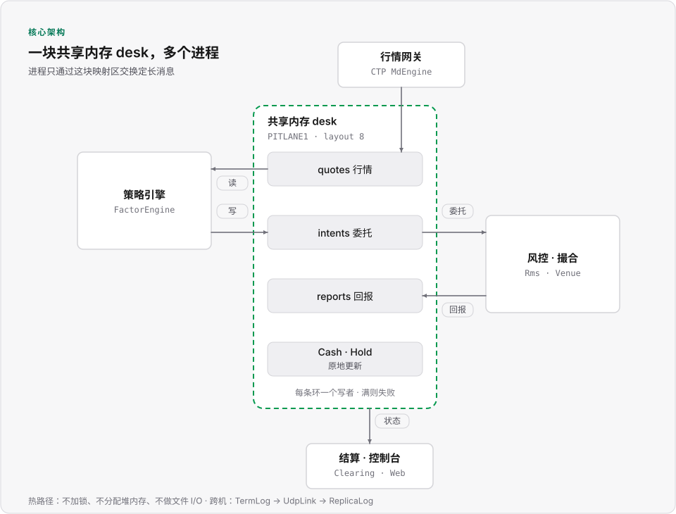

一块文件映射（`PITLANE1`，`kDeskVersion` 8）承载所有环以及资金、持仓行。只有魔数与布局都匹配时，`desk_view` 才会挂接；挂接后每条环只有一个写入者，每个读者各有一个读取位置。环满时写入失败、环内容不变：既不扩容，也不覆盖未确认的槽位。下文依次介绍映射文件、发布与读取消息、运行会话循环，以及如何把委托送入纸面撮合。

## 控制台截图

`pitlane-trading` 的网页控制台（页面在 `client/index.html`）只有一页，读写的正是下文这些环、簿与策略槽位。以下截图来自纸面盘运行：多数帧是四个实例（一个配对价差、三个因子）同时在线、研究网格与回测均已完成并加载了一段块式 tape；交易、风控、清算与账号几帧来自随后的一次会话。

| 策略 | 研究 |
| --- | --- |
| 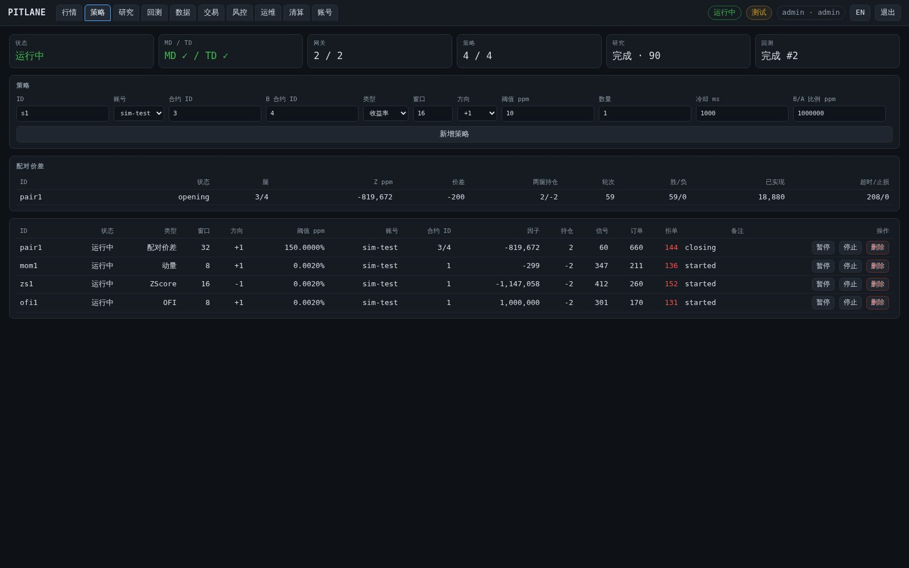 | 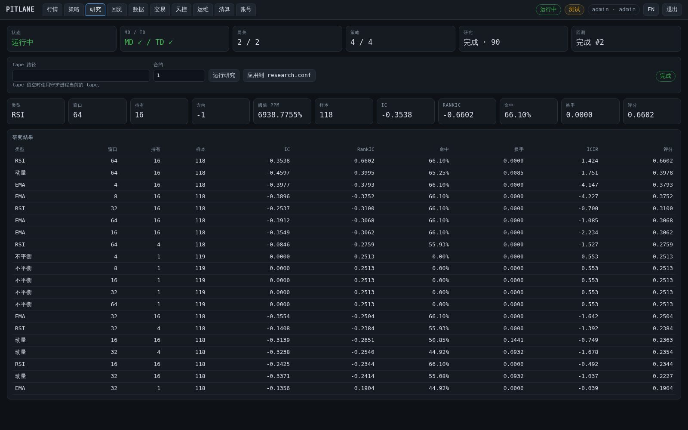 |
| 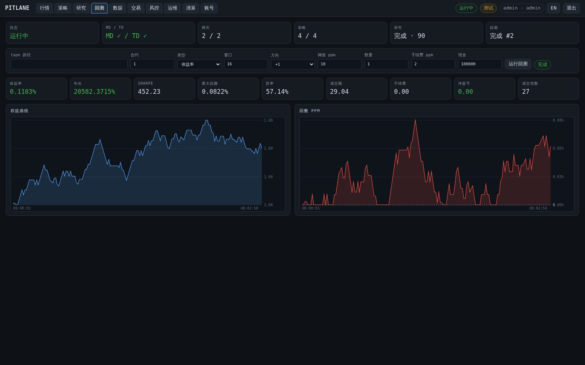 | 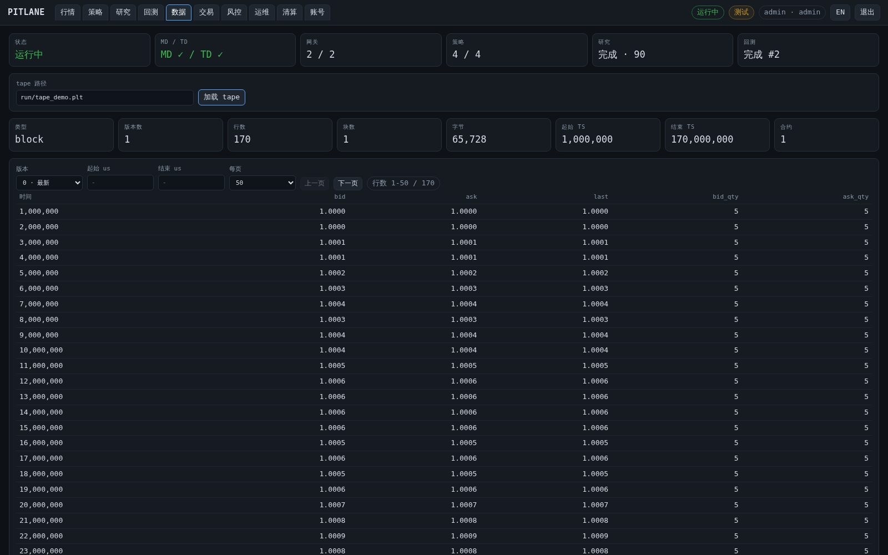 |
| 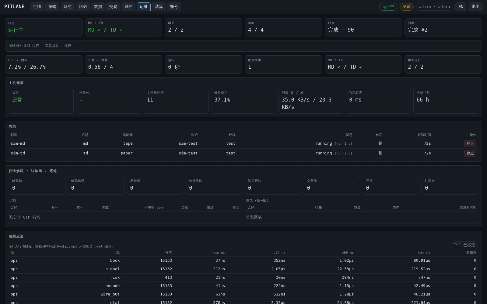 | 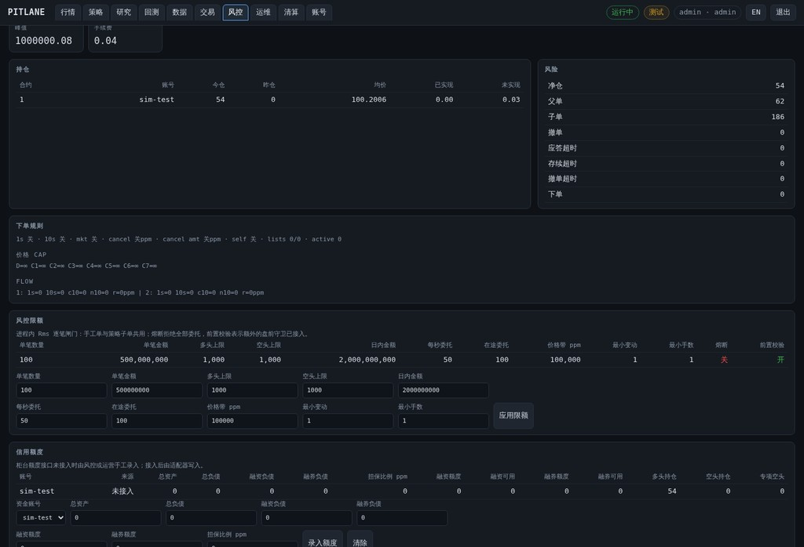 |
| 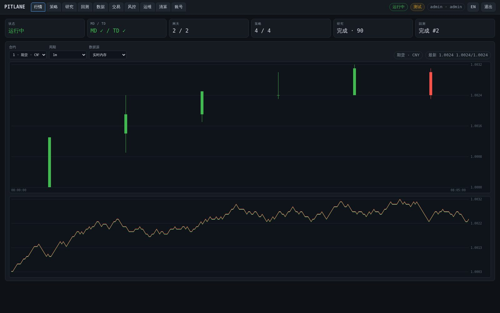 | 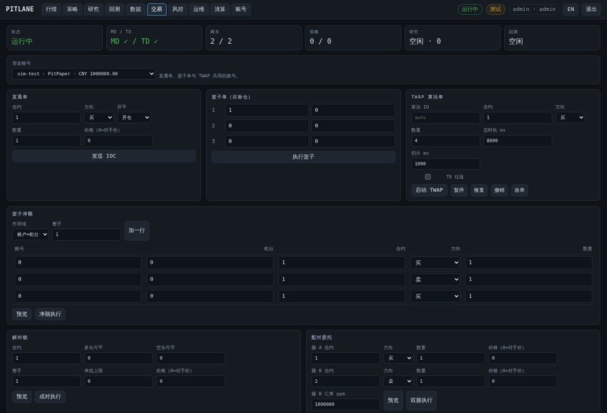 |
| 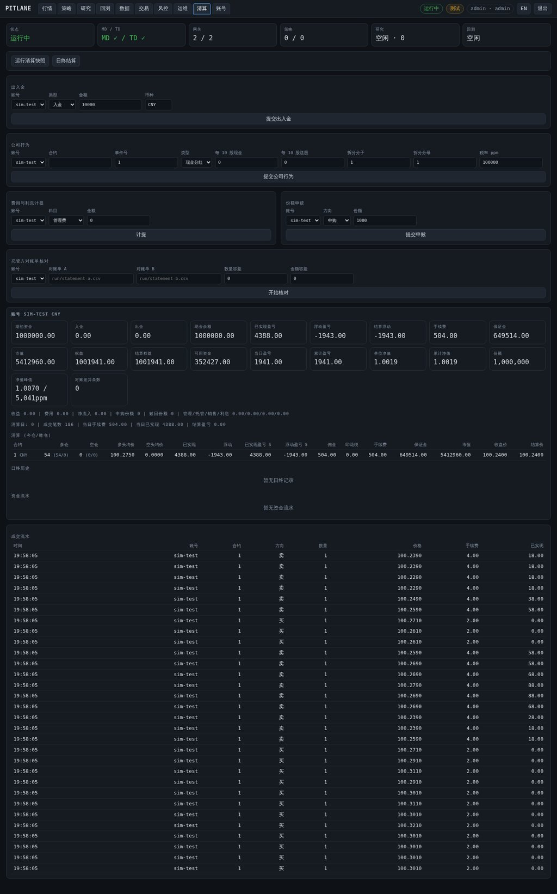 | 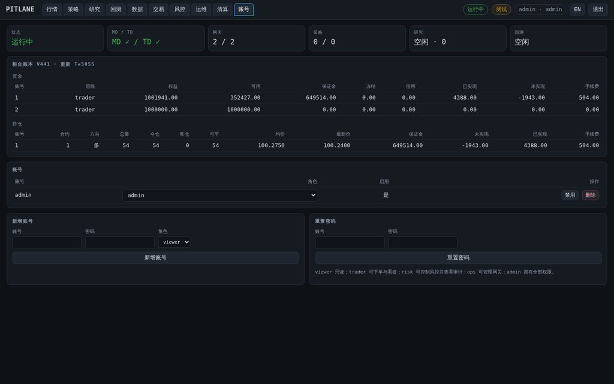 |

策略页把配对价差卡片（价差、均值、ppm 单位的 `z`、两腿持仓、回合数、胜场、已实现盈亏）放在单腿因子表旁边。研究与回测读取的是 **Tape** 一节里的同一套 API，数据页用 `GET /api/tape/meta`、`/rows`、`/describe` 直接读块式 tape。

## 启动配置

库在进程启动时接受的可调项，都放在可选的 INI 风格文件里（`pitlane-trading/conf/paper.conf` 是一份可用的程序配置）。默认值是 `desk/config.hpp` 里 `PitConf` 的成员初值。省略某个键，或把值留空，就保留该默认值。未知键忽略。出现硬解析错误（行被截断、需要数字却给出非数字）时，`conf_load` 返回 false。

`broker` 的 `ack_limit_us` / `life_limit_us` / `pull_limit_us` 默认 `60000000`（60 秒），对齐常见的 60 秒心跳；设为 `0` 关闭该轴。`host` 默认打开 `thp_disable` 与 `mlockall`。Desk FanRing 软容量仍停在编译期上限（`kIntentCap` 等）。十万级标的/行情池在独立的 `[yard]` / `Yard` 映射里（启动期一次建好，热路径不再分配）。基础数据表与 topic 分发都由库内完成（`seed_facts` / `TopicBus` / `RouteBook` / `TermLog` / `ReplicaLog`），库内不保存连接串或券商 URI。

`conf_normalize` 只在加载后执行一次。它把环容量压到 `[2, 编译期 Cap]` 内的 2 的幂，把仅编译期定长的尺寸（`QueryFold`、`BrokerWatch::kCap`）恢复并写入提示，再把每条调整写成一行可读文字放进调用方缓冲。启动时打印这些行。热路径不再读取配置文件。

```cpp
pitlane::PitConf conf{};
if (!pitlane::conf_load("/etc/pitlane.conf", conf)) return 1;
char hints[1024]{};
if (pitlane::conf_normalize(conf, hints, sizeof hints) > 0) {
    std::fputs(hints, stderr);
}

pitlane::MapOpt mop = pitlane::conf_map_opt(conf);
pitlane::MapInfo map{};
if (pitlane::map_create("desk.bin", pitlane::desk_bytes(), &map, mop) != 0) return 1;
pitlane::Desk* desk = pitlane::desk_view(&map, 1);
if (!desk) return 1;
if (!pitlane::desk_apply_conf(*desk, conf)) return 1;  // FanRing::tune，仅空环
```

`conf_map_opt` / `conf_arena_opt` / `conf_risk_caps` / `conf_yard_plan` / `conf_study_plan` 把纠偏后的字段写入映射、arena、风控、Yard 与 study 用的选项结构。`desk_apply_conf` 在环仍为空时对每条 desk 环调用 `FanRing::tune`。软容量不会超过编译期槽数组；磁盘上的 `Desk` 布局仍是 `kDeskVersion`。

| 节 | 键（摘要） |
| --- | --- |
| `[map]` | `hugepage`、`lock`、`prefault`、`numa_node`、`hugepage_dir` |
| `[arena]` | `hugepage`、`lock`、`prefault`、`numa_node` |
| `[desk]` | `intent_cap` … `query_cap`、`cash_cap`、`hold_cap` |
| `[broker]` | `max_qty`、`max_notional`、`max_live`、`*_limit_us`、`watch_cap`（仅提示） |
| `[query]` | `engines`、`accounts`、`queue`、`kinds`（仅提示；编译期定长） |
| `[host]` | `cpu`、`policy`、`priority`、`nice` / `set_nice`、`hugepages`、`thp_disable`、`mlockall`、`numa_node`、`irq_list` |
| `[shed]` / `[pace]` | StayShed / TokenBook–GCRA 默认值，由调用方构造 |
| `[yard]` | `sym_slots`、`quote_lanes`、`quote_depth`、`order_*` / `trade_*` / `rebuild_*` / `mix_*`（深度 2 的幂）、`base_info_cap`、`trade_time_cap` |
| `[study]` | `signal_pools`、`sample_pools`、`factor_pools`、`nonstruct_pools`、`sample_depth`、`factor_depth`、`nonstruct_depth` |

`conf_load_ex` 回报失败行号（从 1 起）。`conf_apply_host` 尽最大努力。`cash_apply_conf` / `hold_apply_conf` 软调行表上限。

## 打开共享区

一块文件映射就是整个工作区。写入进程创建它，其他进程挂到同一路径。

```cpp
pitlane::MapInfo map{};
if (pitlane::map_create("desk.bin", pitlane::desk_bytes(), &map) != 0) return 1;
pitlane::Desk* desk = pitlane::desk_view(&map, 1);
if (!desk) return 1;
```

`map_create` 创建或扩展文件，不会清掉已经存在的映射。默认 `MapOpt` 走显式大页：长度按 Hugepagesize 对齐，优先在 hugetlbfs（默认 `/dev/hugepages`，逻辑名映射为 `pitlane_<基名>`）建文件；路径本身已在 hugetlbfs 上则直接使用。不用 THP / `MADV_HUGEPAGE`。显式大页不可用时回退到调用方路径并置 `MapInfo::fallback`。默认尝试 `mlock`，`numa_node >= 0` 时对该区间做 `MPOL_BIND`。只有魔数是 `PITLANE1` 且布局版本是 `kDeskVersion` 时，`desk_view` 才返回工作区。当前布局版本是 8。第二个参数非 0 时，才会初始化一份仍然空白的文件。魔数不对的文件保持原样，调用返回空指针。魔数写上以后不要再次初始化。

其他进程用 `map_attach` 挂上，再把 0 传给 `desk_view`（须与创建时同一逻辑路径，以便解析到同一 hugetlbfs 文件）。`map_release` 解除映射；若曾 `mlock` 则先 `munlock`，再关闭文件。每条环只有一个写入者。读者不要共用一个读取位置。

`desk->clock_us` 是会话时钟，单位是微秒。`DeskLoop::beat` 把当次传入的时间写到这里。

## 标的 / 行情池（Yard）

`Yard` 是独立的启动期映射（魔数 `PITYARD2`，布局 `kYardVersion` 2），用于启动期定长的池：稠密标的、行情/委托/成交/重建/混合通道，以及 `YardFacts` / `YardHours` 表。默认量级（标的/行情 15 万×256，order/trade 10×32768，rebuild 10×128，mix 10×32768，facts 35000，hours 500）。`yard_open` 一次定长；claim / bind / publish / latest 热路径不分配。池满失败关闭。命名为 pitlane 自有（`YardTick`、`YardPrint`、`YardFacts`、`YardHours`）。

```cpp
pitlane::YardPlan plan = pitlane::conf_yard_plan(conf);  // 测试可用更小 plan
pitlane::YardView yard{};
if (pitlane::yard_open("yard.bin", plan, &yard, pitlane::conf_map_opt(conf), 1) != 0) return 1;
uint32_t id = pitlane::yard_claim_sym(yard, "IF2501");
if (!id || !pitlane::yard_bind_quote(yard, id) || !pitlane::yard_bind_order(yard, id)) return 1;
pitlane::YardMark mark{/* bid/ask px qty, ts_us */};
if (!pitlane::yard_publish(yard, id, mark)) return 1;
pitlane::YardTick tick{/* px qty side ts_us */};
if (!pitlane::yard_publish_tick(yard, id, tick)) return 1;
```

`conf_study_plan` 复制研究量级默认值，供调用方 `FactorSeries` / `NamedFactorRing` 确定容量（不落在共享 mmap 上）。

## 发布和读取

`Desk` 有十九条环：`intents`、`reports`、`quotes`、`algos`、`controls`、`ctl_acks`、`ext_ords`、`pulses`、`prints`、`queries`、`ledger_assets`、`ledger_positions`、`pack_reqs`、`pack_rsps`、`logs`、`subs`、`signals`、`mkt_ords` 与 `rebuilds`。编译期容量对齐交易/篮子规模：`kIntentCap`/`kReportCap`/`kAlgoCap` 32768、`kQuoteCap` 8192、`kControlCap`/`kExtOrdCap` 16384、`kPulseCap`/`kPrintCap`/`kSigCap`/`kMktCap`/`kCtlAckCap` 4096、`kQueryCap` 1024、`kPackReqCap`/`kLogCap`/`kSubCap`/`kRebuildCap`/`kLedgerCap` 2048、`kPackRspCap` 16384。经 `desk_apply_conf` / `FanRing::tune` 后的软容量不超过该上限，由 `capacity()` 报告。资金和持仓在 `cash`（`kCashCap` 512）与 `hold`（`kHoldCap` 4096）里。

`publish` 接收一条消息和一个读者掩码。掩码为 0 时，第一个确认的读者取走这个槽。其他掩码列出必须确认的读者，这些读者都确认之后槽才能再次使用。读者编号从 0 到 63。会话循环是读者 7，也就是 `kLoopReader`。

```cpp
pitlane::Intent in{};
in.tag = 1;
in.name = 1;
in.acct = 2;
in.px = 100;
in.qty = 5;
in.stamp_us = 1;
in.side = static_cast<uint8_t>(pitlane::Side::Buy);
in.act = static_cast<uint8_t>(pitlane::Act::Enter);
in.style = static_cast<uint8_t>(pitlane::Style::Day);
in.off = pitlane::Off::Open;

const uint64_t readers = 1ull << pitlane::kLoopReader;
if (!desk->intents.publish(in, readers)) {
    // 环已满，该新单未写入。
}
```

读者用 `at` 复制一个槽。位置是绝对序号，从 0 开始。这个读者还没有确认时，`fresh` 为真。`ack` 记下这次确认。`latest` 复制最新发布的一条。`tail` 是写入者下一次要使用的位置。

```cpp
pitlane::Intent got{};
bool fresh = false;
if (desk->intents.at(0, pitlane::kLoopReader, got, &fresh) && fresh) {
    desk->intents.ack(0, pitlane::kLoopReader);
}
```

`Intent::off` 取 CTP 的 `Open 0`、`Close 1`、`ForceClose 2`、`CloseToday 3`、`CloseYday 4`、`ForceOff 5`、`LocalForceClose 6` 七个码——决定这笔子单是开仓还是平仓；它占用记录原本预留的字节，`Intent` 仍为 56 字节。强平原因写在 `Intent::force_reason`（CTP `THOST_FTDC_FCC_*`），回报通过 `Report::cause` 带回。`Report` 为 64 字节。`ManualBook::direct` 接受开平参数，篮子与 T0 子单在方向减少净仓时标记为 `Close` 并截断到可平数量，普通平仓在柜台按品种类别归一化。`Intent`、`Report` 和 `Quote` 在 `desk/types.hpp`。`Intent::hedge` 选择投机、套利、套保或备兑。其余槽类型——`AlgoJob`、`AlgoRung`、`ControlNote`、`ControlAck`、`ExecNote`、`ExtOrder`、`LedgerAssetNote`、`LedgerPositionNote`、`Pulse`、`TapePrint`、`QueryNote`、`SubNote`、`SigNote`、`MktNote`、`PackageNote`、`LogNote`——在 `desk/wire.hpp`。`publish_exec` 发布行权（kind 1）或放弃行权（kind 2）请求，`TdEngine` 交给 `TdClient::exercise`。比这些槽更大的数据，由调用方放在自己的环上，类型是 `Parcel<Bytes>`。长度大于 `Bytes` 时，`publish_parcel` 失败。热路径可用 `desk_log_publish` 写入 `LogNote`，再由冷路径排空 `logs` 环。`WireLog` 是进程日志：`log` 把一行打进一个 `PackedLine`（字面量用 `lit`，动态串复制到槽，标量 `memcpy`），满环丢弃该行，热路径不格式化。后台线程或调用方 `flush` 再把槽写成文本。日志文件放 tmpfs，热路径就不碰块设备。

## 运行会话循环

`DeskLoop` 以读者 7 读取各条环，触发定时器，并在看到 `kind` 为 1 的控制消息后停止。循环已经停止时，`beat` 直接返回。定时器编号 0 会被拒绝。`every_us` 为 0 的定时器只触发一次。定时器一共 32 个。

```cpp
void on_quote(void*, const pitlane::Quote&) {}

pitlane::DeskLoop loop;
loop.add_timer(1, /*when_us=*/1000, /*every_us=*/0);
pitlane::LoopHooks hooks{};
hooks.on_quote = on_quote;
loop.beat(*desk, /*now_us=*/1000, hooks);
```

钩子是函数指针：`on_quote`、`on_report`、`on_pulse`、`on_print`、`on_algo`、`on_query`、`on_pack_req`、`on_pack_rsp`、`on_log`、`on_control` 和 `on_timer`。只有你设置了的钩子会被调用。要让这个循环看到的消息，发布时必须带上读者位 7，或者使用掩码 0。

## 准备一笔委托

`IdMint` 生成可以跨重启识别的订单号。字段是站点、种类、交易日个位、十秒槽和流水号，放在一个 64 位整数里。种类由调用方定义。

```cpp
pitlane::IdMint mint(/*site=*/1, /*kind=*/1);
uint64_t tag = mint.next(/*day_index=*/4, /*sec_of_day=*/10 * 3600);
```

`normalize_gate` 在委托入库前整理开平和方向。现货类强制开仓。上期所和能源中心把普通平仓改成平昨。其他期货交易所把平今和平昨收成普通平仓。开平取 CTP 的 0–6 七个码（开仓、平仓、强平、平今、平昨、强减、本地强平），强平类按平仓计入持仓但保留原码。协议方向 0–7 是买卖与信用业务（融资买入、融券卖出、卖券还款、买券还券、申购、赎回），8–14 是现金还款、还券、余券划转、担保品划入划出、锁定、解锁，17–18 是拆分、合并委托；前八种带多空方向，其余不带，业务种类写进 `GateResult::biz`。价格类型支持限价、市价、对方最优、本方最优，非限价不要求价格；限价为 0 时拒绝。结果里的 `Why` 说明原因。

```cpp
pitlane::GateForm form{};
std::snprintf(form.symbol, sizeof form.symbol, "rb2410.SHF");
form.side = static_cast<uint8_t>(pitlane::Side::Sell);
form.off = static_cast<int8_t>(pitlane::Off::Close);
form.px_mode = static_cast<int8_t>(pitlane::PxMode::Limit);
form.px = 3500;
form.qty = 2;
pitlane::GateResult gate = pitlane::normalize_gate(form);
```

`split_lots` 把期货数量拆成几段。模式是 `TodayThenYdayThenOpen`、`CloseOnly` 和 `YdayThenStop`，其他模式返回 -1。超过最大手数的部分会被拆开，小于最小手数的片段会被丢弃。`split_against` 先平反向持仓。`CloseStyle::SplitYday`（上期所、能源中心）把今仓和昨仓分开，`Plain` 合并为一笔平仓；不足的数量再按最大手数拆成开仓。

`commodity_plan` 和 `index_plan` 各自给出推向目标仓的下一笔委托。今仓和昨仓分开时优先平昨仓。`index_plan` 里的昨仓等于持仓减去当日已经开出的数量。`plan_px` 对买入取卖一、对卖出取买一。`next_child_qty` 按完成率曲线给出下一笔数量，落后数量按 `share_ppm` 分摊；领先达到母单大约一成，再算上在途量，下一笔数量为 0。`price_at_quote_vwap` 是盘口一档的量加权价，或是主动一侧的某一档，再按最小变动价位对齐。`pre_px`、`post_px`、`chasing_px` 只根据这份盘口返回价格。

`lock_future` 和 `lock_cash_sell` 冻结平仓或股票卖出需要的数量。`book_fill` 按成交写回今仓、昨仓和总仓。`apply_open_fill` 增加总仓、昨仓不动，新增的部分就是今仓。`apply_close_fill` 减少总仓；普通平仓先消耗尚未冻结的昨仓，平今不消耗昨仓。`roll_session` 把剩余持仓全部转为昨仓。`add_session_us` 只在连续竞价时段里加时间。

## 纸面撮合

`PaperVenue` 最多处理 256 个合约（`kNames`）和 1024 张未完成委托（`kTickets`），合约编号必须小于 256。新单需经过报单时延，再按当时的盘口判断；撤单同样需经过撤单时延。

```cpp
pitlane::VenueCfg cfg{};
cfg.lot = 1;
pitlane::PaperVenue venue(cfg);
const pitlane::Rung asks[] = {{100, 5}};
venue.set_levels(1, nullptr, 0, asks, 1);

pitlane::Report reps[4]{};
pitlane::VenueOut out = venue.admit(in, in.stamp_us, reps, 4);
```

`on_ext` 用序号和买卖委托号匹配未完成的挂单。`print_hits` 要求成交不早于该单；`rigid` 打开时价格必须严格穿过滑点后的限价。`same_side_print` 在该方向的委托号更晚时为真。同向成交仍计入该挂单，成交价用逐笔价。另一方向计入时用委托价。`match_quote` 是主动路径：买价触及卖盘、卖价触及买盘时，按可见量成交。一笔逐笔成交的数量在多张挂单之间共用。

`admit` 把回报写入调用方缓冲区并设置 `out.why`。`trade_open=0` 时新开仓得到 `Why::Closed`。`on_clock` 在延迟到期后推进暂存委托并完成到期撤单（`hang` 时跳过）。`on_print` / `on_tape` 削减队列前方数量；打开 `rigid` 时 `tape_keep` 丢弃同向主动成交。`force_fill` / `force_pull` / `force_deny` / `drill_apply` 通过 `DrillCue` 提供强制注入（`DrillCue::Closed` = 10，即休市）。`TouchMode` / `resolve_px` 解析对手/本方/最新/中间/五档。主动方为 0 时保留每笔成交。`on_shown` 应用后续的显示量变化，且不会重复扣减已有成交。

PitConf `[venue]` 的九段 go/pull 延迟可用整数微秒（`go_usN` / `pull_usN`）或按秒的小数（`go_secN` / `pull_secN`），另有 `rigid`、`tape_first`、lot/rate/notional、`cancel_pow_x1000`。用 `conf_venue_cfg` 生成 `VenueCfg`。

`Center::step` 是交易中心循环（交易中心进程角色）：可选 `TapeMd` 或实盘 `MdEngine`，行情顶档写入 `PaperVenue`，再驱动 `StratEngine`，然后是已就绪的 `TdEngine` 或 `TradeLane`。它把 `now_us` 写入 desk 时钟。`RouteAllow` 位图为 0 表示不过滤。心跳往推送环 `pulses` 写主题 `hb`。`TapeMd` 重放调用方持有的行情数组。

`Engine` 是进程角色：`set_up`、`pre_run`、`loop_task`、`post_run`、定时器、控制消息、合约表和 `housekeep`。`MdEngine` 排空 `subs`（行情、信号、重建、市场委托、市场成交）。连续五次订阅失败后不再发送。`copy_subs` 先复制订阅名单再发送。`write_quote`、`write_print`、`write_signal`、`write_factor`、`write_mkt`、`write_rebuild` 是网关写入。`TdClient` 是网关要实现的柜台面（`insert`、`cancel`、`on_algo`、`query_asset`、`query_position`、`exercise`）。`TdEngine` 依次处理报单、资金查询、持仓查询、算法单、行权请求，再处理 `BrokerWatch` 超时；应答、存续、撤单三类超时分别计数。`risk_filter` 可以在调用柜台前拒掉一笔报入。`StratEngine` 同时是策略和它的上下文：它收取回报、行情、重建、市场委托、逐笔、算法单、查询应答和信号，并发布报单、订阅和查询。`order_precheck` 在发布前丢弃数量、方向、编号或时间不合法的子单。库内不含券商套接字；CTP 网关位于继承这些类型的程序中，`pitlane-trading/adapters/ctp` 就是示例。

`SimRole` 标出纸面四角色（回放、行情适配、交易、撮合）。`order_delay` 和 `tape_speed` 控制回放节奏。`timer_due` 处理到期的撮合与撤单。`adjust_offset` 是先平反向持仓再开仓的拆分。

组合层（热路径仍无堆）：`FeedHub`、`TradeLane`、`StratHook`（含算法单、篮子、日志与暂停）、`seed_cash` / `seed_hold`；本地基础数据用 `seed_facts` / `seed_hours` / `seed_holidays` 以及冷加载 `load_facts` / `load_hours` / `load_holidays`，盘中刷新用 `reload_facts` / `reload_hours`（只更新已存在的槽位，未知合约返回 -1，版本幂等）；本机 topic 用 `TopicBus`；策略→算法绑定用 `RouteBook`。`pulse_bridge` 把推送板 `PulseBoard` 的队列扇入 Desk `pulses`（本机 topic 分发）。

`Style::Day` 触及限价时，剩余数量全部成交，可以多于该档显示量。`Style::Passive` 一旦会穿越对手价就过期。`Style::Immediate` 只成交可见量（FAK）。`Style::All` 在可见量不足时整笔过期（FOK）。`Style::BestFive` 最多吃对手前五档的可见量，剩余过期。同一账户的买卖自成交时，该委托停止撮合。

9 点 30 分之前，时延表是 0。之后 `session_band` 按 10:00、10:30、11:00、11:30、13:30、14:00、14:30 和 15:00 把一天分开。没有载入采样点时，`SimClock` 使用这九段。`SimClock::go` 返回负数时，表示该委托未进入盘口。这个结果由调用方决定如何处理。`admit` 自己不读该时钟。

`auction_clear` 选择成交量最大的价格。`tie_higher` 在成交量相同时取更高的价格。否则取更接近参考价的价格。

## 合约、信号和柜台

`NameBook` 最多保存 1024 个合约。`insert` 写出从 1 开始的编号。符号已经存在或目录已满时返回 false。`link` 记录关系：0 相关，1 标的，2 衍生，3 跟踪标的，4 跟踪衍生。`set_session` 允许开市分钟晚于收市分钟，用来表示跨过午夜的时段。

推送板 `PulseBoard` 有 128 路订阅和 256 条队列。`watch` 建立一路订阅。没有匹配或队列已满时，`offer` 失败。`drain` 把队列里的推送复制出去。

`BrokerWatch::screen` 检查数量、方向、名义金额和在途笔数。`remember` 跟踪一笔已发出的委托。`expire` 去掉未及时确认、超过存活时间，或撤单后等待过久的委托。上限小于等于 0 时，这一项检查关闭。

`QueryFold` 最多接受 32 个引擎和 64 个账号，每个引擎 16 条排队请求，查询种类最多 8。`push(engine, acct)` 保持仅按账号合并的旧路径。`push(engine, acct, kind, page)` 可带 page token；引擎、账号、kind 越界或队列满时失败。`fold` 合并队列。`pending` 每个账号列出一次。`pending_kind` 列出互异的 `(acct, kind)` 及最后一次 page；输出缓冲过短返回 -1。库不会在两页之间等待；下次查询时机由调用方决定。

`session_date` 把一个时刻归到它所属的交易日。8 点至 18 点不回退。18 点之后，周一回退 3 天，其余日子回退 1 天。凌晨则周一回退 2 天，其余日子回退 1 天。然后再跳过周末和 `ClosedDays` 里的日期。

## 辅助函数

`QuoteFold::apply` 写入一批 `Add`、`Set` 和 `Del`。其中一条不合法时，原有档位保持不变。`copy` 先给出最优价。`PrintLog::push` 只记录逐笔，不接收行情簿。`DayRoll::on_msg` 更新当前分钟。时间戳往回走时返回 false。时间单位是微秒。早于一天的分钟会被丢弃。

```cpp
pitlane::QuoteFold<8> book;
const pitlane::FoldEdit edits[] = {{pitlane::FoldOp::Add, 1, 10, 4}};
book.apply(edits, 1);
```

方向 1 是买盘，方向 2 是卖盘。价格已经存在时，`Add` 失败。`Set` 的数量为 0 时删掉这一档。`Del` 一个不存在的价格仍然成功。

`band_at_hold` 在价格正好等于下一档起点时留在较低的一档。`walk_up` 和 `walk_down` 从这一档开始走 tick。一步落到下一档起点之后，后面的 tick 用新档的步长。`clamp_px` 只在上限高于下限时夹价格。`TickGrid` 最多十档，带涨跌停，并在热路径缓存当前档下标。`span_index` 返回包含这一分钟的时段，没有则返回 -1。结束分钟不大于开始分钟的时段跨过午夜。`session_part` 对一个 `SessionRow` 返回开市、午休或休市。

`life_next` 返回下一个 `Phase`。从当前阶段不能接受这个事件时，结果是 `Phase::None`。撤单等待期间的成交仍留在 `PullWait`。`Resume` 和 `ResumePartial` 把被拒绝的撤单退回已报或部分成交。

`margin_need` 用乘数乘价格乘数量，再乘保证金分子，除以保证金分母。`charge_class` 对股票、债券、基金、科创板、指数和回购使用现货公式，其余品种使用费率公式。乘数和保证金比例由 `scale_of` 给出。

`rest_room` 是一条腿还能挂出的数量。两腿同时下单时结果为 0。`cut_hedge` 在一条腿被削减后，按差额削减另一条腿。`slice_weight` 把一半进位，新的一段不大于 0 时返回 false。`align_leg` 先除以行情系数，再按最小变动价位四舍五入，一半进位。`pair_qty_ok` 对 688 和 689 要求至少 180，对其他沪深代码要求至少 80。`chase_px` 买入向上走，卖出向下走。

`IdBind::put` 写入一条待确认的对照。表已满或柜台键已经存在时失败。`confirm` 把它标成已关联。`erase` 留下空位，后面的 `put` 可以再用。本地号 0 会被拒绝。

订单还处在未设置、已发送或已确认时，`bind_fill` 把数量和金额累加到提前到达的字段。`bind_status` 把这些字段复制到订单。已确认并且已经有成交时，状态变成部分成交。柜台剩余少于本地剩余时，`bind_final` 先保留全成或已撤状态。`bind_catchup` 在剩余为 0 时写入这个状态。撤单尚未回来，且新价格等于成交价时，`quote_repost` 返回 false。

`lane_accepts` 读取 `LaneRule`。撤单要看 `pull`。新单要看价格类型和开平。`lane_can_amend` 读取 `amend`。`Cause` 从 10 起是字段检查，从 40 起是资金和持仓，从 70 起是风控，从 100 起是本进程以外。`cause_band` 返回这个分组。`cause_text` 是一个固定的短词。

`list_cause` 查开仓名单或平仓名单。`FlowWindow::allow` 把这一次也算进去，总数仍低于 `limit` 才通过。时间窗和传入的时刻使用同一单位。样本笔数还低于 `min_n` 时，`count_ratio_ok` 直接通过，比例刚好等于上限也通过。`cash_ratio_ok` 在金额比例等于上限时不通过。`cancel_ok` 和 `reject_ok` 在比例相等时不通过。`fill_ok` 在等于下限时通过。`px_shift` 是相对最新价的有符号距离，再乘上 `den`。`deviation_cause` 用这段距离的绝对值。`wash_hit` 要求同一合约、相反方向，并且价格相遇或穿越。账户相同，或者组号不是 0 并且相同，都算命中。

`ByteFrame::begin` 先留出四个字节。`end` 把正文长度写回去，并返回总长度。失败时返回 -1。缓冲区短于这个长度时，`frame_read` 失败。`seq_feed` 对下一个序号返回 0，跳过若干序号时返回正的缺口，旧序号返回 -1。第一个序号会启动这次监视。`SeqHold::start` 设定 `take` 下一步要放出的序号。`offer` 只保留接下来 `Cap` 个序号以内的消息。`SpanMark::mark` 拒绝负数时刻。任一节点还没有时刻时，`between` 失败。

## 调用方自己保管的辅助函数

这些调用不挂到共享工作区上。存储由调用方保留，数字由调用方传入，结果怎么用也由调用方决定。

`IdSlip::issue` 给出下一个编号。只有这个编号仍是最新且尚未调用 `keep` 时，`undo` 才能将它退回。`WireMold::seal` 把前缀写入调用方的缓冲区。`put_u64` 和 `put_i64` 在这段前缀里的偏移上写入小端字节。`read_block` 接受长度至少为 `know` 的块，更短的块会被拒绝。`block_end` 跳过声明的块，包括这一版不读取的字节。

`StayShed::drop` 使用调用方自己的时间单位。停留短于目标时退出丢弃状态。第一次达到或超过目标时开始计窗口，这一条保留。窗口结束后，仍然偏晚的条目被丢弃。停留再次短于目标时退出丢弃状态。

`floor_chunk` 把负数 tick 向远离 0 的方向对齐到块起点。`ChunkMap<Ticks,Blocks>` 按每块 `Ticks` 个价格保存数量，最多 `Blocks` 块。`Ticks` 取 8 到 256，并且是 64 的倍数。`Blocks` 取 1 到 64。数量 0 清掉这个 tick。只有正数量才会占用新块。目录已满时写入失败，原有数量保持不变。`chain_link` 把调用方自己的节点接到链尾，并返回槽位和复用计数。复用计数不一致时，`chain_unlink` 失败。`chain_zero` 让节点留在链上，数量为 0。`chain_take` 减少这个数量。

`ticket_pull` 和 `ticket_amend` 只从 `Working` 或 `Partial` 出发。每次都先留下原来的票据，再把版本加一。`ticket_rewind` 只在版本仍是这条命令写下的那个值时恢复快照。`ticket_fill` 也会把版本加一，所以成交会阻止尚未退回的命令。`PullWait` 期间的成交仍留在 `PullWait`。

`slice_open` 用时间跨度里的间隔数拆分母单数量，切段最多一百万。一段低于手数、而总量仍够一手时，整笔收成一段。最后一段带上余数。`slice_poll` 等到到期时刻才给出下一段。`slice_restore` 把没做完的子单退回池子。`slice_late` 先记入成交，能从池子里扣的先扣，返回值是从已经再次排出去的子单上收回的数量。`basket_make` 接受 `Create`、`Pause`、`Resume`、`Stop` 和 `Update`。种类最多 15 个字符。字节数大于 `max_bytes` 时失败。载荷本身不保存。

`recon_fill` 对同一个柜台成交编号只应用一次。本地还没有该委托时，用 `size` 建出来，先给出确认，再给成交。超过委托数量的部分记入 `over`，不加进 `filled`。重复编号给出 `Dup`，不改变订单。`recon_cancel` 把已知且未结束的委托标记为已撤。

`FlightQueue<Cap>` 保存 2 到 64 条命令，按到期时刻排序。队列已满，或者编号、合约为 0 时，`push` 失败。`take` 只取出这个合约上已经到期的命令。

`BarFold` 忽略调用方标成不可交易的 tick，也忽略非正价格、负数量和负时间戳。桶起点是时间戳减去它对周期的余数。更晚的桶会结束当前 K 线。更早的 tick 被拒绝，当前 K 线保持不变。空的周期不会被补出来。`seal` 输出尚未结束的 K 线。

`act_mul` 用 `jump_den / jump_num` 作为价格乘数。现金分红只在 `income` 置上、并且前收高于分红时才改变这个乘数。`mul_fold` 只乘上 `ymd` 不晚于指定日期的公司行为。`scale_px` 向 0 截断。`traded_move` 返回去掉原始跳变之后的价格变化。1 股拆成 2 股时，跳变用 `1/2`。除权价正好是前收的一半时，交易变动是 0。

## 组帧、节奏和快照

这些调用不打开套接字，也不发单。字节、时钟和决定都留在调用方。

`digest_of` 只覆盖传给它的字节。`Sum8` 是求和的低 8 位。`Crc16` 是 CRC-16/CCITT-FALSE。`Crc32` 是 ISO-HDLC 的 CRC-32。`digest_write` 把这个值按小端写出去。`StreamAsm<Cap>` 把字节追加进自己的缓冲，`Cap` 从 16 到 65536。`FrameSpec` 在 4 到 32 字节的头里，用 `len_off` 处的小端长度读取正文。头、正文和校验都到齐，`pull` 才给出一帧。正文超过 `max_body`，或者整帧放不进缓冲，返回 `BadLen`，缓冲保持原样。校验不对时返回 `BadDig`，丢弃这一帧，后面的字节留下。好帧留在缓冲开头，直到 `commit`。帧还没取走时，`append` 失败。

`SeqGate<Cap>` 在旁边保留 2 到 64 个更晚的序号。`start` 设定下一个期望序号，0 会被拒绝。`live` 只在序号正好接上时放行。出现空洞时记下缺失区间，并把更晚的序号停进旁路。落在当前空洞里的实时序号被忽略。`replay` 只接受缺口里的下一个序号。缺口补齐后，连续的旁路序号一并放出。旁路里还有更后面的空洞时，再开一个新缺口。旁路已满，或者输出缓冲太短，门的状态不变。这个门不发送重传请求。

`token_open` 把令牌桶初始填满到 `burst`。每过 `per` 个时间单位，`token_take` 补充 `rate` 个令牌，存量不超过突发上限。时间往回走不补充。一次取用超过突发上限就失败。`gcra_open` 保存间隔和容忍量。`now` 加上容忍量达到理论到达时间时，`gcra_allow` 才通过，并把这个时间向前推一个间隔。`TokenBook` 和 `GcraBook` 保存 1 到 64 个键。键 0 被拒绝。每个槽都还在闲置时间以内时，新键被拒绝。闲置时间为 0 时不复用旧槽。第一次取用失败时，新键不会留下来。

`sign_ready` 在拒绝数为 0、并且通过数达到 `need` 时为真。已经拒绝之后，再通过也不能清除拒绝。`sign_reset` 清零两个计数，`need` 保持不变。开仓的 `hold_reserve` 扣掉数量，并占用一次撤单次数。平仓两样都不占。`hold_cancel` 只用于开仓记录，并退回未成交数量。只有 `rejected_here` 置上时才退回撤单次数。开仓全部成交，并且这次成交不是账户外来的，`hold_done` 才退回撤单次数。开仓超时的 `hold_late` 退回未成交数量和撤单次数。平仓超时只结束这条记录，不改额度。`hold_cancel_late` 退回撤单次数，持仓记录仍然留着，后面的全部成交不会再退一次。

`key_num` 和 `key_text` 把接口名和柜台键放在一起。数值键和文本键不相同。文本超过 23 个字符，或者接口名超过 15 个字符，写入失败，原来的键保持不变。`AckBook<Cap>` 保存 2 到 64 行。表满或者键已经存在时，`put` 失败。`link` 把等待下单确认的一行改成已关联。`arm_cancel` 从已关联状态开始撤单计时。`sweep` 只列出到期的本地编号，不改这些行。存续时间超过自身上限才算到期。距上次巡检还在 `gap` 以内时，这次不列出。输出缓冲太短时，巡检时钟不动。

`lat_mark` 仅在打点开启且时刻非负时写入。任一节点还没有时刻，`lat_span` 就失败。`skew_sample` 保存柜台时间与本地时间之差的一半，整数除法向 0 截断。`skew_apply` 加上这个整数。`LatHist<Buckets>` 使用 4 到 32 个桶。0 和 1 落在 0 号桶。更大的值用不超过它的最高二次幂，超出最后一档的都留在最后一桶。`cum` 从 0 号桶累加到给出的桶。

`SnapPub<T, Slots>` 在对象里放 2 个或 3 个槽。一个写者调用 `begin_write`，填完后用 `publish` 让它可见。`pin` 让一个读者占用当前发布的槽。在 `unpin` 之前，第二次 `pin` 失败。只有 2 个槽时，读者还占着一个、另一个已经发布，再次写入就失败。有 3 个槽时，写者可以替换一份已经发布、随后又被跳过的槽。库不启动线程。

`SigBook<Buckets, Keys>` 的桶数是 2 到 256 的 2 的幂，键是 1 到 1024 个。每个桶 8 个槽。签名 0 表示空槽，算出来是 0 就存成 1。签名写在键下标之后。`find` 返回从 1 开始的下标，没有则返回 0。`find4` 一次查四个键，比对前预取两侧桶。有 SSE2 时，一个桶的八个签名用一条向量比较。键已经存在时，`put` 返回真。两个桶都满时，一次插入最多把旧键向它的另一个桶转移 8 次。转移不尽则失败，原来的键还在。插入侧一个写者。

`Grace<Readers>` 跟踪 1 到 64 个读者。`online` 记下当前代。`offline` 写成 0，该读者不再阻止回收。调用方放下共享指针之后，用 `quiesce` 记下这一代。`bump` 把代加一，并返回新值。还有在线读者停在更老的代上时，`elapsed` 返回假，它不等待。调用方自己也在读者名单里时，要先 `quiesce` 再问 `elapsed`，否则自己仍算停在旧代。`RetireList<Cap>` 按放入顺序保存 2 到 64 个令牌。`reap` 从最老的开始放出已经过去的令牌，遇到第一个还没过去的就停。输出缓冲太短时，列表保持原样。列表不释放调用方的内存。

## 周期计数和定长低延迟表

这些调用不打开套接字，不发单，也不启动线程。存储和推进它的线程都由调用方持有。

`cycles_read` 读取周期计数。`cycles_ordered` 等前面的指令完成后再读。终点早于起点时，`cycle_gap` 失败。`load_fence`、`compiler_fence`、`cpu_relax` 和 `keep` 放在一次测量的两侧。`CycleProbe::arm` 指定要丢弃的预热次数。`begin` 先加栅栏再读。`end` 返回 1 表示留下这个样本，返回 0 表示仍在预热，返回 -1 表示读取失败或者计数往回走。

`UsSlot` 独占一条缓存行。`us_store` 用 release 写下微秒数。`us_load` 用 acquire 读取。这个槽由调用方写。探针打开期间，库不去取时钟。

`scale_set` 用调用方量到的周期数和纳秒数保存乘子和移位。两个数都必须是正数，周期数还要放得进宽除法。`scale_ns` 计算 `(cycles * mult + half) >> shift`，四舍五入到纳秒。`scale_span` 换算一段向前的周期差，终点更早则失败。

`DutyPace::open` 保存快档间隔、慢档间隔，以及一毫秒对应多少周期。`step` 返回跳过、快档、慢档或超时。它不去轮询描述符。`deadline_at` 把偏移加到起点上，加出会溢出就失败。期限还在前面时，`before_deadline` 为真。

`lap_ns` 把两个时刻相减。负数时刻表示还没写入，终点早于起点则失败。`hop_ns` 用记录写好的时刻减去触发它的时刻。`order_to_ack`、`tick_to_trade` 和 `tick_to_cancel` 对调用方已经记下的时刻用同一条规则。

`MagHist` 按数量级给每个桶记一个计数。值落在表外时，加入失败，原来的计数不动。0 分位是最小样本，100 分位是最大样本。中间的分位取跨过这个名次的那一格的下沿，名次向上取整。`mag_report` 填上个数、最小、最大、中位数、99 分位和 999 分位。`note_paced` 先记下这段耗时。耗时跨越多个间隔时，再把仍然不小于一个间隔的剩余逐段记下。最多记 64 笔。更长的停顿在这 64 笔之后返回 -1。回调返回假时，这一串就停。

`clock_publish` 把周期比例写到一页上。代先写成奇数，写完字段，再写成偶数。代是 0 表示这页还没发布过。周期数为 0，或者放不进宽除法，发布失败，页保持原样。`ClockView::refresh` 复制一份稳定的偶数代，并保存整数乘子和移位。页还没发布、这份比例组不起来，或者连续读到的代一直是奇数，就返回假。`to_wall` 用这份乘子和移位把周期戳换成墙钟，换算本身不再做除法，然后再把纳秒折进秒。

`TickWheel<Cap>` 保存 8 到 4096 个定时器。空闲链表和待挂栈各自独占一条缓存行。标签 0 被拒绝。`arm` 在调用它的线程上插入。`post` 可以在别的线程上调用，下一次 `take` 再把它们挂进轮子。不严格晚于当前刻度的定时器会被推迟到下一个刻度。`take` 推进到给出的界限，并写出到期标签。缓冲不够就停下，剩下的定时器留在原地。`cancel` 去掉一个已经挂上的标签。`next_deadline` 是下一个有定时器的近桶，或者下一次把更远的桶并入的刻度。

`StageRing<T, Cap>` 使用 4 到 1024 个槽，容量是 2 的幂。每个槽都还被占着时，`acquire` 失败。阶段 0 的 `finish` 写入内容。`take` 只交出这一阶段的下一个序号。后占的序号先写完，也要等前面的序号。阶段 1 才发布已经释放的计数。只接受阶段 0 和 1。

`SeqWin<Cap>` 的窗口是 8 到 1024，并且是 2 的幂。令牌 0 被拒绝。`push` 返回 `In`、`Dup`、`Busy` 或 `Far`。重复的序号留下先到的令牌。离窗口远过两倍的序号是 `Far`，不会放进去。`pull` 先交出已经准备好的前缀，再交连续的窗口头，遇到空洞就停。滑动时旁边的队列放不下，`push` 返回 `Busy`，新令牌不保存。

`ReadWin` 跟踪 8 个读者。窗口小于 4 时，`open` 失败。`limit` 是已经加入的读者里最慢的位置再加上窗口。不是常驻的读者，落后超过窗口的四分之一，并且安静时间达到保持时长，就离开集合。一个读者都不剩时，`limit` 失败。这次调用不写调用方的字节。

`core_slot` 返回调用方内存中某个核槽位的地址。步长至少 64 字节，并且是 64 的倍数。核号超出个数则失败。

`Urgent` 独占一条缓存行，只放一个非 0 标签。槽里还有标签时，`post` 失败。`take` 返回这个标签，槽空时返回 0。

`TraceGate` 独占一条缓存行。`arm` 保存一个 16 位事件号和一个开关。`CoreTape<Cap>` 只在开关打开时写入。记录序号单独占一条缓存行。容量是 16 到 4096，并且是 2 的幂。写满以后覆盖最旧的一条。还没写过，或者已经被覆盖的记录，`at` 失败。`SegTape<Seg, N>` 有 2 到 16 段，每段 4 到 1024 条。下一段已经用 `give` 交回时，写满的这一段才封存。否则写者从当前段开头重写，覆盖次数加一，这次 `push` 返回假。`SpikeRing<Cap>` 只记录严格超过阈值的间隔。没有超过阈值时返回假，不算丢失。环满时，写者一侧的丢失计数加一，并返回假。读者序号单独占一条缓存行。

`FillRing<T, Cap>` 一个生产者、一个消费者，槽数是 2 到 1024。`claim` 返回下一个槽。已经有一次还没发布的领取，或者环已满，就返回空。`publish` 让这个槽可见。`cancel` 放弃这次领取，不发布。`take` 取出下一个已经发布的槽。`take_span` 一次取出多条，读取序号只向前推进一次。每个槽独占一条缓存行。

`SendJoinRing<T, Cap>` 多个生产者、一个消费者，槽数是 2 到 65536 的 2 的幂。下一格追上 head 时 `try_push` 失败。尾字高位是世代号、低 16 位是下标，环绕后旧值不会与 compare-exchange 匹配。占槽后再写载荷，`ready` 用 release 发布。`try_pop` 在 acquire 看到 ready 后才搬走，再推进 head。

`hex_encode` 写出小写十六进制，并在末尾放一个空字符。缓冲要同时容得下这两部分。缓冲太短时返回 -1，原来的文本不动。`hex_decode` 先检查每一位，再写入。长度是奇数，或者有一位不是十六进制，返回 -1，并且不写。`bytes_diff` 返回第一处不同的下标，两段相同返回 -1，指针或长度不能用时返回 -2。

`Mix64` 从调用方保存的种子往下取。`below` 会消耗一次取值。上界小于等于 1 时返回 0。更大的上界返回严格小于它的值。`span` 返回从下界到上界、包含两端的值，上界低于下界则失败。这个混合不是密码学生成器。

`TextBuf<Cap>` 保存 8 到 4096 字节，含末尾的空字符。`put`、`put_i64` 或 `put_hex` 失败时，原来的文本留下。`put_char` 拒绝值为 0 的字节。`put_hex` 的宽度是 1 到 16，值需要的位数更多就拒绝。

`SampleBox<Cap>` 保存 2 到 256 个样本。均值向 0 截断。百分位用向上取整的最近名次。0 分位是最小样本，100 分位是最大样本。`SampleBox` 已满，或者总和会溢出时，加入失败，新样本不写入。

`StepClock::step` 只向前走，负的步长或者会溢出的步长被拒绝。`jump` 可以跳到任意时刻。`FailBudget::arm` 允许那么多次成功，之后 `allow` 返回假。`StepList<Cap>` 要求标签非 0，时间不能早于上一次放入。`take` 复制出已到期标签的一个前缀。缓冲太短时，剩余项保留。`ladder_check` 接受空档。买档必须严格递减，卖档必须严格递增。价格或数量不是正数就失败。`intent_make`、`report_make` 和 `quote_make` 在拒绝时把输出清零。买价高于卖价的行情被拒绝，买价等于卖价则保留。

## 一笔委托

`phase_text` 给出状态名称。`sheet_open` 在调用方自己的委托上写入本地编号、方向、价格和数量。编号为 0、方向无法识别，或价格、数量不是正数时拒绝，原委托保持不变。`sheet_bind` 记下一次柜台编号。再来一个不同的编号会被拒绝。

`sheet_apply` 按状态表推进该委托。状态表不允许的事件，所有字段都保持原样；成交数量大于还没完成的数量时，整笔不动。一次成交消耗完剩余数量时，状态停在部分成交，剩余为 0，全部完成要再给一次结束事件。拒绝会记下调用方传入的原因。发送、接受和结束这几类事件只保留第一次非负的时刻，负数时刻不写。`sheet_ack_ns` 和 `sheet_done_ns` 把这些时刻相减。`sheet_line` 用一行替换文本缓冲，内容为编号、方向、状态、原因、数量、已成和剩余。本地编号放不进有符号 64 位时拒绝，原行保持不变。

`gate_ask` 对一次下单或一次撤单按顺序做检查，返回第一个原因。名单、通道规则、自成交表、资金行、持仓锁、风控上限、`BrokerWatch` 或流速窗口是空指针时，这一项跳过。限价下单要求价格和数量都是正数。名字在名单上就是拦截。通道不接受撤单时，返回撤单上限这一原因。通道不接受这种价格类型时，返回价格原因。通道的其他拒绝都是拦截。偏离只在限价下单、并且上限大于等于 0 时检查。自成交只在下单、并且表存在时检查。设置了 `cash` 与 `cash_need` 时走 `cash_enough`。设置了 `lots` 与 `lock_qty` 时只读检查持仓（`lock_future_ok` / `lock_cash_sell_ok`）。今仓不够返回 `NoToday`，昨仓不够返回 `NoYday`，总仓不够返回 `NoPos`。名单就是黑名单。限价下单的 `fee_den` 大于 0 时，冻结额是名义金额加上品种费用（`prelock_ok`）。设置了 `risk` 时检查数量/名义/在途上限（有 `watch` 时走 `BrokerWatch::screen`）。前面这些检查都通过以后，才改流速窗口；任一更早失败都不改流速窗与在途侧状态。窗口已经到达上限时，下单返回流速原因，撤单返回撤单流速原因，窗口保持原样。这次调用不发单。

`risk_merge` 对每个正上限取更严（更小）的一侧，0 表示该轴关闭。`AcctRiskTab` 存账户级上限，未命中 fail-closed。`sign_begin(need)` 复位 `SignSlip` 并设定模块数，各模块再 `sign_pass` / `sign_reject`，最后 `sign_ready`（常见 need=3：全局/账户/通道）；拒绝一直保持到复位。

`PreTradeGuard` 是 `Rms` 之后的柜台侧规则管线，顺序固定：入参、熔断、开/平黑名单、分类名义上限、账户 1 秒与 10 秒流量、市场 1 秒流量、带预热笔数的累计撤单率、滚动窗口撤单金额比、自成交；首个失败项给出原因（`pre_code_name`）。`FlowGate` 用每账户、每市场 16 个一秒桶承载窗口，单次查询最多 16 个单元，过期桶按纪元忽略，无需清理扫描。`on_submit` 记录下单，可挂单的同时写入 128 槽活动表；开启自成交保护且活动表已满时返回 `ActiveFull` 而不是丢失保护。`on_cancel` 与 `on_done` 维护撤单侧与活动表。全程零分配，上限为 0 即关闭该规则。

`GroupRiskBook` 把带符号数量乘标记价汇总为账户名义，再按组汇总总敞口、净敞口与最大账户敞口。它在 1 Hz 冷线程运行，违规位保持到下次清零，并可查询总/净剩余额度。

`ReplayPace` 把行情时间映射为回放墙钟。速度是以 ppm 表示的整数倍（1,000,000 为 1 倍），最多 16 个有序区段覆盖默认速度，用于开盘前空档、午休和隔夜。`due` 推进游标，顺序前进为 O(1)，只有回退才从起点重算。

## 研究，以及调用方自己的决定

`feat_of` 读调用方已经拿着的盘口顶部。它给出价差、中间价、不平衡，以及一个微价格。微价格用对面的数量给本侧价格加权，除法走宽乘积，商是整数价格。两侧都没有数量时，用中间价。买价缺失，或者卖价低于买价，就拒绝。

`horizon_ticks` 把最多四个后来的价格换成整数跳，向零截断。后来的价格是负数时，这一档没有填写，结果写成 0。价格没变时结果也是 0。哪几档填过，由调用方自己知道。买入在后来的价格更高时算赚。卖出在后来的价格更低时算赚。

`RelBook` 给每个名字记一个标的，最多 64 个名字。同一个名字再次绑定会换掉标的。`related` 把指向同一个标的的名字复制到缓冲区，直到缓冲区满。`FactorBoard` 给 64 个名字各留四个最新值。再次写入只替换这一格。`Replay` 在调用方已经拿着的表上往前走，不自行打开文件。

`study_step` 先应用一批行情，再按新的盘口顶部填写特征。盘口先更新，然后才判断特征。选择函数是空，或者选择函数返回假，委托单保持原样。选择函数返回一笔委托时，如果给了检查就先走 `gate_ask`，如果给了委托单再把它记成已暂存。被拒绝的委托不改委托单。给了委托单而本地编号是 0 时拒绝。这次调用不发单。调用方传入的函数，就是写策略的地方。库不决定方向，也不决定价格。

## 价格窗口、槽池和两笔费用

`PriceWindow<Cap>` 从下限价格起覆盖 `Cap` 个跳。`Cap` 是 64 到 4096 之间、64 的倍数。`reset` 写下限和步长，并清空窗口。`set` 写一侧的数量。数量 0 清掉这一跳。价格不落在步长上，或者落在窗口外，就拒绝，原有数量留下。`best` 给出最高的有量买价和最低的有量卖价。空档按机器字批量跳过。`shown_before` 把严格优于某个价格的数量加起来：买价看更高的，卖价看更低的。这个价格自己的数量不计入。加总会溢出时，输出保持原样并返回失败。

`publish_batch` 写入 1 到 `Cap` 条共用同一个读者掩码的槽，然后只存一次尾指针。有一条槽还忙着，调用返回 0。环里已经有的槽保持原样。`ack_span` 为一个读者连续确认若干位置，遇到确认不了的位置就停。已经确认过的位置保持确认。

`SlotPool<T, Cap>` 保存可平凡复制的记录。`Cap` 是 2 到 1024 之间的 2 的幂。`take` 拒绝编号 0、重复编号和已满的池。`drop` 把槽还给空闲栈。`find` 返回池内的指针。这个指针在该编号被丢弃之前有效。

`margin_both` 返回 `价格 * 数量 * 乘数 * 金额分子 / 金额分母` 与 `每手 * 数量` 中的较大值。参数不合法时返回 0，溢出时返回有符号最大值。`right_value` 中方向 1 为认购、2 为认沽；方向无法识别或价格为负时返回 -1。

`FillRing` 是一个写入者和一个读取者。`claim` 返回一个可以原地填写的槽。`publish` 让这个槽可见。`cancel` 丢弃还没有发布的占用。`take` 复制出最早发布的槽。`take_span` 按调用方给的条数复制出若干槽，读取序号只写一次。每个槽独占一条缓存行。写入者记住上次看到的读取序号，读取者记住上次看到的发布序号。只有本端副本显示环已满或已空时，才再次读取共享序号。环满或已经占着一个槽时，再次占用失败，已有内容不被覆盖。

`ExtremeWindow<Cap>` 保留最近 `Cap` 个正价格里的最高价和最低价。`Cap` 是 4 到 256 之间的 2 的幂。非正价格被拒绝，窗口保持原样。`clear` 清空全部价格。这个窗口不决定成交。

`TimeLine<Cap>` 按从旧到新保存同一个价格上的编号。`Cap` 是 4 到 256 之间的 2 的幂。`push` 拒绝编号 0、重复编号和已满的队列。`pop` 去掉最前面的编号。`erase` 去掉一个编号，其余编号的先后不变。拒绝时队列保持原样。

`cover_qty` 走调用方已经拿着的价格和数量。买入计入小于等于限价的价格。卖出计入大于等于限价的价格。买入和卖出是两条循环。在 SSE4.2 上每一步用一次打包比较处理两个价格，其余用四级展开的标量收尾。价格或数量不是正数就跳过。加总到 `need` 就停。数组保持原样。

`touch_lines` 对每一条缓存行做预取和加载，也处理最后一个字节。在 SSE2 上这次加载是 16 字节的打包读。空指针或长度是 0 时什么都不做。

`util/hint.hpp` 提供 `likely` / `unlikely`、冷热段布局、`assume_aligned`、缓存行长度与预取。在 x86_64 上打开 `PITLANE_NATIVE` 时增加 `-mprefer-vector-width=256 -mno-avx512f`。`util/simd.hpp` 提供打包的 `zero_i64`、`zero_i64_stream`、`copy_bytes`、`bytes_eq`，以及买入和卖出的 cover 辅助。构建定义了 AVX2 时，一次清零或比较四个 int64。缺少对应指令集时都走标量实现。`ByteArena` 为定容匿名 bump 字节 arena；默认以 `MAP_HUGETLB` 映射并将长度对齐到 Hugepagesize，不用 THP；内核未预留时回退普通匿名页并置 `fallback`，默认可再 `mlock` 与 NUMA bind；满容量时拒绝分配。`batch_size_for` 按积压给出自适应微批大小。`RankBits` 用字前缀加 popcount 得到稠密下标；`QuadTab` 把静态键装进每行至多四个键的缓存行表。`SpinLock` 是独占缓存行的 TTAS 自旋锁。`util/bound.hpp` 提供单次比较的下标检查与行走预算。`DagPlan` 以灰/黑染色求拓扑序。类型态票据以编译期标签使非法成交在类型上不可调用。`OwnPair` 保存调用方本地双边最优价。`SlotGate` 在 `on_drop` 之后忽略行情，直到 `seeded` 清掉 `need_seed`。`pick_cut` 与 `tandem_lat` 根据调用方已测得的间隔给出路径切分判定。`SeqPublishRing` 为无背压序号发布环，写端在读者未消费时可覆写槽位。`global_scale_set` 写入进程内共享的整数 TSC 周期换算系数。`DecideScratch` 暂存调用方装载的带评分候选意图。`host/` 提供 `sched_setaffinity`、调度策略与 nice、IRQ `smp_affinity_list`、`nr_hugepages` / `thp_disable`、`mlockall` 与 NUMA `mbind`；无权限时返回失败。

## 持久状态、快照与尾部证据

`wal_open` 映射一块定长文件日志。`cap` 是记录条数，每条带 128 字节载荷。头部有魔数、版本、载荷大小、容量、已提交尾指针和同步次数。`wal_append` 先写正文、按字段算 CRC32C，再发布尾指针；未提交的记录不可见。`wal_append_item` 接受不超过载荷大小的可平凡复制类型。`wal_recover` 按顺序重放已提交记录，遇到序号、长度、类型或校验和不对的第一条就停，并把尾指针退回最后一条好记录。`wal_sync` 是显式组提交。日志不决定记录含义；调用方写入自己的 Intent、Report、资金或持仓载荷，并在恢复回调里应用。

`SnapRing<T, Cap>` 是单写多读快照环。头部正好 64 字节；每格先是序号字，再是 `T`，格从偏移 64 开始。`publish` 在复制正文时把序号置为奇数，发布计数前进前再置回偶数。`read` 复制一条记录，序号变过就重试。`snap_open` 建立映射，`snap_view` 校验魔数、版本、槽大小、步长和容量。另一种语言的读者映射同一文件，读取 `magic`、`version`、`slot_bytes`、`stride` 和 `cap`，不需要 C++ 类型。

`TscClock::calibrate` 在短窗口内采样 TSC 与 `CLOCK_MONOTONIC_RAW`，写入 `CycleScale`。`now_ns` / `now_us` 只读 `rdtsc`。`publish(Desk&, offset_us)` 在发布边界写 desk 时钟；偏移只在边界加一次，不进测量区。`publish(UsSlot&)` 写独立槽。

`TailBoard` 每个 lane 有一个等待直方图、一个间隔直方图、样本数、超预算数和最大周期。`tail_note` 记录样本，只有跨过已装载触发线的那一次返回真。`tail_report` 给出分位。`TailTape<Cap>` 是小型事件 tape，可按需冻结，旁路程序读取最近事件时不阻塞写端。

`ShadowStats` 对比真实成交与影子成交。买入滑点是 `real_px - sim_px`，卖出是 `sim_px - real_px`；正数表示真实执行更差。`ShadowBook` 为每个执行算法保留一行。`report` 返回计数、带符号与绝对滑点、名义金额和分位。

`ReplayTape` 保存一段有界的环位置与记录。`replay_capture_all` 复制已发布范围。`replay_ring` 按顺序重发，`FaultPlan` 可以丢弃一次发布，或让某个槽不确认。一直不确认时，`publish` 最终失败，回放停在原地，不覆盖正在使用的数据。

`MboBook` 用固定槽保存活动委托，并用固定桶链按编号索引。`apply` 接受新增、修改、撤单和成交。`best`、`depth`、`qty_at` 与 `invariant` 从活动委托推导视图。`RouteBook::unbind` 去掉一条绑定，`generation` 每次真实变化都前进，`route_control` 解析 `strategy|algo` 控制文本。`StratEngine::routes` 应用这些控制，`pin_cpu` 在建图时给策略线程绑核。

`net_pack` / `net_unpack` 在 32 字节 `NetHeader` 后面放定长 desk 记录，头里有魔数、版本、长度和 CRC32C。`TermLog` 是单写多读的 term log：data、pad、heartbeat 三种帧；term 用 pad 帧轮转；每个读者有自己的绝对位置；最慢读者将被覆盖时 `publish` 直接失败。`UdpLink` 是非阻塞 IPv4 数据报 socket，只承载 pitlane 与 pitlane 之间的流量；`open` / `close` 属于启动和退出。`ReplicaLog` 是 leader/follower 日志：`follower_append` 校验 `prev_index` / `prev_term`，leader 按 `match` 的多数派提交，`apply` 按 index 顺序返回已提交条目。`RemoteHub` 把 desk 的回报和行情抽到出站日志，并把解出的远端 `Intent` 帧写入 `Desk::intents`，本机 `Center` 仍是唯一枢纽。

`Oms` 用固定池保存调用方委托。`submit` / `ack` / `fill` / `cancel` / `confirm_cancel` / `reject` / `amend` 推动 `Phase`，拒绝重复的柜台成交编号，并维护 `filled`、`leaves`、`avg_px`。`parent_progress` 聚合子单。`sor` 按含 taker 费用的有效买价/卖价比较柜台，遵守柜台上限和最小变动单位，按成交权重分配被动单，`ShownHold` 记录已发出但尚未回来的可见数量。`Ems` 打开父单切片计划，在 `slice_poll` 切出数量时通过 SOR 产生子单，并记录成交。`Pms` 用平均成本维护多空持仓、今昨仓、已实现盈亏、费用和未实现盈亏。`Rms` 是纯盘前检查，覆盖数量、名义金额、当日名义、持仓、在场委托、下单速率、价格带、现金和停机标志。卖出超过净多头时返回 `RmsCode::Short`，只有设置 `RmsReq::allow_short` 才放行，这就是品种关闭卖空的方式，不需要柜台特例。

`clear/clearing.hpp` 是清算与结算路径，核心是 `ClearingBook`。成交在多头和空头两侧开 FIFO 批次，平仓按最早的反向批次撮合，因此上次日终之前的昨仓先于今仓被平。每个批次同时保留成交价（收盘价基准）和结算价（结算价基准）。`settle(now, marks, n)` 按结算价盯市、把盯市变动计入已实现（结算基准）、重置批次基准，然后将全部批次转为昨仓、当日计数归零并追加一条日终记录；`settle(now)` 只做日期滚动不做重估。费率分三种：开仓用 `fee_ppm`，平昨用 `close_fee_ppm`（缺省取 `fee_ppm`），平今用 `close_today_fee_ppm`（缺省取平昨费率），另有每笔最低收费和卖出印花税，佣金与印花税分开累计。资金由 `set_cash` 的期初余额加上流水环构成，环内除 `deposit` / `withdraw` 外还记录分红、计提费用、融资利息与份额申赎，`cash_moves_since` 增量读取；`cash_balance = 期初 + 入金 - 出金 + 收益 - 费用 + 申购 - 赎回`，`equity = cash_balance + 已实现 - 费用 + 未实现`，`equity_settle` 为结算价基准权益，`today_pnl` 扣除上次结算后的出入金与申赎流水，`total_pnl` 为权益减去出资，收益与费用保留在盈亏内。`accrue_expense(kind, amount, now)` 分别累计管理费、托管费、销售服务费与其他费用，`accrue_interest(amount, now)` 累计融资利息，负数表示冲回并按原值记录。`apply_corp(ClrCorp, now)` 处理公司行为：现金分红按 `per10_cash`（1e-4 单位）计税，净空头记为负的应付；送股按 `per10_stock` 生成零成本批次，净空头拒绝执行；拆并股（`kClrSplit` / `kClrMerge`）按 `new = old * num / den` 饱和取整，合并要求 `num < den`，数量归零则整个事件失败；同一 `(name, event_id)` 只入账一次。`subscribe` / `redeem` 按变动前单位净值申赎，更新 `shares`、`shares_in`、`shares_out`，赎回超过当前份额直接拒绝。`set_shares` 把权益换算成单位净值，`cumulative_nav = 单位净值 + distributions_ppm`，现金分红按 `gross * 1e6 / shares` 抬高分布。每次日终保留 32 条日记录（权益、现金、净值、扣除流水后的当日盈亏、收益、费用、累计净值），`clr_period` 汇总当日、7 日、30 日与年初至今。每个品种行给出今仓/昨仓数量、两种基准的盈亏、收盘价与结算价、保证金、市值与币种；`ccy_id` / `set_rate` 把合计折算成基准币种，`fx_missing` 统计未配置汇率的行。`report` 同时按账号把清算净数量与 `Pms` 对账。`ClearingBoard` 用双槽发布报告，读取方不会阻塞交易线程。

`clear/statement.hpp` 负责托管方对账单导入与核对。`StmtBook::load_csv` 读取 `name,qty,equity,realized,unrealized`，支持 `#` 注释、空行、CRLF 与省略金额列，同名行以最后一行为准。`recon_three_way(report, a, b, qty_tol, money_tol, out)` 将内部账与对账单 A、B 三方对齐，给出每个品种的三个数量与权益（缺失源为 `INT64_MIN`）、内部−A、内部−B、A−B 三组差异，超过容差（含等于）置 `qty_bad` / `money_bad`。`recon_csv` 输出差异表。

`clear/report.hpp` 把已结算的净值序列折成区间报表。`NavTrack<Cap>` 是定长环，同一时间戳覆盖尾部，更早的时间戳拒绝，`since` 复制起点之后的点。`report_fold` 返回收益率、年化、区间均值与平均绝对收益（波动）、Sharpe（均值/波动）、最大与实时回撤、胜率、最好与最差区间、基准收益、超额、跟踪误差、信息比率与费用，全部为整数 ppm。`rpt_since` 解析 UTC 日、周一起算的周、月、年起点，`report_csv` 输出一行。控制台在自己的线程上用清算快照更新这个环。

`order/algo.hpp` 是自适应母单执行器。`ExecCfg` 设定风格（直线 TWAP、成交量曲线 VWAP、不定时直通）、总量、时间跨度、整手、最小变动价位、单笔与最小单笔、参与率、追赶带、重挂间隔、迟到容忍、行情过期、挂单与吃价步数、封板只发一次标志，以及可选的涨停价与跌停价。`target_at` 按直线或权重曲线返回累计应完成量。`poll` 每次最多输出一条下单或撤单：落后计划的子单以 `Style::Immediate` 吃价，按计划的子单以 `Style::Day` 挂价，工作超过 `reorder_us` 的子单先撤一次再重报，行情过期则暂停，结束时间加 `timeout_us` 后强推剩余。未设置 `allow_at_limit` 时，买单触及跌停、卖单触及涨停即停止。`on_ack`、`on_fill`、`on_cancel`、`on_reject`、`pause`、`resume` 与 `stop` 补全状态机，`row` 给出进度、均价与计数。`BasketLegCtl` 与 `basket_child` 把同样的控制按篮子单腿、针对带符号净持仓应用。

`book/sessions.hpp` 以整分钟回答交易时钟问题。`session_total_min`、`session_elapsed_min`、`session_remaining_min`、`session_open_at`、`session_next_open_min` 与 `session_next_close_min` 使用与日历相同的 `Span` 表，包含跨夜 `Span`。`session_add_min` 与 `session_sub_min` 在开盘区间内推进或回退，跳过午休与夜盘休市，跨过午夜，并通过 `day_shift` 返回跨过的自然日数。空表、零长度 span、负 delta 与 `INT64_MIN` 都有确定行为。

`order/auction.hpp` 处理开盘或收盘集合竞价。`AucCfg` 给出买卖方向、竞价类型、时间窗、总量、整手、最小变动价位、可选分档表以及涨跌停价。`px_mode` 可选指定限价（按网格向有利方向对齐）、对手价加减 `adjust_ticks`、或中间价向有利方向对齐。`poll` 同一时刻只发一笔子单，在途时不重复发单，拒单或撤单后换新 id 重发，按 `max_clip` 与整手裁剪；未设置 `allow_at_limit` 时，买单触及跌停、卖单触及涨停即停止。窗口结束后要么停止，要么进入 `Roll`，由 `roll_out` 把未成交量交给连续竞价母单。`AucRow` 给出进度、均价与计数。

`order/unlock.hpp` 用于解对锁：同一标的上锁仓的多头与空头按配对数量同时减仓。`UnlockPlan::open` 接收两侧当日可平数量，取较小者向下取整手作为配对目标。`step` 只在某条腿尚未达到目标时给出对应的卖出多头或买回空头子单，因此单边成交或撤单后，另一条腿会在下一拍补齐，不会留下半解开的锁仓。`clip` 限制每条腿的单拍数量，`on_fill` 在目标处截断，`on_cancel` 与 `on_reject` 把数量退回并重新发出。`row` 给出两侧锁仓量、配对目标、已完成与在途数量、较小一侧或整手取整留下的余量，以及各项计数。

`order/netting.hpp` 在发出任何子单之前先对篮子做净额。同一作用域内的买卖相抵，差额按每个键输出一笔净单。作用域可以是账户加柜台、账户内跨柜台，或在允许跨账户净额时只看标的。键按首次出现的顺序保留，净额为零的键直接丢弃，其余按 `lot` 向下取整，余量只记账不外发。表在构造时定容：超出容量的新键计为溢出，已有键的后续行仍可继续合并；`legs` 给出总量、净量、取整余量、被抵消的数量以及各项行数。

`ops/instruments.hpp` 保存按合约的参考数据：分类、币种、标量 tick、乘数、保证金与费率、可选整手、单笔最小与最大委托量，以及最多八档 `tickb=<lo>:<hi>:<step>,...`。`px_step(px)` 与 `qty_ok(qty)` 回答盘前两个问题，`InstrumentRegistry` 按名称转发。

`ops/health.hpp` 采集主机健康。`health_sample` 读取 `/proc/stat`、`/proc/meminfo`、`/proc/loadavg`、`/proc/self/status`、`/proc/self/fd`、`statfs("/")`、`/proc/net/dev` 与 `/proc/uptime`，网络计数换算成相对上次调用的速率；`health_beat` 记录心跳，心跳年龄进入 `heartbeat_us`。`health_eval` 为每个越界指标置位并给出等级：达到阈值 80% 为 1（告警），达到阈值为 2（严重），每次调用重算，恢复即清除。

`FactorEngine` 用一条固定价格环和一条行情环，以整数缩放单位计算 Return、Momentum、Volatility、ZScore、Ema、Rsi、Ofi 和 Imbalance。`FactorEval` 记录因子与未来收益，输出 Pearson IC、Spearman rank IC、命中率和分位收益。`FactorPipeline` 在研究、回测、纸面和实盘阶段复用同一条因子路径；只有研究和回测写入评估，`signal` 在任意阶段超过阈值时发出 `SigNote`。

## 因子网格、回测和策略实例

`FactorLab` 在行情 tape 上扫描因子 kind、window 和 horizon 的固定网格。`sweep` 覆盖 kind 2、4、5、6、7、8，window 4/8/16/32/64，horizon 1/4/16，共 90 行；缓冲至少给 `kMaxRows`（96）个位置，返回行数。`eval_combo` 只算一个组合。每个 `LabRow` 带 `n`、`ic_ppm`、`rank_ic_ppm`、`hit_ppm`、`top_ppm`、`bottom_ppm`、`turnover_ppm`、`icir_milli` 和 `score_ppm`；ICIR 把 `[t_begin,t_end)` 均分成 8 段，用各段 rank IC 的均值除以标准差。`sort` 先按 score、再按 rank IC 绝对值降序。`pick` 取 `|factor|` 的 75 分位（至少 1）作阈值，符号取自 rank IC，并回填 `LabPick` 的 `sign`、`threshold_ppm`、`trigger` 和 `ready`。

`Backtester<Cap>` 对单一合约按 tick 回放。`run(tape, n, cfg, out)` 把每个 tick 输入因子引擎，每 `stride` 个 tick 评估一次。目标仓是 `sign * factor`：达到 `threshold_ppm` 为 `+qty`，低到相反数以下为 `-qty`，其余为空仓。买入付 `ask + slip_ticks * tick`，卖出得 `bid - slip_ticks * tick`，一侧没有有效盘口就跳过这次调仓。费用是 `名义 * fee_ppm / 1e6`，向上取整并取 `min_fee`。`BtMetrics` 给出 `points`、`trades`、`round_trips`、`wins`、`gross_pnl`、`fees`、`net_pnl`、`turnover`、`return_ppm`、`annual_ppm`、`sharpe_ppm`、`max_dd_ppm`、`win_ppm`、`exposure_ppm`、`final_equity`、`peak_equity` 和 `span_us`。`curve` 按时间顺序复制出采样后的权益与回撤点，最多 `Cap` 个。参数不合法（window 不在 2..256、`qty <= 0`、`cash <= 0`）或可用样本不足两个时返回 false。

`StrategyRegistry` 管理 8 个策略实例。`StratSpec` 记录 id、账户、合约、因子 kind 与 window、符号、阈值、数量、冷却和模式；槽位在 `Idle -> Running -> Paused -> Running` 与 `Stopped` 之间迁移，出错为 `Failed`。HTTP 侧用 `submit` 把 `StratCmd` 推进定长 32 槽 SPSC 环，交易侧用 `take` 取出，`apply` 返回槽位，失败返回 -1 并把原因写入行备注。Add 拒绝重复 id 或已满的表；命令带另一模式的 `env` 会被拒绝。`publish` / `read` 通过 seqlock 读写 `StratRow`，读者不会看到写了一半的行。`save` 供 worker 或退出路径写配置；交易线程不碰文件。kind 9 为配对：`instrument_b` 与 `ratio_ppm` 扩展规格，行快照额外带 B 腿持仓、价差、均值、标准差、轮次、胜、负、超时、止损次数与就绪标志。控制台把冷路径放在 `pitlane-trading/jobs.hpp`：单 worker 线程、8 槽请求环、seqlock 发布结果，tape 文件不存在时用内置确定性合成 tape。

## 块存储 tape 与 C ABI

`study/block_tape.hpp` 用只追加的列式文件保存逐笔。写入端批量攒行，再由提交发布版本：

```cpp
pitlane::BlockTapeWriter w;
w.open("ticks.plt", 1);          // 合约号为 1；建立文件
w.append(ticks, n);              // 行先复制进定长暂存块
w.commit();                      // 刷出未满块，追加提交记录并 fsync
```

`append` 每攒满 1024 行写一个块。只有 `commit` 会 `fsync`，也只有它发布版本；从未提交的写入端不会留下可见版本。`rows()` 和 `versions()` 返回进度，析构时关闭文件。

```cpp
pitlane::BlockTapeReader r;
if (!r.open("ticks.plt")) return 1;           // 魔数、头、或尾部截断都会失败
pitlane::TapeMeta m{};
r.meta(m);                                     // versions、blocks、symbol、rows、bytes、首尾时间
pitlane::TapeTick buf[256];
uint32_t n = 0;
r.rows(0, INT64_MIN, INT64_MAX, 0, 256, pitlane::kTapeColLast, buf, 256, n);
```

`open` 校验魔数、格式版本、列数与每块行数，以及整条提交链；文件缺失、格式不同、尾部截断或带垃圾都会失败。`meta` 填 `TapeMeta`。`describe(version, TapeStats&)` 填 `version`、`rows` 以及逐列的 `min`、`max`、`last` 和 `mean`（`double`）。`load_quotes(version, Quote*, cap, n)` 读整份版本给回测用。`blocks_read` / `reset_blocks_read` 给出查询实际碰到的块数。

### 盘上布局

| 部分 | 大小 | 内容 |
| --- | ---: | --- |
| 文件头 | 64 B | 魔数 `PLTAPE01`、格式版本 1、8 列、每块 1024 行、合约号 |
| 块 | 64 B + 64 KiB | 块头（`PLBLK001`、行数、块序号、首尾 `exch_us`），随后是 8 列 × 1024 行 × 8 B，按列存放；尾部未用行补 0 |
| 提交记录 | 64 B | `PLCMT001`、版本号、累计行数、结束偏移、首尾 `exch_us`、块数 |

块写入后不再改变。一次提交在已写行数处发布版本 N，下一次提交在同一前缀上发布 N+1。版本 0 表示最新；`1..versions` 中的版本永远不变。读取不加锁、不做文件映射：`pread` 每次只取一个块的一段列，所以 `open` 之后文件被截断也不会触发 `SIGBUS`。

### rows() 的语义

`rows(version, since_us, until_us, offset, limit, cols, out, cap, n)`：

- `version` 为 0 取最新；小于 1 或大于 `versions` 失败。
- `since_us` / `until_us` 为闭区间；`INT64_MIN` / `INT64_MAX` 表示不限。区间外的块按块头时间跳过，边界在块内二分查找。
- `offset` 与 `limit` 在时间过滤之后生效。`limit` 为 0 时最多复制 `cap` 行，`cap` 也是单次调用的硬上限。
- `cols` 是按盘上顺序的位掩码：`kTapeColExch`（bit 0）到 `kTapeColLastQty`（bit 7），`kTapeColAll`（`0xff`）；0 表示全选。未选中的列保留输出缓冲原值，只需要部分列时请先清零。
- 版本非法或 I/O 出错返回 false；`n` 是实际复制的行数。

时间必须非递减，块头和块内二分都以此为前提。

### tape_source 适配器

`study/tape_source.hpp` 定义 `TapeLoadFn` 和 `TapeSourceApi{name, load}`，研究代码可以只拿一个函数指针，而不必绑定具体文件。`tape_load_block` 把整份版本读成 `Quote` 行并回传版本号；`tape_tail_block` 只读最后 `cap` 笔，供实盘式回放使用。路径缺失、不是块存储 tape、或容量放不下时都返回 false。

### C ABI

`include/pitlane/capi/pitlane_c.h` 是可选的 C 接口，编成 `libpitlane_c.so`，从不链进热路径。`pl_tick`、`pl_meta`、`pl_stats`、`pl_query`、`pl_bt_cfg`、`pl_bt_metrics` 都是普通 C 结构体；`pl_tape` 不透明。`pl_event` 与 `pl_cmd` 是 64 字节记录，`pl_log` 是 128 字节日志行，`pl_bridge` 是三条有界环形队列的不透明句柄：两条无等待单生产/单消费环分别承载引擎到策略的事件、策略到引擎的委托与查询，第三条把策略日志送往引擎。队列满时丢弃并计数，不阻塞。

| 函数 | 返回 | 用途 |
| --- | --- | --- |
| `pl_tape_open(path)` | `pl_tape*` | 打开并校验 tape；文件缺失、魔数错误或尾部截断返回 `NULL` |
| `pl_tape_close(t)` | `void` | 关闭并释放句柄 |
| `pl_tape_meta(t, out)` | 1/0 | 文件头摘要 |
| `pl_tape_rows(t, q, out, cap, n)` | 1/0 | 按时间、offset、limit 和列投影读取 `q->version` 的行 |
| `pl_tape_describe(t, version, out)` | 1/0 | 逐列统计 |
| `pl_tape_write(path, symbol, ticks, n)` | 1/0 | 把 `n` 笔写成一次提交的版本 |
| `pl_backtest(path, cfg, out)` | 1/0 | 读整份 tape 并跑 `Backtester` |
| `pl_version()` | `const char*` | 库版本，例如 `"1.0.0"` |

策略桥新增一个句柄与十五个调用：

| 函数 | 返回 | 用途 |
| --- | --- | --- |
| `pl_bridge_open(event_cap, cmd_cap)` | `pl_bridge*` | 分配各条环；传 0 取 4096 事件与 1024 命令，向上取 2 的幂；日志环固定 1024 行 |
| `pl_bridge_close(b)` | 无 | 释放句柄与各条环 |
| `pl_bridge_post(b, ev)` | 1/0 | 引擎侧：发布一个事件，满则返回 0 |
| `pl_bridge_poll(b, out, cap, n)` | 1/0 | 策略侧：按序排空至多 `cap` 个事件 |
| `pl_bridge_send(b, cmd)` | 1/0 | 策略侧：发布一条委托或查询，满则返回 0 |
| `pl_bridge_take_cmd(b, out)` | 1/0 | 引擎侧：取一条命令，无命令返回 0 |
| `pl_bridge_log(b, level, text)` | 1/0 | 策略侧：发布一行日志，文本截断到 `PL_LOG_TEXT`-1 字节，满则返回 0 |
| `pl_bridge_take_log(b, out)` | 1/0 | 引擎侧：取一行日志，无日志返回 0 |
| `pl_bridge_events_pending(b)` / `pl_bridge_cmds_pending(b)` / `pl_bridge_logs_pending(b)` | 计数 | 队列深度 |
| `pl_bridge_events_lost(b)` / `pl_bridge_cmds_lost(b)` / `pl_bridge_logs_lost(b)` | 计数 | 队列满时丢弃的记录数 |
| `pl_now_us()` | 微秒 | 两侧共用的单调时钟 |

事件用 `PL_EV_QUOTE`、`PL_EV_ORDER`、`PL_EV_TRADE`、`PL_EV_SIGNAL`、`PL_EV_ASSET`、`PL_EV_POSITION`、`PL_EV_PACKAGE_REQ`、`PL_EV_PACKAGE_RSP`、`PL_EV_TIMER`、`PL_EV_REBUILD_QUOTE`、`PL_EV_MKT_ORDER`、`PL_EV_MKT_TRADE`、`PL_EV_ALGO_REQ`、`PL_EV_ALGO_RSP`、`PL_EV_SIGNAL_BATCH`、`PL_EV_CONTROL_REQ`、`PL_EV_CONTROL_RSP`、`PL_EV_PROPERTY`、`PL_EV_LOG`、`PL_EV_NEW_PARAM`、`PL_EV_ONE_PARAM_DONE`、`PL_EV_NEW_DATE`、`PL_EV_ONE_DATE_DONE`、`PL_EV_BACKTEST_DONE` 标记；命令用 `PL_CMD_INSERT`、`PL_CMD_CANCEL`、`PL_CMD_PAUSE`、`PL_CMD_RESUME`、`PL_CMD_SUBSCRIBE`、`PL_CMD_UNSUBSCRIBE`、`PL_CMD_QUERY_ASSET`、`PL_CMD_QUERY_POSITION`、`PL_CMD_SIGNAL_SUB`、`PL_CMD_SIGNAL_UNSUB`、`PL_CMD_INSERT_ALGO`、`PL_CMD_CANCEL_ALGO`、`PL_CMD_SUB_MKT_ORDER`、`PL_CMD_SUB_MKT_TRADE`、`PL_CMD_SUB_REBUILD`、`PL_CMD_QUERY_SOURCE`、`PL_CMD_SET_LOG_STATE`、`PL_CMD_CONTROL_RSP` 标记。方向 0 无、1 买/多、2 卖/空。每条记录是引擎侧类型行的紧凑整数投影，完整盘口、委托、算法、资产与持仓字段留在 C++，线上记录固定 64 字节。

`ctypes` 可以直接映射这些结构体：

```python
import ctypes

lib = ctypes.CDLL("build/libpitlane_c.so")
lib.pl_version.restype = ctypes.c_char_p
print(lib.pl_version().decode())

class Tick(ctypes.Structure):
    _fields_ = [(name, ctypes.c_int64) for name in
                ("exch_us", "local_us", "bid_px", "ask_px",
                 "last_px", "bid_qty", "ask_qty", "last_qty")]

lib.pl_tape_open.argtypes = [ctypes.c_char_p]
lib.pl_tape_open.restype = ctypes.c_void_p
tape = lib.pl_tape_open(b"run/tape.plt")
```

`python/pitlane` 做的正是这件事，并额外提供 `version`、`Tick`、`Tape`、`write_tape` 和 `backtest`。它还以 `Bridge`、`Event`、`Cmd`、`Log`、`Context`、`Strategy`、`pump`、`run`、`now_us` 暴露策略桥：继承 `Strategy`，覆写 24 个回调中的任意一个（`on_quote` 到 `on_backtest_done`），并通过 `self.ctx.insert`、`cancel`、`pause`、`resume`、`subscribe`、`unsubscribe`、`query_asset`、`query_position`、`signal_sub`、`signal_unsub`、`insert_algo`、`cancel_algo`、`subscribe_mkt_order`、`subscribe_mkt_trade`、`subscribe_rebuild`、`query_source`、`set_log_state`、`control_rsp`、`log` 发指令；`self.info`、`warn`、`error`、`debug` 与 `bridge.log(level, text)` 一样写入桥日志环，引擎侧用 `bridge.take_log()` 取走。`pitlane.run(strategy, bridge)` 服务到 `stop()` 为止。核心仍是 header-only，引擎从不回调 Python。

## 账本行、控制回执、算法档位与柜台订单

查询环上的资产/持仓标量回包保留。网关同时把完整账本行发布到 `ledger_assets` 与 `ledger_positions`（`LedgerAssetNote`、`LedgerPositionNote`）。每条记录回显请求的 `req`，带批次 `seq`，并在最后一行置 `last`；空批次也会收尾。写入用 `TdEngine::write_ledger_asset` 和 `write_ledger_position`；环满时写入失败，由网关计数丢弃。

引擎消费的每条控制都会在 `ctl_acks` 上产生一条 `ControlAck`，`code` 为 0 表示已生效。自由函数是 `publish_control_ack(desk, note, code)`，`Engine::ack_control` 是对它的封装。

`AlgoJob` 在 `rungs` 中最多携带八档 `AlgoRung`，由 `rung_n` 选择。为 0 时沿用单一 `px/qty`；超过八档按 `phase` 5 拒绝。

`sheet_ext(sheet, name, acct, out)` 把调用方自有的 `Sheet` 转成微秒时间戳的 `ExtOrder`（-1 仍表示未设置），`publish_ext_order(desk, order, need)` 将其写入 `ext_ords`。

## 网页控制台

`pitlane_trading --web <port>` 用同一个页面驱动上面所有端点。测试与实盘模式的版式完全一致，模式徽标只决定页面允许你操作哪些对象。以下为纸面盘运行：


行情按品种类别分组，每张卡片带类别、币种与跳动状态，下方是块式行情驱动的图表。


下单表单绑定资金账号，每个回包都以 toast 呈现后端消息，被风控拒绝时会直接显示原因。 TWAP 卡片可以指定父单 ID，接受后还能暂停、恢复、改量或撤销；勾选 T0 后变为往返单，先建仓再收回起始净仓。 交易页还维护人工配对包：建包、分腿登记成交、调整目标、平仓或撤销，重启后簿记仍在。


风控页把告警横幅、盘前规则、滚动流量计数与按账号持仓放在同一屏。 同屏还有按账号的信用额度表，以及柜台额度接口接入前使用的手工录入表单。


清算页给出每账号汇总、今/昨仓、双基准估值、日终历史、资金流水，以及运行快照与日终结算按钮。

## 调用所在的头文件

| 头文件 | 内容 |
| --- | --- |
| `version.hpp` | 库的发行版本 `kVersion` |
| `book/arrive.hpp` | 纸面到价成交：被动单遇交叉即撤销，当日单余量继续成交，买单逐档穿过（`ArrivalHit`） |
| `book/bar.hpp` | 由调用方标成可交易的 tick 生成的 K 线 |
| `book/depth.hpp` | 固定深度展示簿与聚合侧（`DepthBoard`、`AggSide`） |
| `book/gap.hpp` | 模拟挂单前方的待成交量（`Gap`） |
| `book/calendar.hpp` | 交易日和交易时段 |
| `book/sessions.hpp` | 会话总时长、已过与剩余分钟、下一开盘与收盘、跳过休市的加减 |
| `book/slice.hpp` | 按时间戳有序行的半开时间区间与“某时刻之前最新值”查询 |
| `book/snapshot.hpp` | 十档快照盘口与当日统计，含微价格、深度失衡与陈旧判定 |
| `book/cover.hpp` | 满足限价的可见数量 |
| `book/cumtick.hpp` | 由两帧累计成交量与成交额推算分价位手数 |
| `book/cross.hpp` | 限价簿和集合竞价 |
| `book/lags.hpp` | 时段时延和采样时延 |
| `book/ladder.hpp` | 固定价格窗口和有量的最优价 |
| `book/mbo.hpp` | 逐单盘口构建器（`MboBook`） |
| `book/own.hpp` | 调用方本地双边最优价 |
| `book/quote.hpp` | 行情批次、有序 apply、逐笔记录和分钟滚动 |
| `book/steps.hpp` | 价位档、价格移动，以及带档位游标缓存的 `TickGrid` |
| `book/touch.hpp` | 纸面/柜台价格解析模式（`TouchMode`）与逐笔过滤视图（`TouchView`） |
| `study/factorcal.hpp` | 定长因子日历序列、日历映射、对齐存储与按名挂载环 |
| `study/faces.hpp` | 因子、采样与开放信号的命名环，独立消费游标与启动期 face 池 |
| `book/extprint.hpp` | 按买卖序号的逐笔撮合，以及主动盘口路径 |
| `book/venue.hpp` | `PaperVenue` |
| `book/tradelane.hpp` | 本地交易通道 `TradeLane` / `lane_beat` |
| `book/drill.hpp` | `DrillCue` / `DrillBook` |
| `desk/acct.hpp` | 交易员→多账户表与 `acct_idle` |
| `desk/broker.hpp` | `BrokerWatch`、`QueryFold` 与 `QueryWant` |
| `desk/risk.hpp` | `risk_merge` 与 `AcctRiskTab` |
| `desk/cash.hpp` | 资金/持仓板与 `cash_enough` |
| `desk/config.hpp` | 启动期 `PitConf` 加载、纠偏、host 应用、资金/持仓软上限、`conf_yard_plan` / `conf_venue_cfg` |
| `desk/feedhub.hpp` | 本地行情组合层 `FeedHub` / `feed_push_*` |
| `desk/seed.hpp` | 启动期 `CashSeed` / `HoldSeed` |
| `desk/shelf.hpp` | 本地基础数据种子（`seed_facts` / hours / holidays / `load_facts` / `load_hours` / `load_holidays`） |
| `desk/bus.hpp` | 本地 topic 总线（`TopicBus`） |
| `desk/routebook.hpp` | 本地算法路由表（`RouteBook`） |
| `desk/router.hpp` | 柜台路由与请求关联（`RouteTable`、`route_binding`、`RequestBook`） |
| `desk/pulsehub.hpp` | `pulse_bridge`：推送板 `PulseBoard` → Desk `pulses` |
| `desk/yard.hpp` | 启动期标的/行情池（`YardPlan`、claim/bind/publish/latest） |
| `desk/center.hpp` | `Center` 进程内交易中枢与引擎路由白名单 |
| `desk/instmap.hpp` | `InstMap` 启动期定长名称表（1024 个合约），热路径开放寻址查找 |
| `desk/layout.hpp` | `Footprint`：desk、名称簿与推送板的字节占用 |
| `desk/session.hpp` | 与柜台无关的会话配置（`Account`、`StratCfg`），启动期读取一次 |
| `desk/store.hpp` | 冷路径列存（`Dict`、`Column`、`TimeIndex`） |
| `desk/tape_md.hpp` | `TapeMd` 行情回放引擎，行情数组由调用方持有 |
| `desk/tape_rec.hpp` | `TapeRecorder` 把行情流录成可回放的 CSV tape |
| `order/prelock.hpp` | 两阶段冻结 reserve / commit |
| `order/ledger_view.hpp` | 按账本层级保存完整资产与持仓快照，键归一化、分页查询与汇总 |
| `order/ledger_feed.hpp` | `LedgerFeed` 快照：柜台适配器写入、控制台读取，用自旋锁保证 CTP 回包线程与 HTTP 线程不会读到撕裂的行 |
| `clear/clearing.hpp` | `ClearingBook` FIFO 批次、今昨仓、费用、资金流水、公司行为、收益费用、份额与净值、双价估值、结算、流水 |
| `clear/statement.hpp` | 对账单导入（`StmtBook`）与三方核对（`recon_three_way`、`recon_csv`） |
| `clear/report.hpp` | 定长净值环（`NavTrack`）、区间折叠（`report_fold`）、区间起点（`rpt_since`）与报表 CSV |
| `match/kernel.hpp` | 连续竞价与集合竞价共用簿的撮合内核（`MatchingKernel`）、队列位置、涨跌停、停牌、撤改单 |
| `ops/accounts.hpp` | `AccountRegistry`：资金账户按模式与网关绑定 |
| `ops/alarm.hpp` | `AlarmBoard` 定长 info / warn / critical 告警环 |
| `ops/auth.hpp` | `OpsUserStore` / `OpsSessionStore`：PBKDF2 用户、角色与 8 小时会话 |
| `ops/canary.hpp` | 灰度分发计划、拒单与滑点门槛、晋级与回滚（`Canary`） |
| `ops/command.hpp` | `OpsCommand` / `OpsResult`、风控限额下发与带审计的命令通道 |
| `ops/control.hpp` | `ControlPlane` 暂停、熔断、风控、重载与手工意图 |
| `ops/gateway.hpp` | `GatewayRegistry` 行情与交易网关状态 |
| `ops/health.hpp` | 主机健康采集（`health_sample`）与阈值评估（`health_eval`） |
| `ops/host.hpp` | `HostSample` 读取 `/proc` 计数器 |
| `ops/http.hpp` | `HttpServer` 控制台服务：单 poll 线程、8 KB 请求上限 |
| `ops/logsearch.hpp` | 定容日志环与大小写不敏感检索（`LogIndex`） |
| `ops/policy.hpp` | `OpsPolicy` 控制面与风控共用的限额 |
| `ops/replayctl.hpp` | 行情回放时间轴控制（`ReplayCtl`） |
| `ops/seats.hpp` | 席位与通道台账（`SeatRegistry`）、启停、故障与每秒窗口 |
| `ops/series.hpp` | `SeriesRing` / `SeriesSet`：控制台逐笔、OHLC 与 tape 历史 |
| `ops/sha256.hpp` | 基于调用方内存的 SHA-256、HMAC 与 PBKDF2 |
| `ops/status.hpp` | `StatusBoard` 经 seqlock 发布的封存快照 |
| `order/credit.hpp` | `CreditTerms` 与 `CreditBook` 柜台信用视图（负债、担保比例、融资与融券额度），以及负债空头池与 `option_free` |
| `order/pair_package.hpp` | `PairPackageBook` 人工配对包：建包、改量、撤销、平仓、分腿成交、按比例推导 B 腿与恢复 |
| `study/fair.hpp` | 整数公允价、盘口偏置、压力分 |
| `util/breach.hpp` | 首次越界粘滞标志与池水位 |
| `desk/codec.hpp` | 品种、开平和方向 |
| `desk/feed.hpp` | 订阅掩码、价格缩放和原始行情 |
| `desk/ids.hpp` | `IdMint` |
| `desk/logline.hpp` | `Log` |
| `desk/names.hpp` | `NameBook`，包含重名、关联与市场/品种列表查询 |
| `desk/region.hpp` | 工作区、`MapOpt` 文件映射、环容量与 `kDeskVersion` 8 布局 |
| `desk/ring.hpp` | `FanRing` |
| `desk/replay.hpp` | 确定性环回放与故障注入 |
| `desk/snapring.hpp` | 固定布局跨语言快照环 |
| `desk/wal.hpp` | 文件后备预写日志 |
| `desk/runtime.hpp` | `DeskLoop` |
| `desk/signal.hpp` | `PulseBoard` |
| `desk/types.hpp` | `Intent`、`Report`、`Quote`，以及方向、开平、业务种类、价格模式、套保标志、方式、阶段和 `Why` |
| `desk/wire.hpp` | 算法单、控制、行权、推送、逐笔、查询、订阅、信号、市场委托和载荷槽 |
| `desk/engine.hpp` | `Engine` 进程角色 |
| `desk/md_engine.hpp` | `MdEngine` 行情网关 |
| `desk/td_engine.hpp` | `TdEngine` / `TdClient` 交易网关 |
| `desk/plane.hpp` | `SimRole`、回放时延与播放倍率 |
| `study/strat_engine.hpp` | `StratEngine` 策略与上下文 |
| `study/shadow.hpp` | 影子成交对比与按算法滑点 |
| `host/affinity.hpp` | 设置调用线程或进程的 CPU 亲和性掩码 |
| `host/hugepage.hpp` | `nr_hugepages`、Hugepagesize、`thp_disable` |
| `host/memlock.hpp` | 进程级 `mlockall` / `munlockall` |
| `host/irq.hpp` | 读写 IRQ `smp_affinity_list` |
| `host/numa.hpp` | NUMA 节点查询与区间 `mbind` |
| `host/priority.hpp` | `SCHED_FIFO` / `SCHED_RR` / `SCHED_OTHER` 与 nice |
| `order/ack.hpp` | 下单确认和撤单确认计时 |
| `order/bind.hpp` | 柜台单号和乱序回报 |
| `order/idclaim.hpp` | 定容 id 状态表（Wait / Live / Final） |
| `order/inbound.hpp` | 等到到期时刻再放出的命令 |
| `order/judge.hpp` | 名单、流速、比例、偏离和自成交 |
| `order/inflight.hpp` | 只列出超时在途标签的扫描 |
| `order/lane.hpp` | 通道规则、`LaneBook` 和 `Cause` |
| `order/latch.hpp` | 粘滞节奏开关与滞回门（`PaceLatch`、`HysteresisGate`） |
| `order/manual.hpp` | `ManualBook` 手工直接单、目标篮子与 TWAP，共用同一发送回调 |
| `order/notion.hpp` | `LinearBook` / `InverseBook` 整数名义金额费率 |
| `order/pace.hpp` | `PaceOrder` / `SliceCfg` 执行节奏状态机，只产出决策不发单 |
| `order/basket.hpp` | 按合约的篮子目标账本（单账本最多 2048 条腿）、单腿控制（`BasketLegCtl`）与下一笔子单（`basket_child`） |
| `order/algo.hpp` | 自适应母单执行器（`ExecAlgo`）：TWAP、曲线 VWAP、直通、追赶、撤补、参与率、涨跌停停止 |
| `order/auction.hpp` | `AuctionAlgo` 开盘/收盘集合竞价执行器：三种定价、触板防护、重发与剩余量交接 |
| `order/ledger.hpp` | 冻结、保证金、费用、成交回写、登录编号和在途槽 |
| `order/linkstate.hpp` | 报单链路状态机（`OrderLink`）：心跳、在途超时、序号缺口、重发代次与降级 |
| `order/life.hpp` | 委托状态迁移和状态名字 |
| `order/line.hpp` | 同一个价格上编号的到达顺序 |
| `order/lots.hpp` | 手数拆分、整手校验与两融数量辅助 |
| `order/parent.hpp` | 母单时间切片、下一笔数量和篮子控制头 |
| `order/quoteprice.hpp` | 只看盘口的挂单价、被动价和追价 |
| `order/plan.hpp` | 下一笔委托、可挂数量、切片和追价 |
| `order/pool.hpp` | 按编号查找的固定槽 |
| `order/recon.hpp` | 本地成交和柜台成交对齐 |
| `order/shed.hpp` | 按停留时长丢弃 |
| `order/sheet.hpp` | 委托单、部分撤与 `gate_ask` |
| `order/sign.hpp` | 多模块签字组合与开仓额度 |
| `order/ticket.hpp` | 命令快照和版本 |
| `order/typed.hpp` | 带编译期标签的票据类型 |
| `study/acb.hpp` | FIFO 手数队列与平均成本持仓账本 |
| `study/corp.hpp` | 公司行为的价格因子 |
| `study/decide.hpp` | 带评分候选意图的暂存与比较 |
| `study/extreme.hpp` | 最近一段固定价格里的最高价和最低价 |
| `study/flow.hpp` | 整数微观结构辅助（`OfiWin`、`FootBin`、`TopSnap`） |
| `study/plan.hpp` | 灰/黑染色因子拓扑序与固定动作表 |
| `study/perf.hpp` | `PerfCurve` 整数净值统计、Sharpe 与回撤 |
| `study/study.hpp` | 盘口特征、事后偏移、关联、因子、回放，以及一次研究步骤 |
| `study/strathook.hpp` | 策略门面 `StratHook` / `strat_stage_*` |
| `time/clock.hpp` | 发布出去的周期比例和墙钟 |
| `time/cut.hpp` | 依已测间隔判定是否切分路径 |
| `time/cycle.hpp` | 周期读取、整数比例和缓存的微秒 |
| `time/global.hpp` | 进程内共享的整数 TSC 周期换算系数 |
| `time/lap.hpp` | 调用方已经记下的时刻之差 |
| `time/mag.hpp` | 按数量级分桶和按间隔补记 |
| `time/sample.hpp` | 定长样本 |
| `time/simclock.hpp` | `SimClock` |
| `time/span.hpp` | 留在消息旁边的时刻 |
| `time/tape.hpp` | 开关、每核轨迹、封存的段和超阈值通知 |
| `time/tail.hpp` | 按 lane 的 TSC 尾延迟直方图与触发冻结 tape |
| `time/hops.hpp` | 逐跳延迟账本（`HopLedger`）与单笔时间戳轨迹（`HopTrace`） |
| `time/baseline.hpp` | 性能基线捕获、序列化与带容差的回归比较（`PerfBaseline`） |
| `time/flame.hpp` | 嵌套作用域计时累积成 folded stack（`FlameBook`） |
| `time/trace.hpp` | 耗时样本、时钟差和分桶 |
| `time/tsc.hpp` | 校准后的 TSC 微秒时钟与 desk 发布 |
| `time/urgent.hpp` | 不进队列的一个标签 |
| `time/wheel.hpp` | 时间轮 |
| `util/arena.hpp` | 默认显式大页的定容 bump 字节 arena |
| `util/batch.hpp` | 按积压自适应的微批大小 |
| `util/bound.hpp` | 单次比较的边界检查和行走预算 |
| `util/corebank.hpp` | 调用方自持的每核固定步长银行 |
| `util/chunk.hpp` | 稀疏价位块和撤单句柄 |
| `util/drill.hpp` | 测试用的时钟、预算、档位和普通记录 |
| `util/duallane.hpp` | `DualLane` 单调请求道、连续回报道与缺口判定 |
| `util/ema.hpp` | `IntEma` / `IntEmaDev` Q16 整数平滑 |
| `util/fillring.hpp` | 原地填写的槽 |
| `util/authbits.hpp` | MAC 白名单（≤3）与角色位校验 |
| `util/frame.hpp` | 组帧、序号缺口和重排 |
| `util/grace.hpp` | 读者代和回收列表 |
| `util/hex.hpp` | 十六进制和逐字节比较 |
| `util/hint.hpp` | 分支提示、冷热段布局和预取 |
| `util/latest.hpp` | `LatestKeep` 每个 key 只保留最新载荷，落后读者排空脏槽 |
| `util/mix64.hpp` | 分裂混合 |
| `util/mold.hpp` | 预备报文、块长度和可以退回的编号 |
| `util/objpool.hpp` | 线程私有定容对象池 |
| `util/numeric.hpp` | 检查用的宽乘积 |
| `util/page.hpp` | 普通页与 Hugepagesize、按字节向上对齐 |
| `util/pace.hpp` | 令牌桶和理论到达时间 |
| `util/phase.hpp` | 有符号票号 PhaseGate；`flip_ready` 非阻塞等待上一轮排空；ActiveSum 轮换计数器 |
| `util/pinbank.hpp` | PrioSnap 优先级三槽缓冲；PinBank 按槽引用计数的多读者快照 |
| `util/readwin.hpp` | 最慢读者再加上一段窗口 |
| `util/seqgate.hpp` | 序号缺口恢复、`gap_width` 与 `reset` |
| `util/seqpub.hpp` | 无背压、可覆写未消费槽的序号发布环 |
| `util/seqwin.hpp` | 遇到空洞就停下的序号窗口 |
| `util/sendjoin.hpp` | `SendJoinRing` 多生产者发送环，满环拒绝 |
| `util/seqfield.hpp` | `SeqField` 单行小记录的 seqlock |
| `util/rankbits.hpp` | `RankBits` 稠密下标与 `QuadTab` 四键表 |
| `util/sig.hpp` | 签名桶 |
| `util/simd.hpp` | 打包清零、打包拷贝和 cover 辅助 |
| `util/snap.hpp` | 整份发布的快照槽 |
| `util/spin.hpp` | 独占缓存行的 TTAS 自旋锁 |
| `util/stage.hpp` | 按占槽顺序完成的环 |
| `util/stream.hpp` | 帧校验和字节流重组 |
| `util/sticky.hpp` | wait-free `StickyCounter`（写入后读侧可见最终值） |
| `util/stride.hpp` | 某一个核那一槽的地址 |
| `util/textbuf.hpp` | 定长文本 |
| `util/textutil.hpp` | `CellGrid` 与 `FlatMap` 文本辅助 |
| `util/touch.hpp` | 按缓存行预取并加载 |
| `util/wirepx.hpp` | 尾数指数价格与定点换算 |
| `util/wirelog.hpp` | `WireLog` 异步定长环日志，热路径不格式化 |
| `net/frame.hpp` | `NetHeader`、`NetKind`、`net_pack`、`net_unpack`、CRC32C |
| `net/logbuf.hpp` | `TermLog` term 缓冲，含 pad 帧与流控 |
| `net/udp.hpp` | `UdpAddr`、`udp_addr`、`udp_parse`、`UdpLink` |
| `net/replicate.hpp` | leader/follower `ReplicaLog`，多数派提交 |
| `net/hub.hpp` | `RemoteHub`，desk 与日志双向桥接 |
| `order/oms.hpp` | `Oms`、`OmsOrder`、`OmsFill`，订单状态与父子进度 |
| `order/sor.hpp` | 柜台有效价格、主动/被动路由、`ShownHold` |
| `order/ems.hpp` | `Ems` 通过 `SlicePlan` 和 SOR 切父单 |
| `order/pms.hpp` | `Pms` 平均成本持仓与盈亏 |
| `order/rms.hpp` | `Rms` 盘前限额检查，按业务轴区分方向性与本地记账 |
| `order/risk_guard.hpp` | `RiskGuard` 1 Hz 事后风控，粘滞阻断或熔断 |
| `order/flowgate.hpp` | `FlowGate` 按账户和市场滚动的下单、撤单、金额窗口 |
| `order/precheck.hpp` | `PreTradeGuard` 按固定顺序执行黑白名单、分类限额、流量、撤单率、自成交检查 |
| `order/unlock.hpp` | `UnlockPlan` 解对锁：配对目标、整手裁剪，并在单边成交后补齐另一条腿 |
| `order/netting.hpp` | `NetBook` 篮子净额：按账户柜台、账户或标的作用域合并买卖，整手取整并汇总总量与净量 |
| `order/credit.hpp` | `CreditTerms` 与 `CreditBook`：按柜台资产查询对齐的账户信用字段、推导担保比例、剩余额度与空头库存 |
| `order/pair_package.hpp` | `PairPackageBook` 人工双腿配对包：定容、建包/改量/撤销/平仓、分腿成交、自动完成与恢复 |
| `ops/instruments.hpp` | `InstrSpec` 与 `InstrumentRegistry`：分档 tick、整手、单笔上下限、`px_step`、`qty_ok` |
| `ops/group_risk.hpp` | `GroupRiskBook` 组合级总敞口、净敞口、单账户名义上限 |
| `time/replay_pace.hpp` | `ReplayPace` 整数化的行情时间到墙钟时间回放节拍 |
| `study/factor.hpp` | `FactorEngine` 整数因子序列 |
| `study/factor_eval.hpp` | `FactorEval` IC、rank IC、命中率、分位 |
| `study/pipeline.hpp` | `FactorPipeline` 研究/回测/纸面/实盘阶段 |
| `study/backtest.hpp` | `Backtester`、`BtCfg`、`BtMetrics`、`BtPoint` 单合约事件驱动回测 |
| `study/block_tape.hpp` | `BlockTapeWriter` / `BlockTapeReader` 只追加的列式逐笔 tape |
| `study/tape_source.hpp` | `TapeSourceApi` 适配器，把块存储 tape 或其尾部读成 `Quote` 行 |
| `study/factor_lab.hpp` | `FactorLab` kind/window/horizon 扫描、IC/rank IC/ICIR、排序与选取 |
| `ops/strategy.hpp` | `StrategyRegistry` 8 个策略槽、状态机、命令环、seqlock 行快照 |
| `strat/pair.hpp` | `PairEngine` 双腿价差策略：滚动 z 值、开/持/平状态机、比例下单、主动腿吃价、被动腿在盘内挂价、被动腿改价与撤单阈值、未回报窗口、顺序双腿、单腿批量上限、组合入场校验、暂停/恢复/停止、单腿超时、行情偏斜防护、已实现盈亏 |
