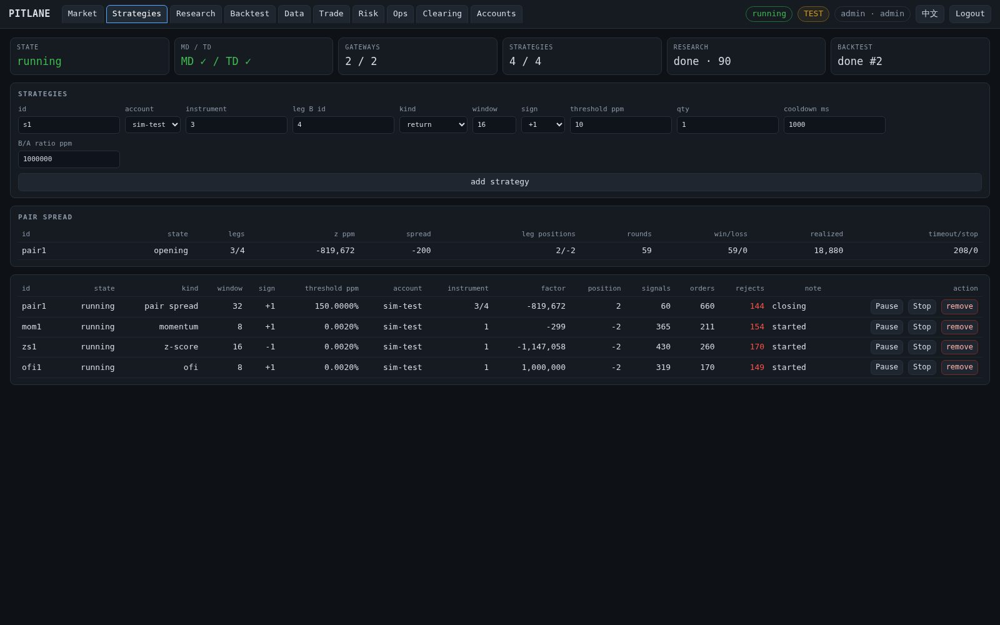
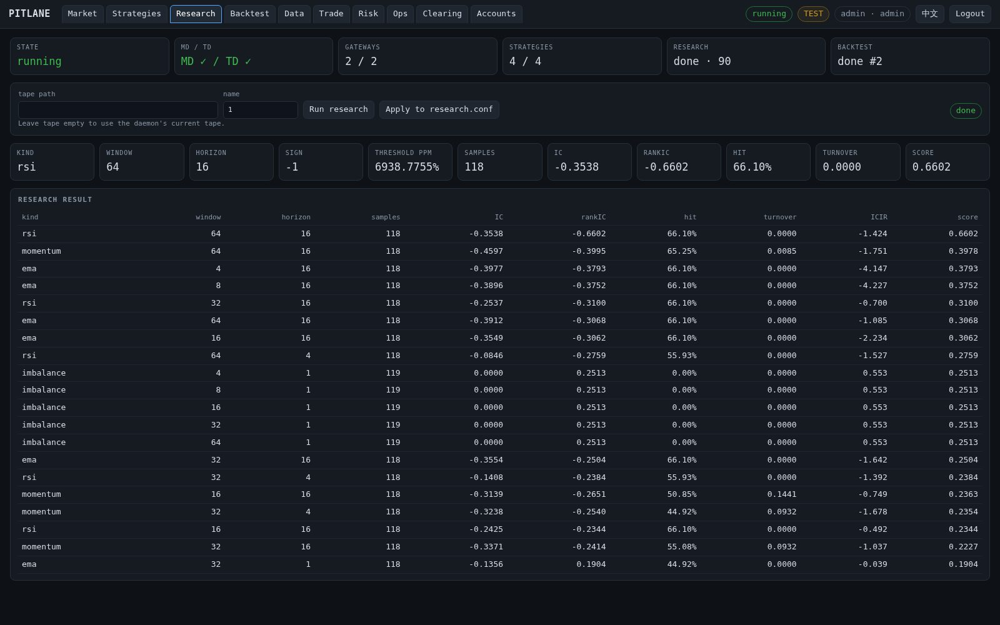
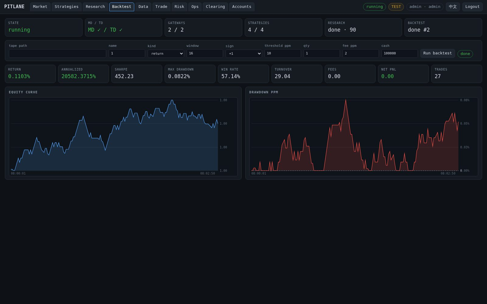
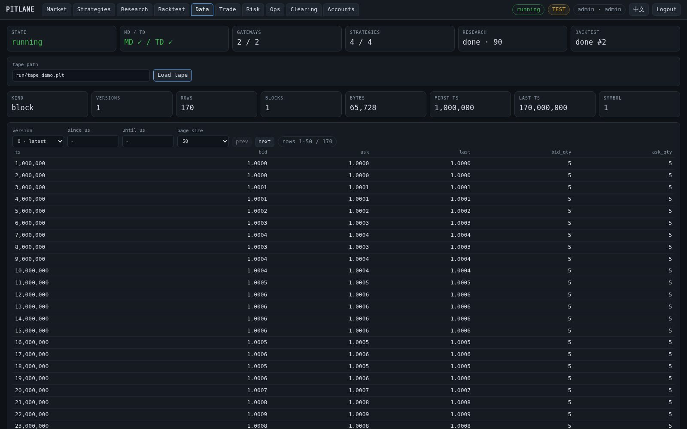
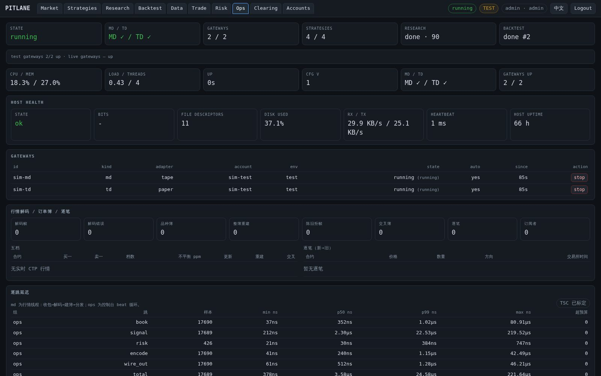
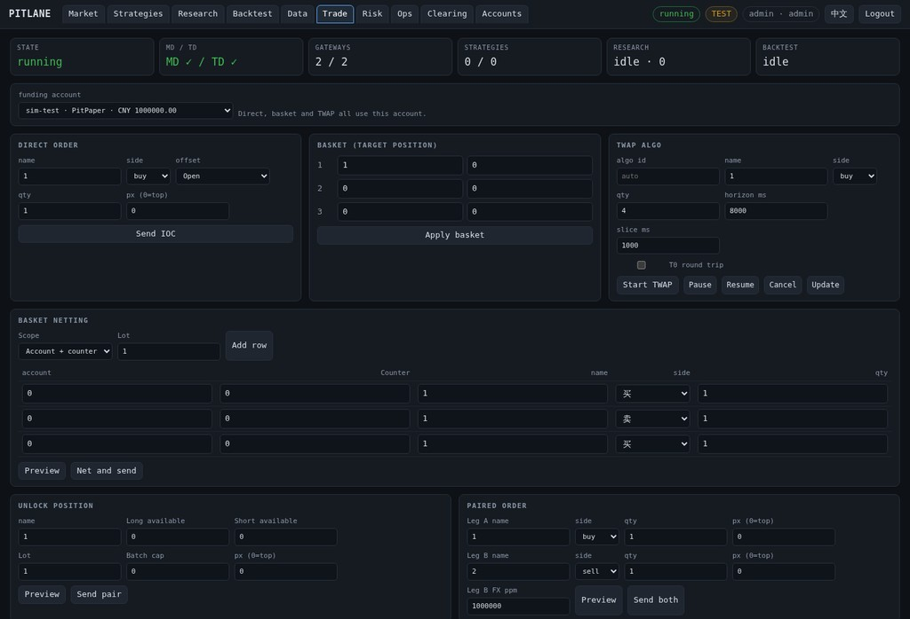
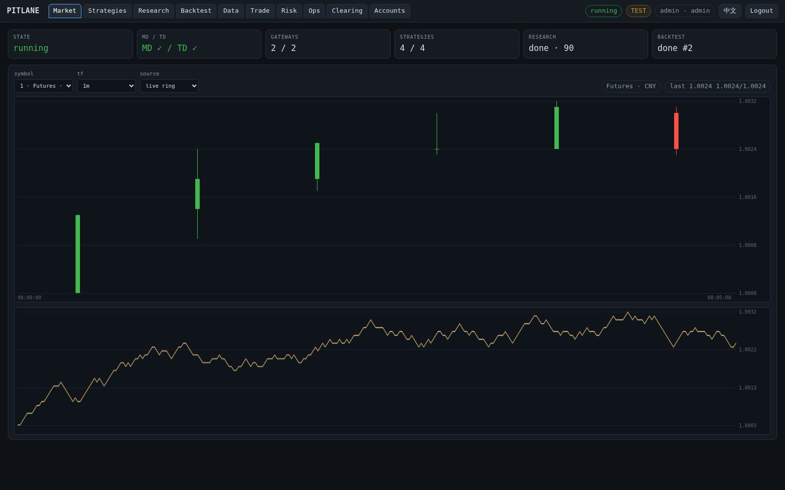
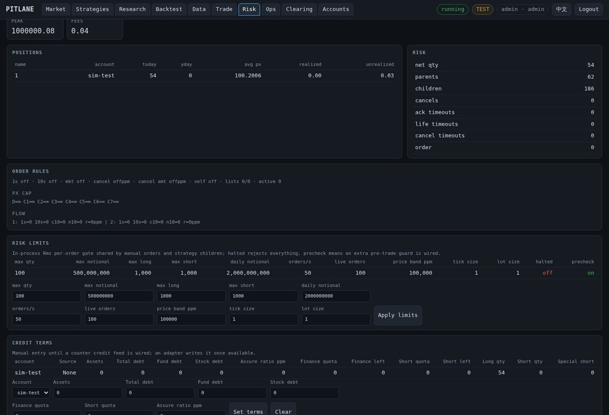
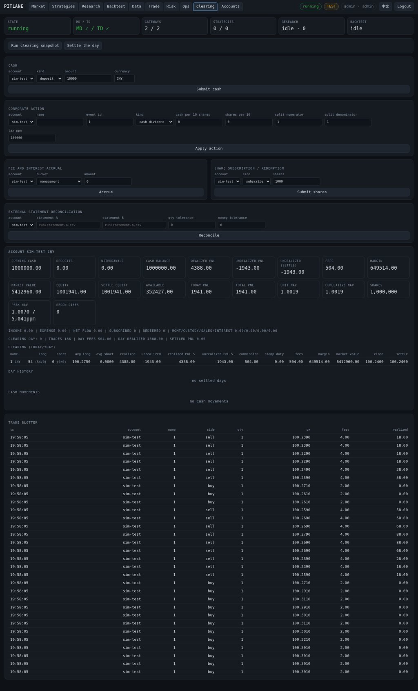

# pitlane-trading

Self-contained paper/live trading console on the pitlane kernel: MD → strategy → real IOC → TD accept, with local/gate/roundtrip T2T.

It is the runnable program of the pitlane tree and also an independent CMake project. It builds as a subdirectory of pitlane, or on its own against a pitlane source tree or the upstream repository.

## Console

Every panel reads the same rings, books, and strategy slots the C++ calls use; manual tickets and strategy orders share one `Rms` → `Oms` → `Pms` chain. Frames from a paper run with a pair-spread instance, three factor instances, a finished research grid, a finished backtest, and a loaded block tape:

| Strategies | Research |
| --- | --- |
|  |  |
|  |  |
|  |  |

## Trade panels

The Trade tab carries the direct IOC, target-position basket, and TWAP tickets plus four tickets that mirror the old terminal:

- **Basket netting** folds the rows below it with `order/netting.hpp`. The scope is account and counter, one account across counters, or the name across accounts; the net is rounded down to the lot and the remainder stays in the report instead of reaching the venue. Preview shows gross, net, offset quantity, and lot residual; send posts one IOC per net leg.
- **Unlock position** takes the sellable long and coverable short on one name and uses `order/unlock.hpp` to pair them down to the smaller side. One click sends one sell and one buy-back at the same quantity; repeat with the remaining quantities to finish the release. A clip caps each leg, and a lot remainder is reported.
- **Paired order** sends leg A then leg B in one action. `fx_ppm` converts leg B into leg A's currency for the spread preview only; CTP futures settle in one currency, so no conversion is applied to the wire price.
- **File orders** reads a CSV, TSV, or JSON file or pasted text and previews the parse before sending. A row is name, side, quantity, and price; the price is in yuan and scaled to `px` on the wire, `px_1e6` is taken as is in JSON, and a header line is skipped. Send posts one direct IOC per row through `POST /api/order`, counting the rows that the gate accepted.

The endpoints are `POST /api/netting`, `POST /api/unlock`, `POST /api/pair/order`, and `POST /api/order` for file rows; each takes the session account unless a row names its own. Environment switching is already the login mode (`paper` or `live`). Target baskets re-emit the unfilled gap every cycle, which covers the old client's replenish count without a separate counter. Short-securities quota enquiry is a broker equity API with no CTP counterpart, so the console does not expose it.

## Layout

```
pitlane-trading/
  CMakeLists.txt           # standalone project, also included by the pitlane tree
  main.cpp                 # closed-loop host
  adapters/adapter.hpp     # adapter selection + conf location
  adapters/ctp/            # CTP gateway on MdEngine and TdClient
  adapters/ctp/config.hpp  # CTP-only settings (account, fronts, auth)
  adapters/market_view.hpp # venue-neutral market board for the console
  third_party/ctp/         # vendored official CTP API (_se headers + Linux libs)
  conf/paper.conf          # center loop, no broker
  conf/live.conf.example   # venue-neutral live conf (adapter = ctp)
  conf/live.conf           # local live conf (gitignored)
  conf/adapters/ctp.conf.example
  conf/adapters/ctp.conf   # local CTP secrets (gitignored)
  run/                     # flow_*, desk.bin, wire.log (gitignored contents)
  README.md
```

The console page lives at `../client/index.html` in the repository root; the
build records that path and the program also probes `../client`, `client`, and
`web` at runtime, so `--web-root` is only needed for a relocated page.

Account, engines, and `WireLog` are pitlane framework types. `Account` is
venue-neutral: instruments and runtime paths only. `adapters/` holds the venue
gateways; each subdirectory subclasses the library, talks to one counter, and
owns its configuration. `adapters/ctp/` is the built-in one: the system conf
writes `adapter = ctp`, and the CTP keys (broker, investor, password, app id,
auth code, fronts) load from `conf/adapters/ctp.conf` next to it. Another venue
is a sibling directory with its own `config.hpp`, a name in `kAdapterNames`, and
`adapter = <name>` in the conf; `adapter_conf = FILE` overrides the default
`<conf dir>/adapters/<name>.conf`. The host only reads `adapter` and
`adapter_conf` and never parses adapter-private keys. `mode = paper` runs the
trading center (`Center` + `TapeMd` + `PaperVenue`) with no broker.
`mode = live` uses the same desk with the selected gateway. Progress is written
to `run/wire.log`.

```bash
../build/pitlane_trading conf/paper.conf
```

`pitlane_trading_bench` times that paper center without a broker library. It also checks the scale, lap, and histogram helpers, and times one call inside the ring, the order gate, and the paper venue. `ctest` runs it as `trading_bench` when the tests are enabled.

```bash
cmake --build build -j --target pitlane_trading_bench
./build/pitlane_trading_bench
```

## Build

The CTP `_se` headers and Linux shared objects live under `third_party/ctp`
(package `v6.7.13_20260225`). Point `PITLANE_TRADING_CTP_API_ROOT` at another
unpacked `_se` package to override.
From the pitlane root:

```bash
cmake -S . -B build -DCMAKE_BUILD_TYPE=Release
cmake --build build -j --target pitlane_trading
```

Build it as its own project instead. A sibling pitlane source tree is used
automatically when `../include/pitlane/pitlane.hpp` exists; otherwise pass
`-DPITLANE_SOURCE_DIR=/path/to/pitlane`, or let CMake fetch
`https://github.com/zzxscodes/pitlane` (`-DPITLANE_FETCH_TAG=<branch|tag>`):

```bash
cmake -S pitlane-trading -B build-trading
cmake --build build-trading -j
```

A standalone configure builds the library only: its tests, shared library, and
C ABI are off. Turn the console's own checks on with
`-DPITLANE_TRADING_BUILD_TESTS=ON` and run `ctest --test-dir build-trading`.

## Run

```bash
cd pitlane-trading
cp -n conf/live.conf.example conf/live.conf
cp -n conf/adapters/ctp.conf.example conf/adapters/ctp.conf   # edit password
../build/pitlane_trading conf/live.conf
```

Optional: `PITLANE_CTP_PASSWORD` / `PITLANE_CTP_INVESTOR` (or the `SIMNOW_*`
aliases) override the adapter conf, and `PITLANE_WORK_DIR` overrides `work_dir`.

Runtime files only under `./run` (or `work_dir` in conf).

## Full-flow validation

`--full`, `--serve`, and `--backtest` run one instance of every core pitlane path
in a single process:

```
tape quotes -> FactorPipeline (Momentum / OFI / ZScore) -> signal
  -> RMS pre-trade check -> EMS parent slice -> SOR venue choice
  -> OMS state machine -> PaperVenue (paper/backtest) or real CTP IOC (live)
  -> PMS position/PnL -> WAL append + recover -> snapshot publish -> tail latency
```

Only the first subscribed instrument is used as the factor series; other
instruments still connect and receive quotes.

Three stages of the same code path:

```bash
cd pitlane-trading

# 1. Strategy development / backtest: replay a recorded tape, no broker.
#    The tape is replayed to the end so every parent gets a chance to complete.
../build/pitlane_trading --backtest --tape tape.csv conf/paper.conf

# 2. Paper trading: same desk, synthetic tape, stops as soon as the flow passes.
../build/pitlane_trading --full conf/paper.conf

# 3. Live: real SimNow market data and orders.
../build/pitlane_trading --full conf/live.conf

# 4. Live console: stay resident for manual and algo orders (until stopped).
../build/pitlane_trading --serve --web 8080 conf/live.conf
```

### Research loop

`--record` taps the quote stream from either the CTP callback thread (live) or
the paper center, pushes it into a bounded ring (full = drop and count, never
block), and lets a writer thread flush CSV; `close()` fsyncs and renames
`FILE.tmp` onto `FILE`. All four stages share the tape format above:

```bash
cd pitlane-trading

# 1. Collect quotes only, no orders. Ctrl-C when done (live needs market hours).
../build/pitlane_trading --record run/tape.csv conf/live.conf

# 2. Research: clean the tape, sweep factor kind x window x horizon, write run/research.conf.
../build/pitlane_trading --research --tape run/tape.csv conf/paper.conf

# 3. Backtest the product: whole tape, many parents, PnL/cost/drawdown/Sharpe.
../build/pitlane_trading --backtest --tape run/tape.csv conf/paper.conf

# 4. Live: the same product drives the real IOC strategy.
../build/pitlane_trading --full conf/live.conf
```

`--record` also works with `--backtest` or `--full` to capture a paper session.
`--study FILE` overrides the default `<work_dir>/research.conf`, and `--out FILE`
overrides the research output path. Without a product the strategy keeps the
built-in Momentum(16) / 10 ppm default.

The grid prints IC, rank IC, hit rate, and top/bottom quintile means.
`research.conf` stores `factor_kind`, `factor_window`, `factor_sign` (the side
with positive rank IC; `-1` trades the inverse), `signal_ppm` (75th percentile
of |factor|), `horizon_bars`, and the evaluation numbers. Backtest and live log
`study kind=.. window=.. sign=.. signal_ppm=..` so runs are identifiable, and
the summary adds:

- `perf` — equity start/end/peak/min, max drawdown in ticks and ppm, per-sample Sharpe.
- `cost` — turnover, fees, lost parents, zero fills, failed sends, RMS rejects.
- `study` — the resolved factor and threshold.

For `--backtest`, 64 extra seconds run after the last row so the final parent
finishes its slices and fills.

`--backtest` without `--tape` falls back to the built-in synthetic tape. The
CSV tape has one quote per row, header optional, no spaces required:

```
exch_us,name,bid_px,ask_px,last_px,bid_qty,ask_qty
1710000000000000,1,999950,1000050,1000000,5,5
```

Prices are integer ticks as used by `pitlane::Quote` (`px_x10000`). `exch_us`
and `local_us` are both set to the timestamp column. Lines that do not parse
as seven integers are skipped; `#` starts a comment. `--name N` keeps only the
rows of product `N` while loading a CSV tape.

Paper matching timing comes from the `[venue]` section of the conf
(`go_us0`, `pull_us0`, `tape_first`); `conf_load` fills `VenueCfg` and both
`run_paper` and `run_sim_flow` use it.

### Web console

`--web PORT` starts the hub console for the `--full`, `--serve`, and `--backtest`
stages. Unlike `--full`, `--serve` never places a strategy order and never exits
on its own: it keeps the live session, the ledger, and the web console up until
`SIGINT`, `SIGTERM`, or the halt control.
It loads `run/ops.conf` (port, bind address, document root, policy limits),
`run/users.conf` (accounts created on first start as `admin` / `pitlane`),
`run/gateways.conf` (the market-data and trading gateways the console may start
and stop), `run/accounts.conf` (funding accounts and their mode), and
`run/instruments.conf` (product class, multiplier, margin, fees, and gateway).
The first `--web PORT` wins over `port` in the conf file.

```bash
cd pitlane-trading
../build/pitlane_trading --full --web 8080 --ops-conf run/ops.conf conf/paper.conf
```

Open `http://127.0.0.1:8080/` and log in. The login form also picks the mode:

| Market | Trade |
| --- | --- |
|  |  |
|  |  |

- `test` — the `tape`/`paper` gateways and the accounts tagged `test`. This is
  what `pitlane-trading` runs.
- `live` — the `ctp` gateways and the accounts tagged `live`. A `ctp` gateway
  only becomes startable when the broker hooks are linked in.

The mode is fixed for the session. The header shows a 测试/实盘 badge, and
`/api/gateways`, `/api/accounts`, `/api/status`, `/api/alarms`, and
`/api/clearing` return only that mode. Naming a gateway or funding account from
the other mode answers `409`, so one console cannot move live money from a test
login.

Tabs appear by role: viewer sees market, risk, and ops; trader adds tickets;
risk adds controls, alarms, and clearing; ops adds gateway start/stop; admin
adds accounts. Every `/api/*` call except `login` and `health` needs a bearer
token, so remote readers use `--web-bind 0.0.0.0` only on a trusted network.
A ticket price of `0` takes the opposite side of that product's latest tick; a
product the hub has no tape for answers `rejected: no quote for name N` instead
of pretending to fill.

`run/accounts.conf` is `account = <id> <display> <class> <ccy> <cash> <test|live>`
where cash is in 1e-6 currency units, and `run/gateways.conf` is
`gateway = <id> <md|td> <adapter> <acct> <auto> [test|live]`.
`run/instruments.conf` is
`instrument = <name> <class> <ccy> <tick> <mult> <margin_ppm> <fee_ppm> [min_fee=N] [stamp_ppm=N] [short=1] [gw=<id>] [close_fee_ppm=N] [close_today_fee_ppm=N] [fx_ppm=N]`,
with `min_fee` in whole currency units. `close_fee_ppm` overrides the commission
on a close (close-yesterday), `close_today_fee_ppm` overrides it further on a
same-day close (`-1` falls back), and `fx_ppm` is the rate from the product
currency into the account's base currency (`0` uses 1:1 and flags `fx_missing`).
The example ships 8 products across
A-share, HK, futures, options, US, ETF, and bond so the market tab can be
grouped by class. Product 1 is a future (`short=1`) because the paper strategy
sells it; a product without `short=1` cannot sell past its net long, and `Rms`
says so in the ticket ack.

Two thresholds act rather than just notify:

- A rejected ticket is refused before it reaches the venue. The reason comes
  back in `msg` (`rejected: qty 11 > max 10`) and the page toasts it; the same
  reason lands in `/api/alarms` with kind `reject`.
- `max_jump_ppm` in `run/ops.conf` drives the market safety ladder. A move of
  two thirds of the threshold warns. At the threshold the hub cancels every
  order of that product on every gateway, stops that product's trading gateway,
  writes an audit record, and raises a `jump` / `critical` alarm. A stale quote
  past `stale_tick_us` follows the same ladder. Paper replays are exempt.

The risk tab also exposes the live `Rms`: `GET /api/risk/limits` reads the
current `max_order_qty`, `max_order_notional`, position, daily notional,
orders/s, live orders, price band, tick, and lot limits with the `halted` and
`precheck` flags, and `POST /api/risk/limits` overrides the fields it is given.
Manual tickets and strategy children share these limits. Orders published
straight onto the desk ring are treated as trusted producers and skip `Rms`,
which is the deliberate layering boundary.

The clearing tab reads `/api/clearing`: cash in, deposits and withdrawals, income
and expense, subscriptions and redemptions, cash balance, realised and
realised-at-settle, unrealised on both bases, commission and stamp duty, margin,
market value, equity, settle equity, available, today and total PnL, shares, unit
NAV / cumulative NAV / peak / drawdown, trade count, turnover, and a per-product
reconciliation against `Pms`, all in whole currency units. Each row splits
long/short into today and yesterday. The page also shows the last four settled
days, the last eight cash movements, and the fee split (management, custody,
sales, financing interest). `GET /api/clearing/history?days=N` returns up to 32
day records and `GET /api/clearing/period` folds the ring into today, seven-day,
thirty-day, and year-to-date PnL. The blotter table comes from
`/api/clearing/trades?acct=1`, and the snapshot button writes
`run/clear-YYYYMMDD-<mode>.csv` (TOTAL plus per-product rows, 29 columns, the
last four being cumulative NAV, income, expense, and net flow). The 日终结算
button hits `/api/clearing?settle=1`, which marks open lots to the settlement
price, writes the same file, and rolls the day counters; cumulative fields stay.
The cash form posts `{acct,action,amount,ccy}` to `/api/clearing/cash`, which the
trading thread applies on its next beat.

Corporate actions, fee accruals, share movements, and statement reconciliation
use their own forms and endpoints: `POST /api/clearing/corp` (cash dividend with
withholding tax, stock dividend, split/merge, idempotent by `event_id`),
`/api/clearing/expense` (`mgmt`, `custody`, `sales`, `other`, `interest`; a
negative amount reverses), `/api/clearing/shares` (`subscribe` or `redeem` at
the pre-movement unit NAV), and `/api/clearing/reconcile` (`statement_a`,
optional `statement_b`, `qty_tol`, `money_tol`; writes
`recon-YYYYMMDD-HHMMSS-<mode>.csv`). All four need clearing permission and queue
onto the trading thread where needed. The Ops tab reads `/api/host/health` for the
host sample, limits, level, trip bits, and heartbeat age; CPU, memory, disk, and
fds warn at 80% of their limits and escalate to critical at 100%, and a heartbeat
older than two seconds trips its own bit. In the paper replay reconciliation is
zero because `Rms` and clearing use the same short rule as the strategy.

```bash
TOKEN=$(curl -s -X POST -d '{"user":"admin","password":"pitlane","mode":"test"}' \
  http://127.0.0.1:8080/api/login | sed -n 's/.*"token":"\([0-9a-f]*\)".*/\1/p')
curl -s -H "Authorization: Bearer $TOKEN" http://127.0.0.1:8080/api/accounts
curl -s -H "Authorization: Bearer $TOKEN" -X POST -d '{"name":1,"side":1,"qty":999}' \
  http://127.0.0.1:8080/api/order          # -> code 3 with the policy reason
curl -s -H "Authorization: Bearer $TOKEN" 'http://127.0.0.1:8080/api/alarms?since=0'
curl -s -H "Authorization: Bearer $TOKEN" 'http://127.0.0.1:8080/api/clearing?run=1'
curl -s -H "Authorization: Bearer $TOKEN" 'http://127.0.0.1:8080/api/clearing/trades?acct=1&since=0'
curl -s -H "Authorization: Bearer $TOKEN" -X POST \
  -d '{"acct":1,"action":"deposit","amount":10000,"ccy":"CNY"}' \
  http://127.0.0.1:8080/api/clearing/cash
curl -s -H "Authorization: Bearer $TOKEN" 'http://127.0.0.1:8080/api/clearing?settle=1'
```

A run is `PASS` when at least one parent completes, at least one child fills,
the WAL replay count matches what was appended, the snapshot latest sequence
matches the published sequence, and both OMS and PMS hold rows. The summary
prints OMS/EMS/PMS counters, factor values and evaluation, WAL/snapshot state,
and quote/report tail percentiles.

Files created under `run/`:

- `flow.wal` — framed append log of parent marks, intents, acks, and fills.
- `flow.snap` — cross-process read-only snapshot ring of flow state.
- `wire.log` — same progress log as the T2T mode.

Live failures are reported with the CTP error id in `run/wire.log`. Common
cases: expired password (`141`), wrong password (`3`), missing authentication,
contract not trading in this session, or settlement not confirmed (`7`).

SimNow expires passwords periodically. When the trader front returns `141`,
set `new_password` in `conf/adapters/ctp.conf` (at least 10 characters and 3
character types). The gateway answers with `ReqUserPasswordUpdate`, then logs
in again with the new password. Once that succeeds, replace `password` with the
new value and remove `new_password`; the account password really changes, so
update any other tool that uses the same account.

The instrument list must contain contracts that are still listed on the
trading day reported by the front (e.g. `au2612,ag2612` in late 2026); expired
contracts subscribe successfully but never tick.

